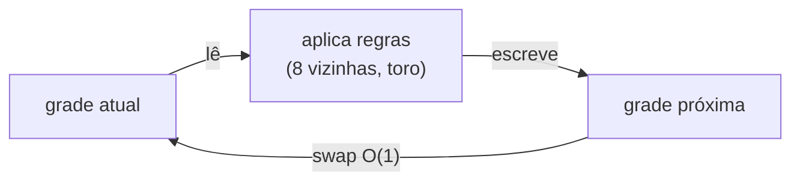

# Projeto 8 — Jogo da Vida e laço de jogo

O **Jogo da Vida** de Conway é um autômato celular: células vivas ou mortas evoluem por regras locais simples e produzem padrões complexos (planadores, osciladores). O projeto implementa a grade **toroidal**, testa padrões conhecidos e anima no terminal com **passo de tempo fixo**, a base de qualquer laço de jogo.

## Objetivos

- Modelar uma grade 2D em um `std::vector` linear (acesso `y * largura + x`).
- Usar **dupla bufferização** (duas grades) para calcular a próxima geração sem corromper a atual.
- Implementar vizinhança **toroidal** com aritmética modular.
- Escrever o laço de jogo com `std::chrono` e passo de tempo fixo.
- Testar com **padrões de propriedades conhecidas** (bloco, pisca-pisca, planador).

## Conceitos praticados

- [[vector]] e [[Cache e Localidade de Dados]] (armazenamento contíguo)
- [[Classes e Structs]] e [[Sobrecarga de Operadores - Cpp]] (`operator==`, `operator<<`)
- [[Tipos Fundamentais]] (`size_t`, aritmética sem sinal)
- [[Exceções try catch throw]] (`out_of_range`)
- `std::chrono` (`steady_clock`, `sleep_until`)
- [[Cpp em Jogos]]: *game loop*, passo fixo

## Estrutura de pastas

```text
vida/
├── CMakeLists.txt
├── include/
│   └── vida/
│       └── grade.hpp        # Grade (regras, toro, padrões)
├── src/
│   └── main.cpp             # laço de jogo e renderização no terminal
└── tests/
    └── test_vida.cpp
```

## Arquitetura

**Regras (por célula, para cada geração):**

| Estado atual | Vizinhas vivas | Próximo estado |
|---|---|---|
| viva | 2 ou 3 | viva |
| viva | outro valor | morta (solidão ou superpopulação) |
| morta | exatamente 3 | **viva** (nascimento) |
| morta | outro valor | morta |



**Truque do toro:** para vizinhança sem `if` de borda, some `altura-1` (equivale a −1) e use `% altura`. Assim a célula `(0, 0)` tem como vizinha a `(largura-1, altura-1)`.

**Laço de jogo com passo fixo:**

```text
proximo = agora
repita:
    atualizar()              # sempre dt constante: simulação determinística
    desenhar()
    proximo += passo
    dormir até 'proximo'     # sleep_until: não acumula erro, ao contrário de sleep_for
```

## `CMakeLists.txt`

```cmake
cmake_minimum_required(VERSION 3.20)
project(jogo_da_vida VERSION 1.0 LANGUAGES CXX)

set(CMAKE_CXX_STANDARD 20)
set(CMAKE_CXX_STANDARD_REQUIRED ON)
set(CMAKE_CXX_EXTENSIONS OFF)

add_library(vida INTERFACE)
target_include_directories(vida INTERFACE include)
target_compile_features(vida INTERFACE cxx_std_20)

add_executable(jogo src/main.cpp)
target_link_libraries(jogo PRIVATE vida)
target_compile_options(jogo PRIVATE -Wall -Wextra -Wpedantic)

enable_testing()
add_executable(test_vida tests/test_vida.cpp)
target_link_libraries(test_vida PRIVATE vida)
target_compile_options(test_vida PRIVATE -Wall -Wextra -Wpedantic)
add_test(NAME vida COMMAND test_vida)
```

## `include/vida/grade.hpp`

```cpp
// arquivo: include/vida/grade.hpp
// grade.hpp — Jogo da Vida de Conway em uma grade toroidal (as bordas se conectam).
#pragma once

#include <cstddef>
#include <cstdint>
#include <initializer_list>
#include <ostream>
#include <stdexcept>
#include <string>
#include <utility>
#include <vector>

namespace vida {

class Grade {
public:
    Grade(std::size_t largura, std::size_t altura)
        : l_{largura}, a_{altura}, atual_(largura * altura, 0), proxima_(largura * altura, 0) {
        if (largura == 0 || altura == 0) throw std::invalid_argument{"grade vazia"};
    }

    std::size_t largura() const noexcept { return l_; }
    std::size_t altura() const noexcept { return a_; }

    bool viva(std::size_t x, std::size_t y) const { return atual_[indice(x, y)] != 0; }
    void definir(std::size_t x, std::size_t y, bool v) { atual_[indice(x, y)] = v ? 1 : 0; }

    // Coloca um padrão a partir de (x0, y0): 'O' = viva, qualquer outro caractere = morta.
    void colocar(std::size_t x0, std::size_t y0, std::initializer_list<const char*> linhas) {
        std::size_t dy = 0;
        for (const char* linha : linhas) {
            for (std::size_t dx = 0; linha[dx] != '\0'; ++dx)
                if (linha[dx] == 'O') definir((x0 + dx) % l_, (y0 + dy) % a_, true);
            ++dy;
        }
    }

    // Uma geração. Duas grades (dupla bufferização): lê de 'atual_', escreve em 'proxima_'.
    void passo() {
        for (std::size_t y = 0; y < a_; ++y) {
            for (std::size_t x = 0; x < l_; ++x) {
                const int n = vizinhas(x, y);
                const bool v = atual_[indice(x, y)] != 0;
                // Regras: viva com 2 ou 3 vizinhas sobrevive; morta com exatamente 3 nasce.
                proxima_[indice(x, y)] = (v && (n == 2 || n == 3)) || (!v && n == 3) ? 1 : 0;
            }
        }
        atual_.swap(proxima_);
        ++geracao_;
    }

    std::size_t populacao() const {
        std::size_t c = 0;
        for (auto v : atual_) c += v;
        return c;
    }

    std::uint64_t geracao() const noexcept { return geracao_; }

    friend bool operator==(const Grade& a, const Grade& b) { return a.l_ == b.l_ && a.a_ == b.a_ && a.atual_ == b.atual_; }

private:
    std::size_t indice(std::size_t x, std::size_t y) const {
        if (x >= l_ || y >= a_) throw std::out_of_range{"célula fora da grade"};
        return y * l_ + x;
    }

    int vizinhas(std::size_t x, std::size_t y) const {
        int n = 0;
        for (std::size_t dy : {a_ - 1, std::size_t{0}, std::size_t{1}})     // -1, 0, +1 sem números negativos
            for (std::size_t dx : {l_ - 1, std::size_t{0}, std::size_t{1}}) {
                if (dx == 0 && dy == 0) continue;
                n += atual_[((y + dy) % a_) * l_ + (x + dx) % l_];          // módulo = grade toroidal
            }
        return n;
    }

    std::size_t l_, a_;
    std::vector<std::uint8_t> atual_, proxima_;
    std::uint64_t geracao_ = 0;
};

inline std::ostream& operator<<(std::ostream& os, const Grade& g) {
    for (std::size_t y = 0; y < g.altura(); ++y) {
        for (std::size_t x = 0; x < g.largura(); ++x) os << (g.viva(x, y) ? "█" : "·");
        os << '\n';
    }
    return os;
}

}  // namespace vida
```

## `src/main.cpp`

```cpp
// arquivo: src/main.cpp
// main.cpp — laço de jogo com passo de tempo fixo: atualizar a simulação e desenhar no terminal.
#include <chrono>
#include <cstdlib>
#include <iostream>
#include <thread>

#include "vida/grade.hpp"

int main(int argc, char** argv) {
    using clock = std::chrono::steady_clock;
    const int geracoes = argc > 1 ? std::atoi(argv[1]) : 60;
    const bool animar = argc > 2;                                 // qualquer 2º argumento liga a animação

    vida::Grade g{40, 16};
    g.colocar(1, 1, {".O.",
                     "..O",
                     "OOO"});                                      // planador
    g.colocar(20, 8, {"OOOOOOOO.OOOOO...OOO......OOOOOOO.OOOOO"}); // padrão linear que evolui de forma complexa

    constexpr auto passo = std::chrono::milliseconds(80);         // tempo fixo por geração
    auto proximo = clock::now();
    for (int i = 0; i < geracoes; ++i) {
        if (animar) std::cout << "\x1b[H\x1b[2J";                  // limpa a tela (ANSI)
        std::cout << "geração " << g.geracao() << "  população " << g.populacao() << '\n';
        if (animar || i == geracoes - 1) std::cout << g;
        g.passo();
        if (animar) { proximo += passo; std::this_thread::sleep_until(proximo); }
    }
}
```

## `tests/test_vida.cpp`

Padrões conhecidos funcionam como **oráculos de teste**: o bloco não muda, o *blinker* tem período 2 e o planador dá a volta em um toro 8×8 em 32 gerações.

```cpp
// arquivo: tests/test_vida.cpp
// test_vida.cpp — padrões clássicos com comportamento conhecido.
#include <iostream>

#include "vida/grade.hpp"

namespace {
int falhas = 0;
void verifica(bool cond, const char* msg) {
    if (!cond) { std::cout << "FALHA: " << msg << '\n'; ++falhas; }
}
}  // namespace

int main() {
    {   // Bloco 2×2 é uma "vida estável": nunca muda
        vida::Grade g{6, 6};
        g.colocar(2, 2, {"OO", "OO"});
        const vida::Grade antes = g;
        g.passo();
        verifica(g == antes, "bloco é estável");
        verifica(g.populacao() == 4, "bloco tem 4 células");
    }
    {   // Pisca-pisca (blinker) tem período 2
        vida::Grade g{5, 5};
        g.colocar(1, 2, {"OOO"});
        const vida::Grade inicial = g;
        g.passo();
        verifica(!(g == inicial), "blinker muda após 1 passo");
        verifica(g.viva(2, 1) && g.viva(2, 2) && g.viva(2, 3), "blinker vira vertical");
        g.passo();
        verifica(g == inicial, "blinker volta após 2 passos");
    }
    {   // Planador: após 4 gerações é o mesmo padrão deslocado em (+1, +1); em grade toroidal 8×8, após 32 gerações volta ao início
        vida::Grade g{8, 8};
        g.colocar(0, 0, {".O.", "..O", "OOO"});
        const vida::Grade inicial = g;
        for (int i = 0; i < 4; ++i) g.passo();
        verifica(g.populacao() == 5, "planador mantém 5 células");
        verifica(g.viva(1, 1 + 0) || g.viva(2, 1), "planador se deslocou");
        for (int i = 0; i < 28; ++i) g.passo();
        verifica(g == inicial, "planador dá a volta no toro em 32 gerações");
    }
    {   // Limites e validação
        bool lancou = false;
        try { vida::Grade g{0, 3}; (void)g; } catch (const std::invalid_argument&) { lancou = true; }
        verifica(lancou, "grade vazia é rejeitada");
        vida::Grade g{3, 3};
        lancou = false;
        try { g.viva(3, 0); } catch (const std::out_of_range&) { lancou = true; }
        verifica(lancou, "acesso fora da grade lança");
    }
    std::cout << (falhas == 0 ? "todos os testes passaram\n" : "há falhas\n");
    return falhas;
}
```

## Compilar, testar e executar

```bash
cmake -S . -B build -G Ninja && cmake --build build
ctest --test-dir build --output-on-failure

./build/jogo 60          # imprime 60 gerações, mostra só a última grade
./build/jogo 300 anima   # animação no terminal (Ctrl+C para sair)
```

> [!success] Verificação
> Compilado com `g++ 13` (`-std=c++20 -Wall -Wextra -Wpedantic`); `ctest` passou e os testes rodaram com **AddressSanitizer + UBSan** sem erros.

## Pontos de atenção

> [!warning] `size_t` e subtração
> `x - 1` com `x == 0` dá um número gigante. O código evita isso somando `largura - 1` e usando módulo.

> [!warning] Desempenho
> Para grades grandes, evite recalcular as 8 vizinhas por célula: use contagem incremental, *bitboards* ou o algoritmo **HashLife**.

## Extensões sugeridas

1. Carregar padrões do formato **RLE** (usado por LifeWiki).
2. Grade **infinita** com `std::unordered_set<Coordenada>` das células vivas.
3. Paralelizar o passo por faixas de linhas ([[Algoritmos Paralelos]], [[TBB e OpenMP]]).
4. Representar a grade em **bits** (64 células por palavra) e vetorizar ([[SIMD e Vetorização - Cpp]]).
5. Interface gráfica com SDL ([[SDL e SFML]]).
6. Variantes de regras (*HighLife*, *Day & Night*) parametrizadas por *bitmask*.

## Veja também

- [[MOC - Projetos - Cpp]]
- [[Cpp em Jogos]]
- [[Cache e Localidade de Dados]]
- [[SDL e SFML]]
- [[Projeto 9 - Parser JSON]]

## Exercício

1. Adicione `Grade::redimensionar` e uma opção para bordas **mortas** (sem toro).
2. Detecte quando a simulação **estabiliza** (grade igual a uma das últimas N).
3. Meça o tempo por geração em grades 100×100 e 1000×1000 e discuta.
