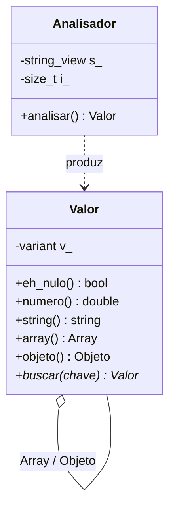

# Projeto 9 — Parser e serializador JSON

Um parser JSON **completo** (RFC 8259) com um tipo de valor baseado em `std::variant` recursivo, mensagens de erro com posição, suporte a escapes `\uXXXX` (inclusive pares substitutos → UTF-8) e serializador com indentação. Entrada JSON é dado **não confiável**: o projeto trata profundidade, limites e erros com rigor.

## Objetivos

- Representar valores heterogêneos e **recursivos** com `std::variant`, `vector` e `map`.
- Escrever um **parser descendente recursivo** sobre `std::string_view`, sem cópias.
- Converter números com `std::from_chars`/`to_chars` (independentes de *locale*).
- Tratar **Unicode** corretamente: escapes `\u`, pares substitutos e UTF-8.
- Defender contra entradas hostis: aninhamento excessivo, caracteres de controle, números malformados.

## Conceitos praticados

- [[variant]] e `std::visit`
- [[string_view]] e [[Unicode e Codificações]]
- [[map e set]] (`std::less<>` para busca heterogênea por `string_view`)
- [[Locale]] (por que `from_chars` e não `stod`)
- [[Exceções try catch throw]] com tipo de erro próprio
- [[Serialização]] e [[nlohmann json e simdjson]] (a versão profissional)

## Estrutura de pastas

```text
jsonparser/
├── CMakeLists.txt
├── include/
│   └── json/
│       └── json.hpp         # Valor, Analisador, serializar
├── src/
│   └── main.cpp             # jsonfmt: formata e consulta
└── tests/
    └── test_json.cpp
```

## Arquitetura



**Tipos:** `Nulo | bool | double | string | Array (vector<Valor>) | Objeto (map<string, Valor>)`. Um tipo que se contém por *containers* funciona porque `vector` e `map` aceitam tipo incompleto na declaração (em `std::vector` é garantido desde o C++17; o `std::map` com tipo incompleto funciona nas implementações principais).

**Gramática (resumida)**

```text
valor   := objeto | array | string | numero | "true" | "false" | "null"
objeto  := "{" [ string ":" valor { "," string ":" valor } ] "}"
array   := "[" [ valor { "," valor } ] "]"
numero  := [-] (0 | 1-9 dígitos) [. dígitos] [(e|E) [+|-] dígitos]
```

Cada regra é uma função; o parser **nunca** lê além do fim (`espiar()` devolve `'\0'`) e informa a posição do erro.

## `CMakeLists.txt`

```cmake
cmake_minimum_required(VERSION 3.20)
project(json_parser VERSION 1.0 LANGUAGES CXX)

set(CMAKE_CXX_STANDARD 20)
set(CMAKE_CXX_STANDARD_REQUIRED ON)
set(CMAKE_CXX_EXTENSIONS OFF)

add_library(json INTERFACE)
target_include_directories(json INTERFACE include)
target_compile_features(json INTERFACE cxx_std_20)

add_executable(jsonfmt src/main.cpp)
target_link_libraries(jsonfmt PRIVATE json)
target_compile_options(jsonfmt PRIVATE -Wall -Wextra -Wpedantic)

enable_testing()
add_executable(test_json tests/test_json.cpp)
target_link_libraries(test_json PRIVATE json)
target_compile_options(test_json PRIVATE -Wall -Wextra -Wpedantic)
add_test(NAME json COMMAND test_json)
```

## `include/json/json.hpp`

```cpp
// arquivo: include/json/json.hpp
// json.hpp — valor JSON (std::variant recursivo), parser RFC 8259 e serializador.
#pragma once

#include <charconv>
#include <cmath>
#include <cstddef>
#include <cstdint>
#include <cstdio>
#include <map>
#include <ostream>
#include <sstream>
#include <stdexcept>
#include <string>
#include <string_view>
#include <variant>
#include <vector>

namespace json {

struct ErroDeParse : std::runtime_error {
    ErroDeParse(const std::string& msg, std::size_t pos)
        : std::runtime_error{msg + " (posição " + std::to_string(pos) + ")"}, posicao{pos} {}
    std::size_t posicao;
};

class Valor {
public:
    using Nulo = std::nullptr_t;
    using Array = std::vector<Valor>;
    using Objeto = std::map<std::string, Valor, std::less<>>;   // chaves ordenadas; less<> permite busca por string_view
    using Variante = std::variant<Nulo, bool, double, std::string, Array, Objeto>;

    Valor() : v_{nullptr} {}
    Valor(std::nullptr_t) : v_{nullptr} {}
    Valor(bool b) : v_{b} {}
    Valor(double d) : v_{d} {}
    Valor(int i) : v_{static_cast<double>(i)} {}
    Valor(const char* s) : v_{std::string{s}} {}
    Valor(std::string s) : v_{std::move(s)} {}
    Valor(Array a) : v_{std::move(a)} {}
    Valor(Objeto o) : v_{std::move(o)} {}

    bool eh_nulo() const { return std::holds_alternative<Nulo>(v_); }
    bool eh_bool() const { return std::holds_alternative<bool>(v_); }
    bool eh_numero() const { return std::holds_alternative<double>(v_); }
    bool eh_string() const { return std::holds_alternative<std::string>(v_); }
    bool eh_array() const { return std::holds_alternative<Array>(v_); }
    bool eh_objeto() const { return std::holds_alternative<Objeto>(v_); }

    bool bool_() const { return obter<bool>("bool"); }
    double numero() const { return obter<double>("número"); }
    const std::string& string() const { return obter<std::string>("string"); }
    const Array& array() const { return obter<Array>("array"); }
    const Objeto& objeto() const { return obter<Objeto>("objeto"); }
    Array& array() { return obter<Array>("array"); }
    Objeto& objeto() { return obter<Objeto>("objeto"); }

    // Acesso seguro: devolve nullptr se não for objeto ou a chave não existir.
    const Valor* buscar(std::string_view chave) const {
        if (!eh_objeto()) return nullptr;
        const auto& o = objeto();
        const auto it = o.find(chave);
        return it == o.end() ? nullptr : &it->second;
    }

    friend bool operator==(const Valor& a, const Valor& b) { return a.v_ == b.v_; }

    const Variante& variante() const { return v_; }

private:
    template <typename T>
    const T& obter(const char* nome) const {
        if (const auto* p = std::get_if<T>(&v_)) return *p;
        throw std::runtime_error{std::string{"tipo incorreto: esperado "} + nome};
    }
    template <typename T>
    T& obter(const char* nome) {
        if (auto* p = std::get_if<T>(&v_)) return *p;
        throw std::runtime_error{std::string{"tipo incorreto: esperado "} + nome};
    }

    Variante v_;
};

namespace detalhe {

class Analisador {
public:
    explicit Analisador(std::string_view texto) : s_{texto} {}

    Valor analisar() {
        Valor v = valor(0);
        espacos();
        if (i_ != s_.size()) throw ErroDeParse{"texto extra após o valor", i_};
        return v;
    }

private:
    static constexpr int kProfundidadeMax = 200;     // protege a pilha contra [[[[...]]]] malicioso

    [[noreturn]] void erro(const std::string& msg) const { throw ErroDeParse{msg, i_}; }

    void espacos() { while (i_ < s_.size() && (s_[i_] == ' ' || s_[i_] == '\t' || s_[i_] == '\n' || s_[i_] == '\r')) ++i_; }

    char espiar() const { return i_ < s_.size() ? s_[i_] : '\0'; }

    void esperar(char c) {
        if (espiar() != c) erro(std::string{"esperado '"} + c + "'");
        ++i_;
    }

    bool literal(std::string_view lit) {
        if (s_.substr(i_, lit.size()) != lit) return false;
        i_ += lit.size();
        return true;
    }

    Valor valor(int prof) {
        if (prof > kProfundidadeMax) erro("aninhamento excessivo");
        espacos();
        if (i_ >= s_.size()) erro("fim inesperado do texto");
        switch (s_[i_]) {
            case '{': return objeto(prof);
            case '[': return array(prof);
            case '"': return Valor{texto()};
            case 't': if (literal("true")) return Valor{true}; break;
            case 'f': if (literal("false")) return Valor{false}; break;
            case 'n': if (literal("null")) return Valor{nullptr}; break;
            default:
                if (s_[i_] == '-' || (s_[i_] >= '0' && s_[i_] <= '9')) return numero();
        }
        erro("valor inválido");
    }

    Valor objeto(int prof) {
        Valor::Objeto o;
        esperar('{');
        espacos();
        if (espiar() == '}') { ++i_; return Valor{std::move(o)}; }
        for (;;) {
            espacos();
            if (espiar() != '"') erro("esperada chave string");
            std::string chave = texto();
            espacos();
            esperar(':');
            o[std::move(chave)] = valor(prof + 1);
            espacos();
            if (espiar() == ',') { ++i_; continue; }
            esperar('}');
            return Valor{std::move(o)};
        }
    }

    Valor array(int prof) {
        Valor::Array a;
        esperar('[');
        espacos();
        if (espiar() == ']') { ++i_; return Valor{std::move(a)}; }
        for (;;) {
            a.push_back(valor(prof + 1));
            espacos();
            if (espiar() == ',') { ++i_; continue; }
            esperar(']');
            return Valor{std::move(a)};
        }
    }

    Valor numero() {
        const std::size_t ini = i_;
        if (espiar() == '-') ++i_;
        if (espiar() == '0') ++i_;
        else if (espiar() >= '1' && espiar() <= '9') while (espiar() >= '0' && espiar() <= '9') ++i_;
        else erro("número inválido");
        if (espiar() == '.') {
            ++i_;
            if (!(espiar() >= '0' && espiar() <= '9')) erro("dígito esperado após '.'");
            while (espiar() >= '0' && espiar() <= '9') ++i_;
        }
        if (espiar() == 'e' || espiar() == 'E') {
            ++i_;
            if (espiar() == '+' || espiar() == '-') ++i_;
            if (!(espiar() >= '0' && espiar() <= '9')) erro("dígito esperado no expoente");
            while (espiar() >= '0' && espiar() <= '9') ++i_;
        }
        double d = 0;
        const auto fim = s_.data() + i_;
        const auto r = std::from_chars(s_.data() + ini, fim, d);       // independente de locale
        if (r.ec != std::errc{} || r.ptr != fim) { i_ = ini; erro("número fora do intervalo"); }
        return Valor{d};
    }

    static void anexar_utf8(std::string& out, std::uint32_t cp) {
        if (cp < 0x80) out += static_cast<char>(cp);
        else if (cp < 0x800) { out += static_cast<char>(0xC0 | (cp >> 6)); out += static_cast<char>(0x80 | (cp & 0x3F)); }
        else if (cp < 0x10000) {
            out += static_cast<char>(0xE0 | (cp >> 12));
            out += static_cast<char>(0x80 | ((cp >> 6) & 0x3F));
            out += static_cast<char>(0x80 | (cp & 0x3F));
        } else {
            out += static_cast<char>(0xF0 | (cp >> 18));
            out += static_cast<char>(0x80 | ((cp >> 12) & 0x3F));
            out += static_cast<char>(0x80 | ((cp >> 6) & 0x3F));
            out += static_cast<char>(0x80 | (cp & 0x3F));
        }
    }

    std::uint32_t hex4() {
        if (i_ + 4 > s_.size()) erro("escape \\u incompleto");
        std::uint32_t v = 0;
        for (int k = 0; k < 4; ++k) {
            const char c = s_[i_++];
            v <<= 4;
            if (c >= '0' && c <= '9') v |= static_cast<std::uint32_t>(c - '0');
            else if (c >= 'a' && c <= 'f') v |= static_cast<std::uint32_t>(c - 'a' + 10);
            else if (c >= 'A' && c <= 'F') v |= static_cast<std::uint32_t>(c - 'A' + 10);
            else { --i_; erro("dígito hexadecimal inválido"); }
        }
        return v;
    }

    std::string texto() {
        esperar('"');
        std::string out;
        for (;;) {
            if (i_ >= s_.size()) erro("string não terminada");
            const unsigned char c = static_cast<unsigned char>(s_[i_++]);
            if (c == '"') return out;
            if (c < 0x20) { --i_; erro("caractere de controle em string"); }
            if (c != '\\') { out += static_cast<char>(c); continue; }
            if (i_ >= s_.size()) erro("escape incompleto");
            switch (s_[i_++]) {
                case '"': out += '"'; break;
                case '\\': out += '\\'; break;
                case '/': out += '/'; break;
                case 'b': out += '\b'; break;
                case 'f': out += '\f'; break;
                case 'n': out += '\n'; break;
                case 'r': out += '\r'; break;
                case 't': out += '\t'; break;
                case 'u': {
                    std::uint32_t cp = hex4();
                    if (cp >= 0xD800 && cp <= 0xDBFF) {                   // par substituto (surrogate pair)
                        if (!(i_ + 1 < s_.size() && s_[i_] == '\\' && s_[i_ + 1] == 'u')) erro("surrogate alto sem par");
                        i_ += 2;
                        const std::uint32_t lo = hex4();
                        if (lo < 0xDC00 || lo > 0xDFFF) erro("surrogate baixo inválido");
                        cp = 0x10000 + ((cp - 0xD800) << 10) + (lo - 0xDC00);
                    } else if (cp >= 0xDC00 && cp <= 0xDFFF) {
                        erro("surrogate baixo isolado");
                    }
                    anexar_utf8(out, cp);
                    break;
                }
                default: --i_; erro("escape inválido");
            }
        }
    }

    std::string_view s_;
    std::size_t i_ = 0;
};

inline void escrever_string(std::ostream& os, const std::string& s) {
    os << '"';
    for (unsigned char c : s) {
        switch (c) {
            case '"': os << "\\\""; break;
            case '\\': os << "\\\\"; break;
            case '\n': os << "\\n"; break;
            case '\r': os << "\\r"; break;
            case '\t': os << "\\t"; break;
            default:
                if (c < 0x20) { char buf[8]; std::snprintf(buf, sizeof buf, "\\u%04x", c); os << buf; }
                else os << static_cast<char>(c);                          // UTF-8 passa direto
        }
    }
    os << '"';
}

inline void escrever(std::ostream& os, const Valor& v, int indent, int nivel) {
    const auto quebra = [&](int n) { if (indent > 0) { os << '\n' << std::string(static_cast<std::size_t>(n * indent), ' '); } };
    struct Visitante {
        std::ostream& os; int indent; int nivel; decltype(quebra)& q;
        void operator()(std::nullptr_t) const { os << "null"; }
        void operator()(bool b) const { os << (b ? "true" : "false"); }
        void operator()(double d) const {
            if (!std::isfinite(d)) { os << "null"; return; }                  // JSON não representa NaN/Infinito
            char buf[40];
            const auto r = std::to_chars(buf, buf + sizeof buf, d);          // menor representação que faz round-trip
            os.write(buf, r.ptr - buf);
        }
        void operator()(const std::string& s) const { escrever_string(os, s); }
        void operator()(const Valor::Array& a) const {
            if (a.empty()) { os << "[]"; return; }
            os << '[';
            for (std::size_t k = 0; k < a.size(); ++k) {
                if (k) os << ',';
                q(nivel + 1);
                escrever(os, a[k], indent, nivel + 1);
            }
            q(nivel);
            os << ']';
        }
        void operator()(const Valor::Objeto& o) const {
            if (o.empty()) { os << "{}"; return; }
            os << '{';
            bool primeiro = true;
            for (const auto& [k, val] : o) {
                if (!primeiro) os << ',';
                primeiro = false;
                q(nivel + 1);
                escrever_string(os, k);
                os << (indent > 0 ? ": " : ":");
                escrever(os, val, indent, nivel + 1);
            }
            q(nivel);
            os << '}';
        }
    };
    std::visit(Visitante{os, indent, nivel, quebra}, v.variante());
}

}  // namespace detalhe

// API pública
inline Valor analisar(std::string_view texto) { return detalhe::Analisador{texto}.analisar(); }

inline std::string serializar(const Valor& v, int indent = 0) {
    std::ostringstream os;
    detalhe::escrever(os, v, indent, 0);
    return os.str();
}

}  // namespace json
```

## `src/main.cpp`

```cpp
// arquivo: src/main.cpp
// main.cpp — "jq" mínimo: lê JSON de um arquivo (ou stdin) e imprime formatado; opcionalmente uma chave.
#include <fstream>
#include <iostream>
#include <iterator>
#include <string>

#include "json/json.hpp"

int main(int argc, char** argv) {
    std::string texto;
    if (argc > 1 && std::string{argv[1]} != "-") {
        std::ifstream in{argv[1]};
        if (!in) { std::cerr << "não foi possível abrir " << argv[1] << '\n'; return 1; }
        texto.assign(std::istreambuf_iterator<char>{in}, std::istreambuf_iterator<char>{});
    } else {
        texto.assign(std::istreambuf_iterator<char>{std::cin}, std::istreambuf_iterator<char>{});
    }

    try {
        json::Valor v = json::analisar(texto);
        if (argc > 2) {                                      // consulta por caminho simples: chave
            const json::Valor* achado = v.buscar(argv[2]);
            if (!achado) { std::cerr << "chave não encontrada: " << argv[2] << '\n'; return 1; }
            std::cout << json::serializar(*achado, 2) << '\n';
        } else {
            std::cout << json::serializar(v, 2) << '\n';
        }
    } catch (const json::ErroDeParse& e) {
        std::cerr << "JSON inválido: " << e.what() << '\n';
        return 1;
    }
}
```

## `tests/test_json.cpp`

A suíte tem três famílias: **válidos**, **inválidos** (a lista tenta cobrir os erros clássicos da RFC) e **round-trip** (serializar → analisar dá o mesmo valor).

```cpp
// arquivo: tests/test_json.cpp
// test_json.cpp — válidos, inválidos, round-trip e casos de borda.
#include <iostream>
#include <string>

#include "json/json.hpp"

namespace {
int falhas = 0;
void verifica(bool cond, const std::string& msg) {
    if (!cond) { std::cout << "FALHA: " << msg << '\n'; ++falhas; }
}

void valido(const std::string& texto) {
    try { json::analisar(texto); }
    catch (const std::exception& e) { verifica(false, "deveria ser válido: " + texto + " -> " + e.what()); }
}

void invalido(const std::string& texto) {
    try { json::analisar(texto); verifica(false, "deveria ser inválido: " + texto); }
    catch (const json::ErroDeParse&) {}
}
}  // namespace

int main() {
    // Estrutura e acesso
    const auto v = json::analisar(R"({"nome":"Ana","idade":30,"notas":[9.5,8,10],"ativo":true,"extra":null})");
    verifica(v.buscar("nome")->string() == "Ana", "string");
    verifica(v.buscar("idade")->numero() == 30, "número");
    verifica(v.buscar("notas")->array().size() == 3, "array");
    verifica(v.buscar("ativo")->bool_(), "bool");
    verifica(v.buscar("extra")->eh_nulo(), "null");
    verifica(v.buscar("inexistente") == nullptr, "chave ausente");

    // Strings: escapes e Unicode
    verifica(json::analisar(R"("a\nb\t\"c\"")").string() == "a\nb\t\"c\"", "escapes");
    verifica(json::analisar(R"("\u00e1")").string() == "\xC3\xA1", "\\u -> UTF-8 (á)");
    verifica(json::analisar(R"("\ud83d\ude00")").string() == "\xF0\x9F\x98\x80", "par substituto -> emoji");

    // Round-trip: serializar e analisar de novo dá o mesmo valor
    for (const char* t : {R"({"a":[1,2,{"b":null}],"c":"x\ny"})", "[]", "{}", "[1.5,-2e3,0.25]", R"("olá")"}) {
        const auto a = json::analisar(t);
        verifica(json::analisar(json::serializar(a)) == a, std::string{"round-trip compacto: "} + t);
        verifica(json::analisar(json::serializar(a, 2)) == a, std::string{"round-trip indentado: "} + t);
    }
    verifica(json::serializar(json::analisar(R"({"b":1,"a":[true,null]})")) == R"({"a":[true,null],"b":1})",
             "serialização compacta com chaves ordenadas");

    // Válidos
    for (const char* t : {"0", "-0", "1e10", "  [ 1 , 2 ]  ", R"({"a":{}})", "true", "null"}) valido(t);

    // Inválidos (RFC 8259)
    for (const char* t : {"", "[1,]", "{\"a\":1,}", "[1 2]", "{a:1}", "01", "1.", ".5", "+1", "nul", "'x'", "\"abc",
                          "[", "{\"a\"}", "\"\\x\"", "\"\\ud800\"", "\"\\udc00\"", "[1] extra", "\"tab\there\""})
        invalido(t);

    // Profundidade excessiva não pode estourar a pilha
    invalido(std::string(10000, '[') + std::string(10000, ']'));

    // Posição do erro é informada
    try { json::analisar("[1, 2, x]"); }
    catch (const json::ErroDeParse& e) { verifica(e.posicao == 7, "posição do erro"); }

    std::cout << (falhas == 0 ? "todos os testes passaram\n" : "há falhas\n");
    return falhas;
}
```

## Compilar, testar e executar

```bash
cmake -S . -B build -G Ninja && cmake --build build
ctest --test-dir build --output-on-failure

echo '{"a":[1,{"b":"é"}],"c":true}' | ./build/jsonfmt - a
# [
#   1,
#   {
#     "b": "é"
#   }
# ]
```

> [!success] Verificação
> Compilado com `g++ 13` (`-std=c++20 -Wall -Wextra -Wpedantic`); `ctest` passou e os testes rodaram com **AddressSanitizer + UBSan** sem erros (inclusive o caso de 10 000 colchetes aninhados).

## Pontos de atenção

> [!warning] Duplicatas de chave
> A RFC não define o que fazer com chaves repetidas; este parser mantém a **última**. Bibliotecas diferem — documente a escolha.

> [!warning] Números grandes
> Todo número vira `double`: inteiros acima de 2⁵³ perdem precisão. Bibliotecas profissionais guardam `int64_t`/`uint64_t` separados.

> [!warning] UTF-8 inválido
> O parser aceita bytes ≥ 0x80 em strings sem validar UTF-8. Para validação estrita, adicione um verificador.

> [!warning] Recursão
> A profundidade é limitada a 200 para impedir estouro de pilha com entradas maliciosas.

## Extensões sugeridas

1. **Caminhos de consulta** (`/a/0/b`, estilo JSON Pointer).
2. Guardar a **posição** (linha/coluna) de cada valor para erros de esquema.
3. Números inteiros exatos (`int64_t`) separados de `double`.
4. Parser **incremental/SAX** (callbacks) para arquivos gigantes.
5. Serialização de `struct` com um *macro* ou, no C++26, **reflexão** ([[Cpp26 Visão Geral]]).
6. Validar UTF-8 estritamente e comparar o desempenho com [[nlohmann json e simdjson]].

## Veja também

- [[MOC - Projetos - Cpp]]
- [[variant]]
- [[Unicode e Codificações]]
- [[Serialização]]
- [[Projeto 1 - Calculadora de Expressões]]

## Exercício

1. Implemente `Valor::at("/caminho/0/x")` com JSON Pointer.
2. Escreva um alvo de *fuzzing* para `json::analisar` ([[Fuzzing]]) e rode por 1 minuto.
3. Faça o serializador ordenar as chaves na ordem de inserção (troque `map` por vetor de pares).
