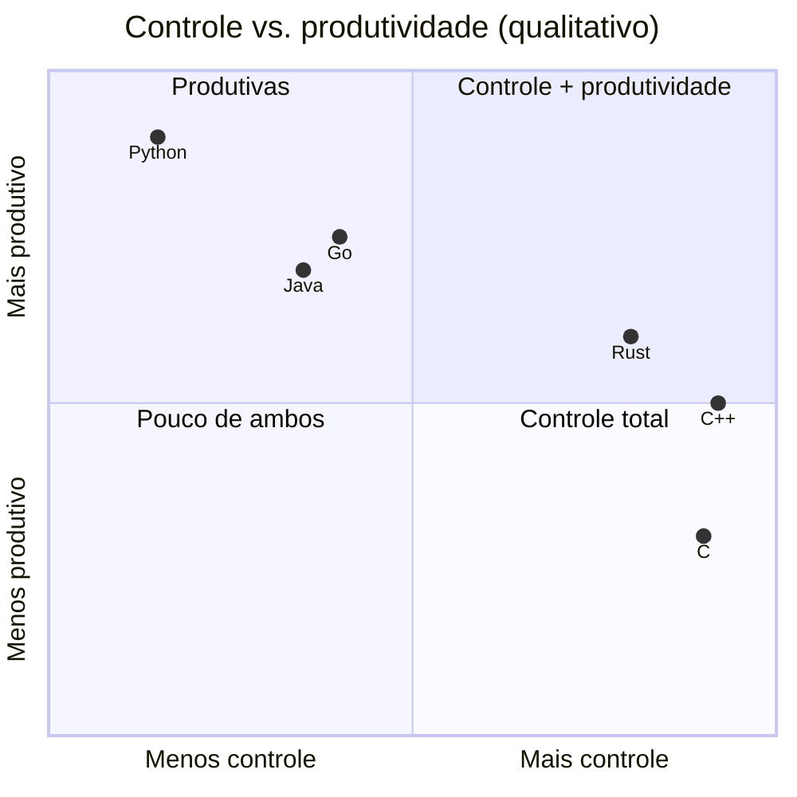

# Comparação de linguagens (resumo)

Visão geral de alto nível. Para análises detalhadas: [[Cpp vs C]] e [[Cpp vs Rust, Java, Go e Python]].

| Aspecto | **C++** | **C** | **Rust** | **Java / C#** | **Go** | **Python** |
|---|---|---|---|---|---|---|
| Modelo | Compilada, nativa | Compilada, nativa | Compilada, nativa | VM/JIT (GC) | Compilada (GC) | Interpretada (GC) |
| Gerência de memória | Manual + **RAII**/smart pointers | Manual | **Ownership/borrowing** verificado | Coletor de lixo | Coletor de lixo | Contagem de refs + GC |
| Segurança de memória | Por disciplina e ferramentas | Por disciplina | **Garantida** (fora de `unsafe`) | Garantida | Garantida | Garantida |
| Desempenho | Máximo controle | Máximo controle | Equivalente a C++ | Alto (JIT), pausas de GC | Bom, GC de baixa latência | Baixo (sem extensões) |
| Abstração de custo zero | Sim (templates, inline) | Limitada | Sim (traits, genéricos) | Parcial | Limitada | Não |
| Genéricos | Templates + concepts | Macros | Traits + genéricos | Genéricos (apagados/reificados) | Genéricos (1.18+) | Duck typing |
| Concorrência | Threads, atomics, corrotinas | pthreads | `Send/Sync`, async | Threads, virtual threads | **Goroutines/canais** | GIL (threads), asyncio |
| Ecossistema de build | CMake, Meson, Bazel (fragmentado) | Make/CMake | **Cargo** (unificado) | Maven/Gradle/NuGet | `go build` | pip/venv/uv |
| Curva de aprendizado | Alta | Média | Alta | Média | Baixa | Baixa |
| Onde brilha | Sistemas, jogos, HFT, embarcados, HPC | Kernels, firmware | Sistemas seguros, CLI, WebAssembly | Apps corporativas, Android | Serviços de rede, DevOps | IA, scripts, ciência |

## Quando escolher C++

- Você precisa de **desempenho previsível** e controle de memória/layout.
- Há **base de código ou bibliotecas** C/C++ existentes (jogos, CAD, bancos de dados, HPC).
- Integração com hardware, GPUs e SDKs nativos.
- Equipe com experiência e ferramentas maduras (profilers, sanitizers).

## Quando considerar outras

- Segurança de memória como requisito forte e novo código: **Rust** (ou C++ com hardening + [[Safety Profiles e Memória Segura]]).
- Produtividade em scripts/dados/IA: **Python** (chamando C++ via [[Interoperabilidade Cpp com Python e C]]).
- Serviços de rede simples e rápidos de entregar: **Go** ou **Java/C#**.

> [!question] Verificar na documentação oficial
> Tabelas comparativas simplificam. Desempenho e características variam por versão, implementação e carga; faça seus próprios *benchmarks* ([[Profiling e Benchmarking]]).

## Veja também

- [[Cpp vs C]]
- [[Cpp vs Rust, Java, Go e Python]]
- [[Filosofia do Cpp]]
- [[Casos de Uso do Cpp]]
- [[MOC - Referência - Cpp]]

## Exercício

1. Escolha um projeto seu e justifique, em 5 linhas, a linguagem que usaria e por quê.
2. Implemente o mesmo algoritmo (por exemplo, *sieve of Eratosthenes*) em C++ e Python e compare o tempo.
