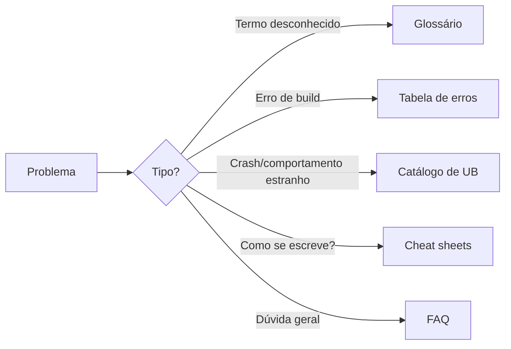

# MOC - Referência - Cpp

Material de **consulta rápida**: glossário, folhas de cola, tabelas de erro, FAQ e recursos.

## Folhas de cola (*cheat sheets*)

- [[Cheat Sheet de Sintaxe - Cpp]]
- [[Cheat Sheet da STL]]
- [[Cheat Sheet de Templates]]
- [[Cheat Sheet de Smart Pointers]]
- [[Cheat Sheet de CMake]]
- [[Cheat Sheet de GDB - Cpp]]

## Diagnóstico e armadilhas

- [[Tabela de Erros de Compilador e Linker]]
- [[Erros Comuns de Iniciantes - Cpp]]
- [[Catálogo de Armadilhas e UB]]

## Conceitos e contexto

- [[Glossário#C++]]
- [[FAQ - Cpp]]
- [[Comparação de Linguagens]]
- [[Livros Cursos e Comunidades - Cpp]]

## Veja também

- [[Home - Cpp]]
- [[MOC - Exercícios - Cpp]]
- [[MOC - Projetos - Cpp]]
- [[Trilha de aprendizado - Cpp]]
