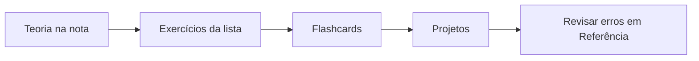

# MOC - Exercícios - Cpp

Listas de exercícios com **gabarito compilável** (todos os códigos foram compilados com `g++ -std=c++20 -Wall -Wextra`) e material de revisão.

## Listas por tema

| Lista | Nível | Pré-requisito |
|---|---|---|
| [[Exercícios de Fundamentos e Básico]] | iniciante | [[MOC - Básico da Linguagem - Cpp]] |
| [[Exercícios de Ponteiros e Memória]] | iniciante | [[MOC - Ponteiros e Memória]] |
| [[Exercícios de Classes e RAII]] | intermediário | [[MOC - Classes e POO]], [[MOC - RAII e Move]] |
| [[Exercícios de Templates e Concepts]] | intermediário | [[MOC - Templates e Concepts]] |
| [[Exercícios de STL e Ranges]] | intermediário | [[MOC - STL e Ranges]] |
| [[Exercícios de Erros Strings e IO]] | intermediário | [[MOC - Erros e Exceções]], [[MOC - Strings e IO]] |
| [[Exercícios de Concorrência - Cpp]] | avançado | [[MOC - Concorrência e Corrotinas]] |
| [[Desafios Avançados]] | avançado | [[MOC - Avançado e Performance - Cpp]] |

## Revisão

- [[Flashcards - Cpp]]

## Projetos maiores

Para prática mais longa, veja [[MOC - Projetos - Cpp]] (9 projetos com código completo).

> [!tip] Método
> 1) Leia a nota. 2) Resolva **sem olhar** o gabarito. 3) Compile com `-Wall -Wextra` e sanitizers. 4) Compare com o gabarito e anote diferenças.

## Veja também

- [[Home - Cpp]]
- [[MOC - Referência - Cpp]]
- [[MOC - Projetos - Cpp]]
- [[Roteiro Semanal]]
- [[Trilha de Estudos - Cpp]]
