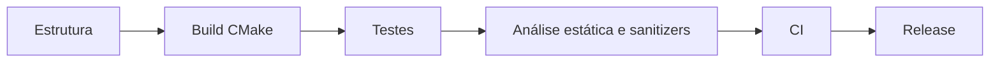

# Checklist de Novo Projeto - Cpp

## Estrutura

- [ ] Layout definido: `include/`, `src/`, `tests/`, `CMakeLists.txt` ([[Estrutura de Projetos]])
- [ ] Controle de versão com `.gitignore` (ignore `build/`)
- [ ] Padrão de linguagem escolhido e fixado ([[Escolhendo o Padrão com -std]])

## Build

- [ ] CMake moderno com alvos e `CMAKE_CXX_STANDARD`/`target_compile_features` ([[CMake Moderno e Presets]])
- [ ] `CMakePresets.json` com presets debug, release e sanitizers
- [ ] Avisos habilitados (`-Wall -Wextra -Wpedantic`; `/W4` no MSVC) ([[Flags Essenciais do Compilador]])
- [ ] Dependências gerenciadas ([[vcpkg e Conan]]); versões fixadas
- [ ] Gerador rápido ([[Ninja e Make]]) e cache de compilação ([[ccache]])

## Qualidade

- [ ] `.clang-format` e `.clang-tidy` na raiz ([[clang-format]], [[clang-tidy e cppcheck]])
- [ ] Framework de testes configurado com `ctest` ([[GoogleTest]] ou [[Catch2 e doctest]])
- [ ] Preset com ASan/UBSan e outro com TSan se houver threads ([[Sanitizers]])
- [ ] Cobertura opcional ([[Cobertura com gcov e lcov]])

## Integração contínua

- [ ] CI compila em GCC, Clang e (se aplicável) MSVC ([[CI e CD para Cpp]])
- [ ] CI roda testes, formatação, análise estática e sanitizers

## Documentação

- [ ] `README` com como compilar, testar e executar
- [ ] Decisões e convenções registradas ([[Core Guidelines]] como base)
- [ ] Licença definida

## Veja também

- [[Estrutura de Projetos]]
- [[CMake Moderno e Presets]]
- [[Checklist de Revisão de Código - Cpp]]
- [[Checklist de Desempenho e Segurança]]
- [[MOC - Checklists e Roteiros - Cpp]]

## Exercício

Crie um projeto vazio cumprindo todos os itens de Estrutura e Build e confirme que `cmake --preset` + `ctest` funcionam.
