# Roteiro semanal (16 semanas)

Plano para **6–8 horas por semana** (3 sessões de 2 h). Ajuste o ritmo: é melhor terminar uma semana por completo do que correr. A trilha detalhada está em [[Trilha de aprendizado - Cpp]].

| Semana | Foco | Estudar | Praticar |
|---|---|---|---|
| 1 | Fundamentos e ferramentas | [[MOC - Fundamentos - Cpp]] | Instalar compilador, [[Primeiro Programa]] |
| 2 | Básico I | [[Tipos Fundamentais]], [[Variáveis e Inicialização]], [[Operadores - Cpp]], [[Controle de Fluxo]] | [[Exercícios de Fundamentos e Básico]] (1–3) |
| 3 | Básico II | [[Funções - Cpp]], [[Strings C e std string]], [[Arrays e std array]], [[const e constexpr]] | Exercício 4 + [[Projeto 1 - Calculadora de Expressões]] |
| 4 | Ponteiros e referências | [[MOC - Ponteiros e Memória]] | [[Exercícios de Ponteiros e Memória]] |
| 5 | Classes | [[Classes e Structs]], [[Construtores e Destrutores]], [[Herança]], [[Polimorfismo e Funções Virtuais]] | Exercícios 1–2 de [[Exercícios de Classes e RAII]] |
| 6 | RAII e movimento | [[MOC - RAII e Move]] | Exercícios 3–4 da mesma lista |
| 7 | STL I | [[vector]], [[map e set]], [[unordered_map e unordered_set]], [[Iteradores e Categorias]] | [[Projeto 2 - Gerenciador de Tarefas CLI]] |
| 8 | STL II | [[Algoritmos da STL]], [[Lambdas e Captura]], [[Ranges e Views]] | [[Exercícios de STL e Ranges]] |
| 9 | Templates | [[MOC - Templates e Concepts]] | [[Exercícios de Templates e Concepts]] |
| 10 | Erros, strings e IO | [[MOC - Erros e Exceções]], [[MOC - Strings e IO]] | [[Exercícios de Erros Strings e IO]] |
| 11 | Organização e build | [[MOC - Módulos e Organização]], [[CMake Moderno e Presets]] | Converter um projeto para CMake |
| 12 | Depuração e qualidade | [[Sanitizers]], [[Depuração com GDB LLDB e Visual Studio]], [[clang-tidy e cppcheck]] | Depurar um erro proposital |
| 13 | Testes | [[MOC - Testes e Qualidade - Cpp]] | Testar o Projeto 2 com [[GoogleTest]] |
| 14 | Concorrência | [[MOC - Concorrência e Corrotinas]] | [[Exercícios de Concorrência - Cpp]] |
| 15 | Desempenho e avançado | [[MOC - Avançado e Performance - Cpp]] | [[Desafios Avançados]] |
| 16 | Projeto final | [[MOC - Projetos - Cpp]] | [[Projeto 4 - Thread Pool]] ou [[Projeto 9 - Parser JSON]] |

```mermaid
gantt
    title Roteiro de 16 semanas
    dateFormat  X
    axisFormat  S%s
    section Base
    Fundamentos e básico      :a1, 0, 3
    Ponteiros e classes       :a2, 3, 6
    section Biblioteca
    STL e templates           :b1, 6, 9
    Erros, strings e IO       :b2, 9, 10
    section Profissional
    Build, testes, depuração  :c1, 10, 13
    Concorrência e avançado   :c2, 13, 15
    Projeto final             :c3, 15, 16
```

> [!tip] Rotina semanal sugerida
> **Sessão 1:** ler a teoria e digitar os exemplos. **Sessão 2:** exercícios sem consultar o gabarito. **Sessão 3:** revisar erros, [[Flashcards - Cpp]] e avançar o projeto.

> [!info] Revisão
> A cada 4 semanas, refaça 3 exercícios antigos e releia [[Erros Comuns de Iniciantes - Cpp]].

## Veja também

- [[Trilha de aprendizado - Cpp]]
- [[MOC - Exercícios - Cpp]]
- [[Livros Cursos e Comunidades - Cpp]]
- [[MOC - Checklists e Roteiros - Cpp]]

## Exercício

Copie a tabela, preencha as datas reais das 16 semanas e marque ao final de cada uma o que realmente concluiu.
