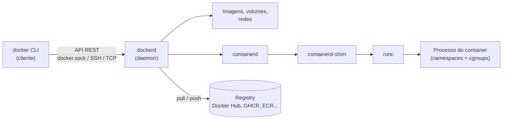

---
tags:
  - docker
  - fundamentos
  - arquitetura
  - mermaid
aliases: []
tipo: conceito
nivel: iniciante
criado: 2026-10-24
relacionados:
  - "[[Docker CLI e API]]"
  - "[[Docker Daemon dockerd]]"
  - "[[containerd e runc]]"
  - "[[Registries]]"
  - "[[Imagens vs Containers]]"
  - "[[Padrão OCI]]"
---

# Arquitetura do Docker

O Docker usa uma arquitetura **cliente-servidor**. O comando `docker` (cliente) conversa com o **daemon** (`dockerd`) por uma API REST, normalmente via socket Unix (`/var/run/docker.sock`), mas também via TCP ou SSH.



## Componentes

| Componente | Função |
|---|---|
| **Cliente** (`docker`) | Interface de linha de comando que envia requisições à API. |
| **Daemon** (`dockerd`) | Gerencia imagens, containers, redes e volumes. Expõe a Engine API. |
| **containerd** | Runtime de alto nível: gerencia ciclo de vida, imagens e snapshots. |
| **containerd-shim** | Processo que mantém o container vivo mesmo que o containerd reinicie. |
| **runc** | Runtime de baixo nível (OCI) que cria o container usando recursos do kernel. |
| **Registry** | Armazena e distribui imagens. |

## Seguindo um `docker run`

1. O cliente envia a requisição ao daemon.
2. O daemon verifica se a imagem existe localmente; se não, faz **pull** do registry.
3. Prepara o sistema de arquivos (camadas + camada gravável) e a rede.
4. Pede ao containerd para criar o container; o `runc` configura namespaces e cgroups e executa o processo.

```bash
# Mostra versões do cliente e do servidor (daemon)
docker version

# Mostra informações do daemon: storage driver, runtime, cgroup, etc.
docker info
```

> [!warning] O socket é poderoso
> Quem tem acesso ao `docker.sock` controla o daemon e, na prática, tem **acesso root ao host**. Veja [[Princípio do menor privilégio - Docker]].

## Exercício

Execute `docker version` e `docker info`. Identifique: versão do cliente, versão do servidor, storage driver, cgroup version e runtime padrão.

## Veja também

- [[Docker CLI e API]]
- [[Docker Daemon dockerd]]
- [[containerd e runc]]
- [[Registries]]
- [[Imagens vs Containers]]
- [[Padrão OCI]]
- [[MOC - Fundamentos - Docker]]
