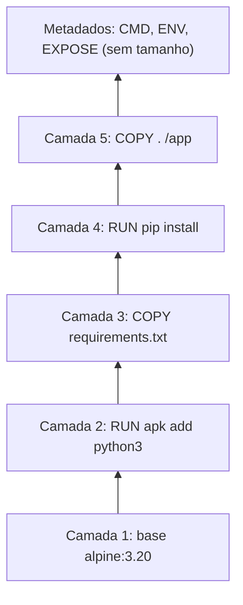

---
tags:
  - docker
  - fundamentos
  - imagens
  - camadas
  - mermaid
aliases: []
tipo: conceito
nivel: iniciante
criado: 2026-10-24
relacionados:
  - "[[Imagens vs Containers]]"
  - "[[Union filesystems e OverlayFS]]"
  - "[[Introdução ao Dockerfile]]"
  - "[[Padrão OCI]]"
---

# Camadas de uma imagem

Uma imagem é uma **pilha de camadas** (layers). Cada instrução que altera o sistema de arquivos em um Dockerfile (`RUN`, `COPY`, `ADD`) cria uma nova camada. Camadas são identificadas por um hash do conteúdo e **compartilhadas** entre imagens.



## Vantagens

- **Cache de build**: se uma camada não mudou, ela é reutilizada.
- **Economia de disco e de banda**: duas imagens com a mesma base compartilham aquela camada no host e no registry.
- **Pull incremental**: só as camadas ausentes são baixadas.

## Inspecionando

```bash
# Camadas, instruções que as criaram e tamanhos
docker history nginx:1.27

# Lista os digests das camadas
docker image inspect nginx:1.27 --format '{{json .RootFS.Layers}}'

# Resumo de uso de disco por imagens, containers e volumes
docker system df
```

> [!tip] Ordem importa
> Coloque o que muda **pouco** no topo do Dockerfile (dependências) e o que muda **muito** no final (código-fonte). Assim o cache é aproveitado ao máximo.

> [!bug] Segredos ficam no histórico
> Uma camada guarda tudo que foi escrito nela, mesmo que removido depois. Nunca copie segredos para dentro da imagem, nem "apagando depois". Veja [[Princípio do menor privilégio - Docker]].

## Exercício

Rode `docker history` em `alpine:3.20` e em `python:3.12-slim`. Quantas camadas cada uma tem? Qual instrução gerou a maior camada?

## Veja também

- [[Imagens vs Containers]]
- [[Union filesystems e OverlayFS]]
- [[Introdução ao Dockerfile]]
- [[Padrão OCI]]
- [[MOC - Fundamentos - Docker]]
