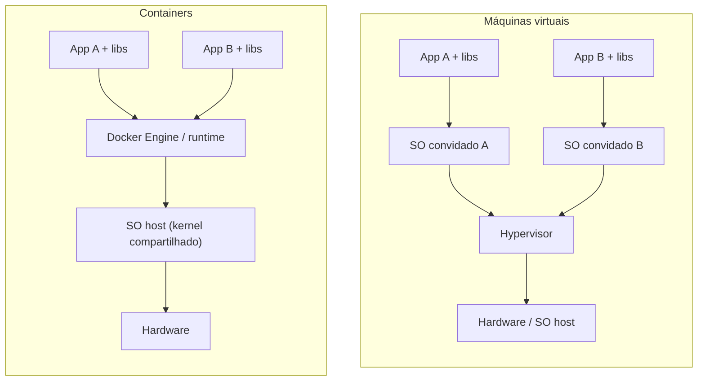

---
tags:
  - docker
  - fundamentos
  - comparativo
aliases:
  - Container vs VM
  - Docker vs VM
tipo: comparativo
nivel: iniciante
criado: 2026-10-24
relacionados:
  - "[[O que é Docker]]"
  - "[[Namespaces]]"
  - "[[Cgroups - Docker]]"
  - "[[Arquitetura do Docker]]"
---

# Containers vs Máquinas Virtuais

Containers e VMs isolam cargas de trabalho, mas em **camadas diferentes**: a VM virtualiza o *hardware*; o container virtualiza o *sistema operacional* (isolamento de processos sobre um único kernel).

## Tabela comparativa

| Característica | Container | Máquina virtual |
|---|---|---|
| Kernel | Compartilha o do host | Kernel próprio por VM |
| Tamanho típico | Megabytes | Gigabytes |
| Inicialização | Milissegundos a segundos | Dezenas de segundos a minutos |
| Isolamento | Processos (namespaces, cgroups) | Forte, ao nível de hardware virtual |
| Densidade por host | Alta | Menor |
| Sistema operacional | Deve ser compatível com o kernel do host | Qualquer SO suportado |
| Superfície de ataque | Kernel compartilhado é um ponto sensível | Hypervisor é a fronteira |
| Uso ideal | Microsserviços, CI, apps empacotadas | Isolamento forte, SOs diferentes, legado |

> [!info] E no Windows e macOS?
> Containers Linux precisam de um kernel Linux. O Docker Desktop executa uma **VM Linux leve** (WSL2 no Windows; uma VM no macOS) e roda os containers dentro dela. Veja [[Docker Desktop vs Docker Engine]].

> [!tip] Não é uma escolha excludente
> É comum rodar containers **dentro** de VMs (por exemplo, instâncias na nuvem) combinando o isolamento das VMs com a agilidade dos containers. Há também tecnologias híbridas, como Kata Containers e Firecracker, que dão a cada container uma micro-VM.

> [!warning] Isolamento não é absoluto
> Como o kernel é compartilhado, uma vulnerabilidade no kernel ou uma configuração permissiva (como `--privileged`) pode comprometer o host. Veja [[Princípio do menor privilégio - Docker]].

## Exercício

Execute `docker run --rm alpine uname -r` e `uname -r` no host (Linux). O que você observa sobre o kernel? Explique o resultado.

## Veja também

- [[O que é Docker]]
- [[Namespaces]]
- [[Cgroups - Docker]]
- [[Arquitetura do Docker]]
- [[MOC - Fundamentos - Docker]]
