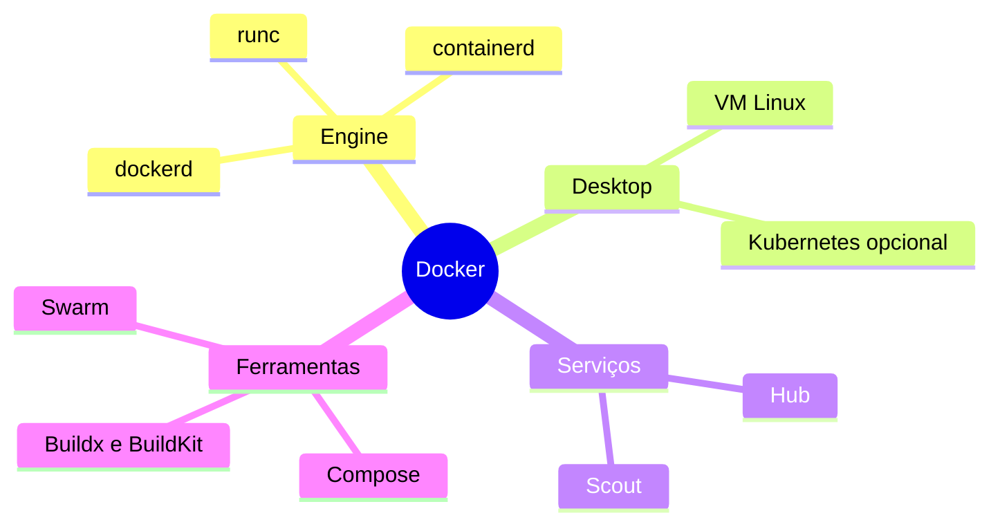

---
tags:
  - docker
  - fundamentos
aliases:
  - Produtos Docker
tipo: conceito
nivel: iniciante
criado: 2026-10-24
relacionados:
  - "[[O que é Docker]]"
  - "[[Docker Desktop vs Docker Engine]]"
  - "[[Docker Hub]]"
  - "[[Visão geral do Docker Compose]]"
  - "[[Visão geral do Swarm]]"
  - "[[Docker Scout]]"
---

# Ecossistema Docker

"Docker" pode significar vários produtos e projetos. Entender cada peça evita confusão.

| Componente | O que é |
|---|---|
| **Docker Engine** | Daemon + API + CLI para Linux (open source, base no projeto Moby). |
| **Docker Desktop** | Aplicativo para Windows, macOS e Linux com VM integrada, interface gráfica, Kubernetes opcional e extensões. |
| **Docker Hub** | Registry público e serviço de imagens oficiais e privadas. Veja [[Docker Hub]]. |
| **Docker Compose** | Define e executa aplicações multi-container com `compose.yaml`. Veja [[Visão geral do Docker Compose]]. |
| **Docker Swarm** | Orquestrador nativo (modo Swarm do Engine). Veja [[Visão geral do Swarm]]. |
| **BuildKit / Buildx** | Motor de build moderno e plugin de CLI para builds avançados e multiplataforma. |
| **Docker Scout** | Análise de vulnerabilidades e recomendações para imagens. Veja [[Docker Scout]]. |
| **Docker Model Runner** | Execução de modelos de IA localmente. Veja [[Docker Model Runner]]. |

> [!info] Fora do ecossistema Docker
> Há alternativas compatíveis com OCI: Podman, containerd + nerdctl, CRI-O, Colima, OrbStack e Rancher Desktop. Veja [[Alternativas ao Docker Desktop]] e [[Docker vs Podman]].

## Veja também

- [[O que é Docker]]
- [[Docker Desktop vs Docker Engine]]
- [[Docker Hub]]
- [[Visão geral do Docker Compose]]
- [[Visão geral do Swarm]]
- [[Docker Scout]]
- [[MOC - Fundamentos - Docker]]
