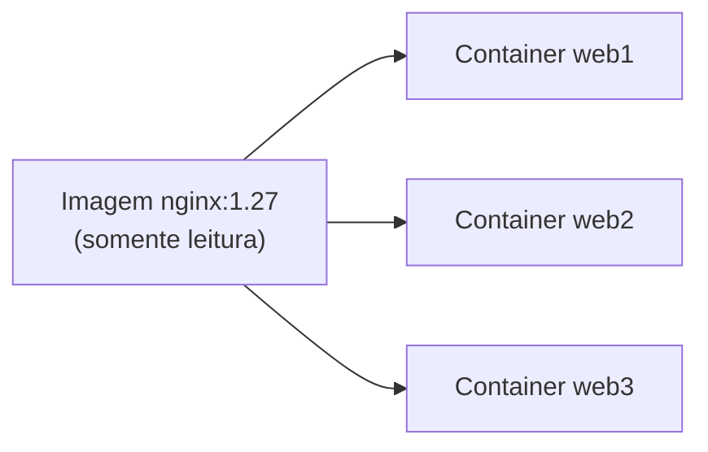

---
tags:
  - docker
  - fundamentos
  - imagens
  - containers
aliases: []
tipo: conceito
nivel: iniciante
criado: 2026-10-24
relacionados:
  - "[[Camadas de uma imagem]]"
  - "[[Ciclo de vida do container]]"
  - "[[Registries]]"
  - "[[O que é Docker]]"
---

# Imagens vs Containers

A distinção mais importante do Docker: **imagem é o modelo; container é a instância em execução.**

| | Imagem | Container |
|---|---|---|
| Natureza | Arquivo imutável (camadas somente leitura) | Processo em execução (ou parado) com camada gravável |
| Analogia | Classe / receita / planta da casa | Objeto / prato pronto / casa construída |
| Criação | `docker build` ou `docker pull` | `docker run` ou `docker create` |
| Quantidade | Uma imagem... | ...pode gerar muitos containers |
| Persistência | Permanente até ser removida | Dados da camada gravável somem ao remover o container |



```bash
# Uma imagem, três containers independentes
docker run -d --name web1 nginx:1.27
docker run -d --name web2 nginx:1.27
docker run -d --name web3 nginx:1.27

docker image ls nginx      # 1 imagem
docker container ls        # 3 containers

# Alterar um arquivo em web1 não afeta web2 nem a imagem
docker exec web1 sh -c 'echo teste > /tmp/arquivo.txt'
docker exec web2 ls /tmp

docker rm -f web1 web2 web3
```

> [!warning] Erro comum
> Dizer "baixei o container" ou "apaguei a imagem e o container sumiu". Você baixa **imagens** e cria **containers**. Remover uma imagem exige que nenhum container (nem parado) a use, ou o uso de `-f`.

## Exercício

Crie dois containers a partir de `alpine`, grave um arquivo em um deles e prove que o outro não o enxerga. Depois remova ambos e verifique que a imagem continua listada.

## Veja também

- [[Camadas de uma imagem]]
- [[Ciclo de vida do container]]
- [[Registries]]
- [[O que é Docker]]
- [[MOC - Fundamentos - Docker]]
