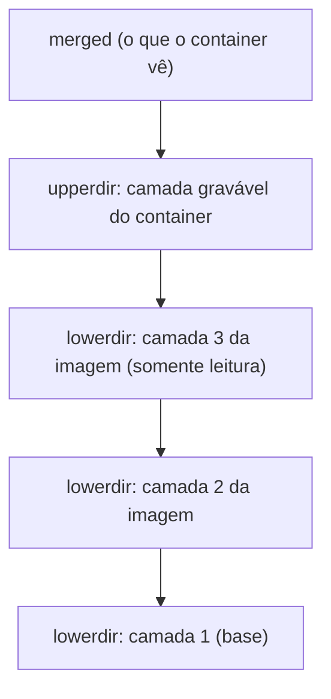

---
tags:
  - docker
  - fundamentos
  - armazenamento
aliases: []
tipo: conceito
nivel: intermediario
criado: 2026-10-24
relacionados:
  - "[[Camadas de uma imagem]]"
  - "[[Storage drivers e overlay2]]"
  - "[[Camada gravável do container]]"
  - "[[Namespaces]]"
---

# Union filesystems e OverlayFS

Imagens são formadas por **camadas somente leitura** empilhadas. Um **union filesystem** monta essas camadas como um único sistema de arquivos coerente. O driver moderno e padrão no Linux é o **OverlayFS** (usado pelo storage driver `overlay2`).

## Como o OverlayFS funciona

| Diretório | Papel |
|---|---|
| `lowerdir` | Camadas inferiores, somente leitura (as camadas da imagem). |
| `upperdir` | Camada superior gravável (a do container). |
| `workdir` | Área de trabalho interna do overlay. |
| `merged` | A visão unificada exposta ao container. |



## Copy-on-write (CoW)

- **Leitura**: o arquivo é lido da camada mais alta onde existir.
- **Escrita em arquivo existente**: o arquivo é **copiado** para a camada gravável e só então modificado (*copy-up*).
- **Remoção**: cria-se um marcador (*whiteout*) na camada superior; o arquivo continua nas camadas de baixo.

> [!info] Consequência prática
> Apagar um arquivo grande em um `RUN` posterior **não reduz** o tamanho da imagem, pois a camada anterior ainda o contém. Por isso comandos de instalação e limpeza devem ficar no mesmo `RUN`. Veja [[Introdução ao Dockerfile]].

```bash
# Confirma o storage driver em uso
docker info --format '{{.Driver}}'

# Mostra os diretórios do overlay de um container (Linux)
docker run -d --name ov alpine sleep 300
docker inspect --format '{{json .GraphDriver.Data}}' ov
docker rm -f ov
```

> [!tip] Dados que precisam persistir
> A camada gravável é descartada junto com o container. Dados importantes devem ficar em **volumes**. Veja [[Volumes nomeados]].

## Veja também

- [[Camadas de uma imagem]]
- [[Storage drivers e overlay2]]
- [[Camada gravável do container]]
- [[Namespaces]]
- [[MOC - Fundamentos - Docker]]
