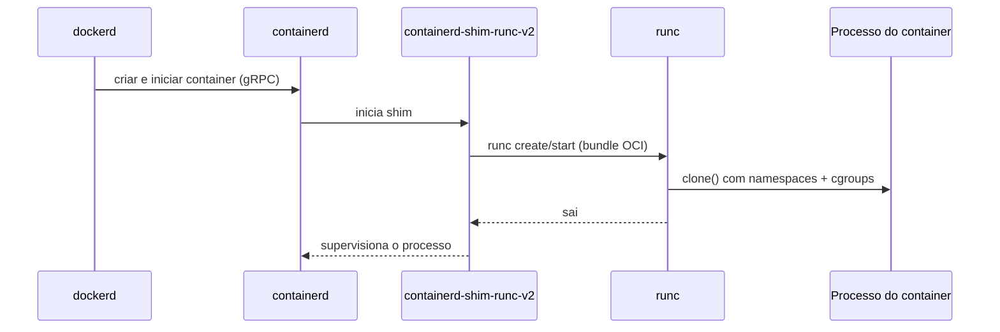

---
tags:
  - docker
  - fundamentos
  - containerd
aliases: []
tipo: conceito
nivel: intermediario
criado: 2026-10-24
relacionados:
  - "[[Arquitetura do Docker]]"
  - "[[Padrão OCI]]"
  - "[[Namespaces]]"
  - "[[Cgroups - Docker]]"
  - "[[História do Docker]]"
---

# containerd e runc

O Docker é composto por camadas. Duas delas são projetos independentes:

## containerd (runtime de alto nível)

- Gerencia o **ciclo de vida completo** do container: pull e armazenamento de imagens, snapshots, execução, supervisão.
- É um projeto graduado da **CNCF** e também é o runtime padrão do Kubernetes na maioria das distribuições.
- Expõe uma API gRPC; o `dockerd` é um dos seus clientes.
- Com o **containerd image store** (padrão em instalações novas do Engine 29), o próprio containerd armazena as imagens, habilitando recursos como imagens multiplataforma e *lazy pulling*.

## runc (runtime de baixo nível)

- Implementação de referência da **OCI Runtime Spec**.
- Recebe um *bundle* (um `config.json` + um `rootfs`) e cria o processo isolado: configura namespaces, cgroups, capabilities, seccomp e executa o comando.
- Após iniciar o container, o `runc` termina; quem mantém o container é o `containerd-shim`.



## Observando no host Linux

```bash
# Inicia um container e procura os processos shim e do container
docker run -d --name demo alpine sleep 300
ps -ef --forest | grep -E "containerd-shim|sleep 300" | grep -v grep
docker rm -f demo

# Runtimes disponíveis para o daemon
docker info --format '{{json .Runtimes}}'
```

> [!tip] Outros runtimes
> Runtimes compatíveis com OCI podem ser configurados no `daemon.json`: `crun`, `gVisor (runsc)`, `Kata Containers`. Úteis quando se precisa de mais isolamento ou desempenho.

## Veja também

- [[Arquitetura do Docker]]
- [[Padrão OCI]]
- [[Namespaces]]
- [[Cgroups - Docker]]
- [[História do Docker]]
- [[MOC - Fundamentos - Docker]]
