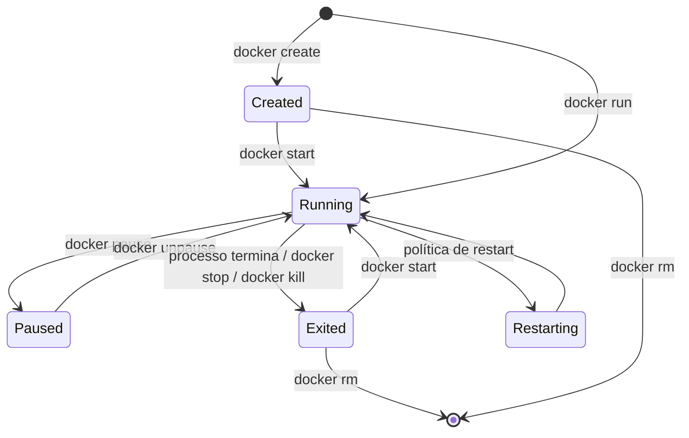

---
tags:
  - docker
  - containers
  - ciclo-de-vida
  - mermaid
aliases: []
tipo: conceito
nivel: iniciante
criado: 2026-10-24
relacionados:
  - "[[Comando docker run]]"
  - "[[Comandos create, start, stop, restart e kill]]"
  - "[[Comandos ps e rm]]"
  - "[[Imagens vs Containers]]"
---

# Ciclo de vida do container

Um container passa por estados bem definidos. Entender a transição entre eles explica a maioria dos comandos.



| Estado | Significado |
|---|---|
| `created` | Container criado, ainda não iniciado. |
| `running` | Processo principal em execução. |
| `paused` | Processos congelados (cgroup freezer). |
| `restarting` | Em reinício por política de restart. |
| `exited` | Processo principal terminou (veja o código de saída). |
| `dead` | Remoção falhou parcialmente; estado raro. |

> [!info] O container vive enquanto o processo principal viver
> Um container é, em essência, **um processo** (PID 1 dentro dele). Quando esse processo termina, o container passa para `exited`. Por isso `docker run ubuntu` "sai imediatamente": o shell padrão não tem terminal para ler e encerra.

## Códigos de saída frequentes

| Código | Significado |
|---|---|
| 0 | Sucesso |
| 1 | Erro genérico da aplicação |
| 125 | Erro do próprio `docker run` (flag inválida, daemon) |
| 126 | Comando encontrado, mas não executável |
| 127 | Comando não encontrado |
| 137 | Morto por SIGKILL (inclui OOM kill, ou `docker kill`) |
| 143 | Encerrado por SIGTERM (`docker stop` com saída limpa) |

```bash
docker run --name teste alpine sh -c 'exit 3'
docker inspect --format '{{.State.Status}} (exit {{.State.ExitCode}})' teste
docker rm teste
```

## Exercício

Crie um container com `docker create`, inicie-o, pause-o, retome-o e pare-o, conferindo o estado com `docker ps -a` a cada passo.

## Veja também

- [[Comando docker run]]
- [[Comandos create, start, stop, restart e kill]]
- [[Comandos ps e rm]]
- [[Imagens vs Containers]]
- [[MOC - Containers]]
