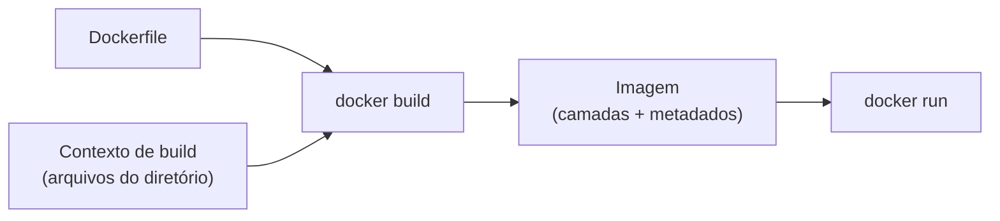

---
tags:
  - docker
  - dockerfile
  - build
  - introducao
aliases: []
tipo: conceito
nivel: iniciante
criado: 2026-10-24
relacionados:
  - "[[Instrução FROM]]"
  - "[[Instrução RUN]]"
  - "[[Instruções COPY e ADD]]"
  - "[[Cache de camadas e ordem das instruções]]"
  - "[[Camadas de uma imagem]]"
  - "[[Boas práticas de Dockerfile]]"
---

# Introdução ao Dockerfile

O **Dockerfile** é um arquivo de texto com instruções que descrevem, passo a passo, como construir uma imagem. Cada instrução que altera arquivos gera uma **camada**.

## Exemplo mínimo e funcional

Estrutura:

```text
meu-app/
├── Dockerfile
└── app.py
```

`app.py`:

```python
# Servidor HTTP mínimo, sem dependências externas
from http.server import BaseHTTPRequestHandler, HTTPServer

class Handler(BaseHTTPRequestHandler):
    def do_GET(self):
        self.send_response(200)
        self.end_headers()
        self.wfile.write(b"Ola, Docker!\n")

HTTPServer(("0.0.0.0", 8000), Handler).serve_forever()
```

`Dockerfile`:

```dockerfile
# syntax=docker/dockerfile:1

# Imagem base com versão fixada
FROM python:3.12-slim

# Diretório de trabalho (criado se não existir)
WORKDIR /app

# Copia apenas o necessário
COPY app.py .

# Documenta a porta (não publica)
EXPOSE 8000

# Executa como usuário sem privilégios (UID numérico)
USER 10001

# Forma exec: o Python é o PID 1 e recebe sinais
CMD ["python", "app.py"]
```

## Construir e executar

```bash
docker build -t meu-app:1.0 .
docker run -d --name meu-app -p 8000:8000 meu-app:1.0
curl http://localhost:8000
docker rm -f meu-app
```

## Fluxo do build



> [!info] Contexto de build
> O ponto final em `docker build -t meu-app:1.0 .` é o **contexto**: o conjunto de arquivos enviado ao builder. Só o que está nele pode ser copiado com `COPY`. Use o [[Arquivo .dockerignore]] para excluir arquivos desnecessários.

## Todas as instruções, em resumo

| Instrução | Função |
|---|---|
| `FROM` | Define a imagem base |
| `RUN` | Executa comandos durante o build |
| `COPY` / `ADD` | Copia arquivos para a imagem |
| `CMD` / `ENTRYPOINT` | Comando executado ao iniciar o container |
| `ENV` / `ARG` | Variáveis de ambiente / de build |
| `WORKDIR` / `USER` | Diretório e usuário |
| `EXPOSE` / `VOLUME` | Documentam porta / declaram ponto de volume |
| `HEALTHCHECK` | Teste de saúde |
| `LABEL` / `SHELL` / `STOPSIGNAL` / `ONBUILD` | Metadados e configurações especiais |

## Exercício

Construa a imagem do exemplo, execute-a e rode `docker history meu-app:1.0`. Identifique qual instrução gerou cada camada.

## Veja também

- [[Instrução FROM]]
- [[Instrução RUN]]
- [[Instruções COPY e ADD]]
- [[Cache de camadas e ordem das instruções]]
- [[Camadas de uma imagem]]
- [[Boas práticas de Dockerfile]]
- [[MOC - Dockerfile]]
