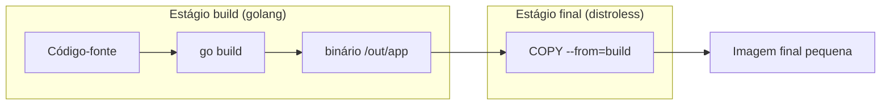

---
tags:
  - docker
  - dockerfile
  - build
  - multi-stage
  - otimizacao
  - mermaid
aliases:
  - Multi-stage
  - Build em múltiplos estágios
tipo: conceito
nivel: intermediario
criado: 2026-10-24
relacionados:
  - "[[Instrução FROM]]"
  - "[[Instruções COPY e ADD]]"
  - "[[Escolha da imagem base]]"
  - "[[Otimização de tamanho e tempo de build]]"
---

# Multi-stage builds

O **multi-stage build** usa vários `FROM` no mesmo Dockerfile: um estágio com compiladores e ferramentas **constrói** o artefato, e o estágio final **só recebe o resultado**. A imagem final fica pequena, mais segura e sem ferramentas de build.



## Exemplo em Go

```dockerfile
# syntax=docker/dockerfile:1

FROM golang:1.24 AS build
WORKDIR /src
COPY go.mod go.sum ./
RUN go mod download
COPY . .
RUN CGO_ENABLED=0 go build -trimpath -ldflags="-s -w" -o /out/app ./cmd/app

FROM gcr.io/distroless/static-debian12:nonroot
COPY --from=build /out/app /app
USER nonroot:nonroot
ENTRYPOINT ["/app"]
```

## Exemplo em Node.js

```dockerfile
# syntax=docker/dockerfile:1

FROM node:22-alpine AS deps
WORKDIR /app
COPY package.json package-lock.json ./
RUN npm ci

FROM deps AS build
COPY . .
RUN npm run build

FROM node:22-alpine AS runtime
ENV NODE_ENV=production
WORKDIR /app
COPY package.json package-lock.json ./
RUN npm ci --omit=dev && npm cache clean --force
COPY --from=build /app/dist ./dist
USER node
CMD ["node", "dist/server.js"]
```

## Recursos úteis

```bash
# Constrói apenas até um estágio (ex.: para testes ou depuração)
docker build --target build -t app:build .

# Copiar de uma imagem externa
# COPY --from=nginx:1.27 /etc/nginx/nginx.conf /tmp/
```

> [!info] BuildKit constrói em paralelo e ignora estágios não usados
> Estágios independentes executam simultaneamente, e estágios que não contribuem para o alvo final não são construídos.

> [!tip] Estágio de testes
> Crie um estágio `test` que roda os testes e faça o CI chamar `--target test`. A imagem de produção não carrega as dependências de teste.

## Exercício

Converta um Dockerfile de aplicação Go (ou Node) de estágio único em multi-stage e compare os tamanhos antes/depois com `docker images`.

## Veja também

- [[Instrução FROM]]
- [[Instruções COPY e ADD]]
- [[Escolha da imagem base]]
- [[Otimização de tamanho e tempo de build]]
- [[MOC - Dockerfile]]
