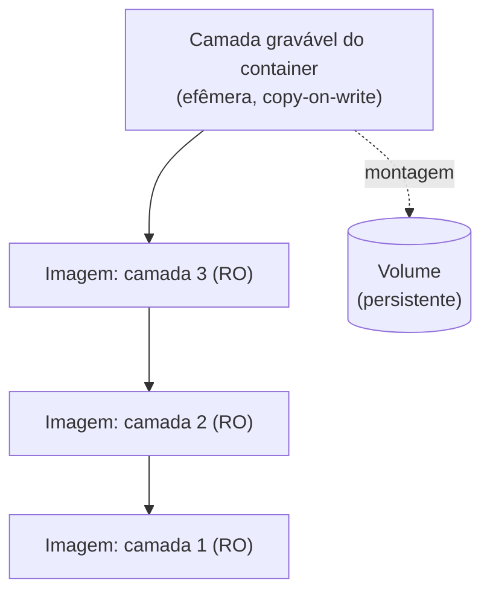

---
tags:
  - docker
  - volumes
  - armazenamento
  - camadas
aliases: []
tipo: conceito
nivel: intermediario
criado: 2026-10-24
relacionados:
  - "[[Union filesystems e OverlayFS]]"
  - "[[Storage drivers e overlay2]]"
  - "[[Volumes nomeados]]"
  - "[[Comandos cp, diff e commit]]"
---

# Camada gravável do container

Ao criar um container, o Docker adiciona uma **camada fina e gravável** sobre as camadas somente leitura da imagem. Tudo que o container escreve fora de volumes vai para ela.



```bash
docker run -d --name app alpine:3.20 sh -c 'echo dados > /arquivo; sleep 300'

# Tamanho: "size" = camada gravável; "virtual" = camada + imagem
docker ps -s --filter name=app

# O que mudou
docker diff app

# Remover o container apaga a camada gravável
docker rm -f app
```

| Característica | Consequência |
|---|---|
| Efêmera | Dados somem ao remover o container |
| Copy-on-write | A primeira escrita em arquivo grande o copia inteiro (custo de desempenho) |
| Gravações intensivas são mais lentas que em volumes | Use volumes para bancos e uploads |
| Cresce sem controle se a aplicação grava arquivos/logs nela | Monitore com `docker ps -s` |

> [!tip] Containers imutáveis
> Execute com `--read-only` e conceda escrita apenas em volumes e `tmpfs`. Isso torna o container mais previsível e seguro.

> [!bug] "no space left on device" com poucos dados
> Verifique camadas graváveis grandes, logs e volumes órfãos com `docker system df -v`.

## Exercício

Crie um container que grava 100 MB em `/tmp/arquivo`, observe `docker ps -s` e compare com o mesmo container gravando em um volume.

## Veja também

- [[Union filesystems e OverlayFS]]
- [[Storage drivers e overlay2]]
- [[Volumes nomeados]]
- [[Comandos cp, diff e commit]]
- [[MOC - Volumes e Armazenamento]]
