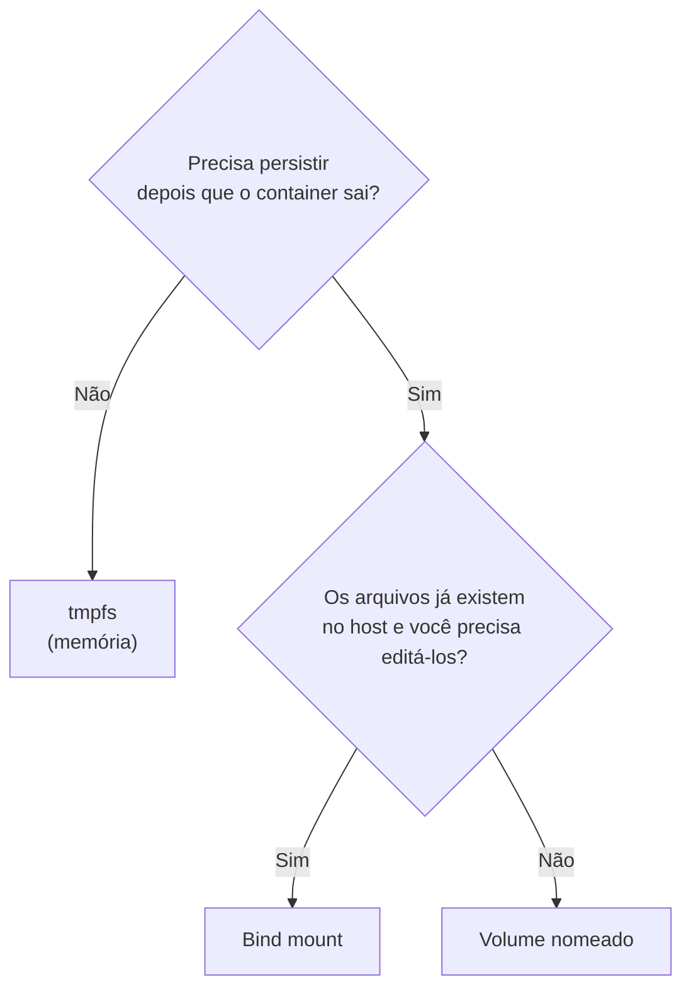

---
tags:
  - docker
  - volumes
  - armazenamento
  - comparativo
aliases:
  - Volume vs bind mount
tipo: comparativo
nivel: iniciante
criado: 2026-10-24
relacionados:
  - "[[Volumes nomeados]]"
  - "[[Bind mounts]]"
  - "[[tmpfs mounts]]"
  - "[[Camada gravável do container]]"
---

# Volume vs bind mount vs tmpfs

| Característica | **Volume** | **Bind mount** | **tmpfs** |
|---|---|---|---|
| Onde fica | Gerenciado pelo Docker (`/var/lib/docker/volumes`) | Qualquer caminho do host | Memória RAM |
| Sobrevive ao container | Sim | Sim | **Não** |
| Criação | `docker volume create` ou automática | O caminho precisa existir (com `--mount`) | Automática |
| Conteúdo inicial copiado da imagem | **Sim** (volume novo) | Não (sobrepõe) | Não |
| Backup/migração | Simples | Depende do host | N/A |
| Drivers remotos (NFS, nuvem) | **Sim** | Não | Não |
| Desempenho no Docker Desktop | Bom | Pode ser lento | Excelente |
| Segurança | Isolado do host | Exposição direta do host | Não persiste em disco |
| Portável entre hosts/OS | **Sim** | Não (depende de caminhos) | Linux apenas |
| Uso ideal | **Dados de produção, bancos** | **Código em desenvolvimento**, configs | Segredos e temporários |

> [!tip] Regra prática
> **Dados da aplicação → volume. Código em desenvolvimento e configs → bind mount. Temporário/sensível → tmpfs.**

## Exercício

Para cada cenário, escolha o tipo de armazenamento e justifique: (a) banco PostgreSQL em produção; (b) hot reload de código; (c) cache de sessão que não pode tocar o disco.

## Veja também

- [[Volumes nomeados]]
- [[Bind mounts]]
- [[tmpfs mounts]]
- [[Camada gravável do container]]
- [[MOC - Volumes e Armazenamento]]
