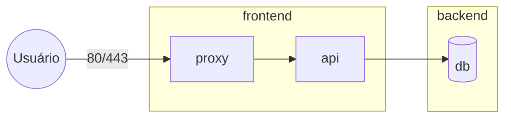

---
tags:
  - docker
  - redes
  - isolamento
aliases: []
tipo: conceito
nivel: iniciante
criado: 2026-10-24
relacionados:
  - "[[Redes bridge]]"
  - "[[DNS interno e descoberta de serviços]]"
  - "[[Publicação de portas]]"
  - "[[Comando docker network]]"
---

# Comunicação entre containers

## Mesma rede: comunicação direta por nome

```bash
docker network create loja
docker run -d --name api --network loja nginx:1.27
docker run --rm --network loja alpine:3.20 wget -qO- http://api
```

Nenhuma porta precisa ser publicada para a comunicação **entre containers** da mesma rede.

## Redes diferentes: isolamento por padrão

```bash
docker network create frontend
docker network create backend

docker run -d --name proxy --network frontend nginx:1.27
docker run -d --name api    --network backend  nginx:1.27

# Conecta a api também à frontend (multi-homed)
docker network connect frontend api

# proxy → api funciona; proxy → (qualquer container só em backend) não
```



> [!tip] Padrão de duas redes
> Coloque o **proxy** só em `frontend`, a **api** em `frontend` e `backend`, e o **banco** apenas em `backend` (idealmente `--internal`). O banco nunca é alcançável do proxy nem publicado.

> [!warning] `localhost` dentro do container é o próprio container
> Para acessar outro container, use seu **nome**. Para acessar o host a partir do container, use `host.docker.internal` (Docker Desktop; no Linux, adicione `--add-host=host.docker.internal:host-gateway`).

```bash
docker run --rm --add-host=host.docker.internal:host-gateway alpine:3.20 getent hosts host.docker.internal
```

## Exercício

Monte a topologia proxy/api/db com duas redes e demonstre, com `wget`, quais conexões funcionam e quais falham.

## Veja também

- [[Redes bridge]]
- [[DNS interno e descoberta de serviços]]
- [[Publicação de portas]]
- [[Comando docker network]]
- [[MOC - Redes]]
