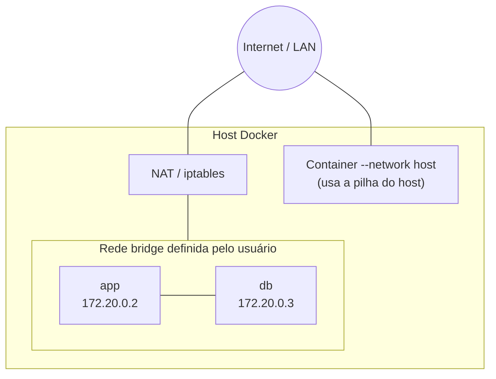

---
tags:
  - docker
  - redes
  - drivers
  - mermaid
  - visao-geral
aliases: []
tipo: conceito
nivel: iniciante
criado: 2026-10-24
relacionados:
  - "[[Redes bridge]]"
  - "[[Rede host]]"
  - "[[Rede none]]"
  - "[[Rede overlay]]"
  - "[[Redes macvlan e ipvlan]]"
  - "[[Comando docker network]]"
---

# Visão geral das redes Docker

O Docker cria redes virtuais que conectam containers entre si, ao host e ao mundo externo. Cada rede tem um **driver**.

| Driver | Escopo | Uso |
|---|---|---|
| `bridge` | Um host | **Padrão.** Containers isolados em uma rede virtual com NAT para a saída |
| `host` | Um host | O container usa diretamente a rede do host (sem isolamento de rede) |
| `none` | Um host | Sem rede (apenas loopback) |
| `overlay` | Multi-host (Swarm) | Conecta containers em hosts diferentes |
| `macvlan` | Um host | Dá ao container um endereço MAC/IP na rede física |
| `ipvlan` | Um host | Como macvlan, compartilhando o MAC do host |



```bash
docker network ls                       # bridge, host, none + as suas
docker network inspect bridge           # detalhes
```

> [!info] Containers na mesma rede conversam livremente
> Em uma rede bridge definida pelo usuário, todos os containers se alcançam por nome e por qualquer porta, **sem precisar publicar portas**. A publicação (`-p`) só é necessária para acesso externo à rede.

> [!tip] Padrão de projeto
> Crie uma rede por aplicação (ou por camada: `frontend`, `backend`) para isolar serviços que não devem se comunicar.

## Exercício

Liste as redes do seu Docker com `docker network ls` e inspecione a `bridge` padrão. Qual é a sub-rede e o gateway?

## Veja também

- [[Redes bridge]]
- [[Rede host]]
- [[Rede none]]
- [[Rede overlay]]
- [[Redes macvlan e ipvlan]]
- [[Comando docker network]]
- [[MOC - Redes]]
