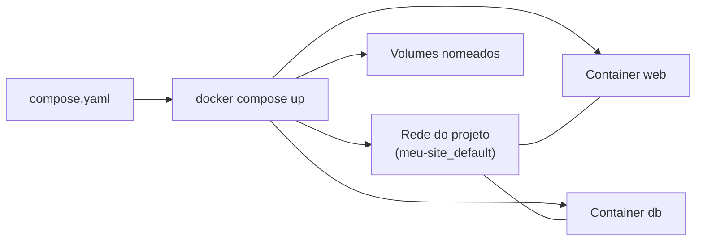

---
tags:
  - docker
  - compose
  - introducao
aliases:
  - Docker Compose
  - Compose
tipo: conceito
nivel: iniciante
criado: 2026-10-24
relacionados:
  - "[[Estrutura do compose.yaml e Compose Specification]]"
  - "[[Comandos do Docker Compose]]"
  - "[[Serviços com image e build]]"
  - "[[Ecossistema Docker]]"
---

# Visão geral do Docker Compose

O **Docker Compose** define e executa aplicações com **vários containers** a partir de um único arquivo declarativo (`compose.yaml`). Um comando sobe (ou derruba) a stack inteira: serviços, redes e volumes.

> [!info] Compose v2
> Hoje o Compose é um **plugin da CLI**: use `docker compose` (com espaço). O antigo `docker-compose` (v1, Python) está descontinuado. O arquivo segue a **Compose Specification** e **não usa mais o campo `version`**.

## Exemplo: Nginx servindo um site estático

```text
meu-site/
├── compose.yaml
└── site/
    └── index.html
```

`site/index.html`:

```html
<!doctype html>
<html lang="pt-BR"><body><h1>Olá do Compose!</h1></body></html>
```

`compose.yaml`:

```yaml
services:
  web:
    image: nginx:1.27
    ports:
      - "8080:80"
    volumes:
      - ./site:/usr/share/nginx/html:ro
    restart: unless-stopped
```

```bash
docker compose up -d        # cria rede, container e sobe em segundo plano
docker compose ps
curl http://localhost:8080
docker compose logs -f web
docker compose down         # remove containers e rede
```

## O que o Compose cria



| Antes (vários `docker run`) | Com Compose |
|---|---|
| Comandos longos e difíceis de lembrar | Um arquivo versionado |
| Redes e volumes criados manualmente | Criados e removidos automaticamente |
| Ordem de inicialização manual | `depends_on` |
| Difícil de compartilhar | `git clone` + `docker compose up` |

> [!tip] Onde o Compose brilha
> Desenvolvimento local, testes de integração, CI e implantações em um único host. Para múltiplos hosts, veja [[Visão geral do Swarm]] ou Kubernetes.

## Exercício

Reproduza o exemplo, altere o `index.html` e atualize o navegador (sem reiniciar). Depois execute `docker compose down` e confira que nada sobrou com `docker ps -a` e `docker network ls`.

## Veja também

- [[Estrutura do compose.yaml e Compose Specification]]
- [[Comandos do Docker Compose]]
- [[Serviços com image e build]]
- [[Ecossistema Docker]]
- [[MOC - Docker Compose]]
