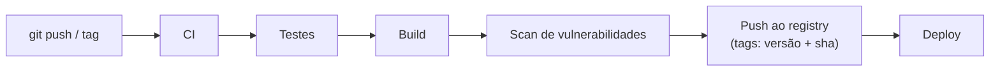

---
tags:
  - docker
  - registries
  - automacao
  - ci
  - publicacao
aliases: []
tipo: procedimento
nivel: avancado
criado: 2026-10-24
relacionados:
  - "[[Login e tokens de acesso]]"
  - "[[GitHub Container Registry]]"
  - "[[Versionamento e tags imutáveis]]"
  - "[[Build multiplataforma]]"
---

# Automação de publicação de imagens

A publicação deve ser **automática, reproduzível e rastreável**. Fluxo típico:



## Script de publicação simples (shell)

```bash
#!/usr/bin/env bash
set -euo pipefail

IMAGEM="ghcr.io/seu-usuario/meu-app"
VERSAO="${1:?Informe a versão, ex.: 1.4.2}"
SHA="$(git rev-parse --short HEAD)"

echo "$GHCR_TOKEN" | docker login ghcr.io -u seu-usuario --password-stdin

docker buildx build \
  --platform linux/amd64,linux/arm64 \
  --label "org.opencontainers.image.revision=$(git rev-parse HEAD)" \
  --label "org.opencontainers.image.version=$VERSAO" \
  -t "$IMAGEM:$VERSAO" \
  -t "$IMAGEM:${VERSAO%.*}" \
  -t "$IMAGEM:sha-$SHA" \
  --push .
```

## Boas práticas

- Gere tags a partir de **tags do Git** (SemVer), nunca manualmente.
- Publique `sha-<commit>` para rastreabilidade.
- Rode **testes e varredura de vulnerabilidades antes do push**.
- Use credenciais de curta duração (OIDC) e escopo mínimo.
- Gere **SBOM e provenance** e, se possível, **assine** a imagem.

> [!info] Pipelines completos
> O detalhamento de GitHub Actions, GitLab CI e Jenkins está na pasta de CI/CD e DevOps.

## Exercício

Adapte o script para seu projeto e execute-o contra o registry local (`localhost:5000`) para validar o fluxo.

## Veja também

- [[Login e tokens de acesso]]
- [[GitHub Container Registry]]
- [[Versionamento e tags imutáveis]]
- [[Build multiplataforma]]
- [[MOC - Registries]]
