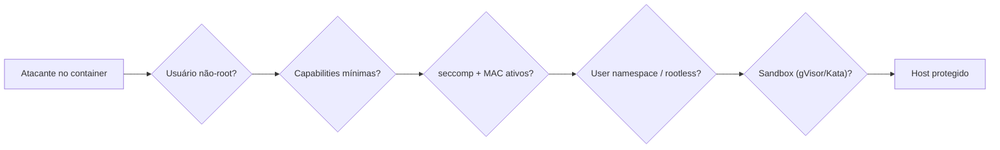

---
tags:
  - docker
  - seguranca
  - defesa
  - kernel
aliases: []
tipo: conceito
nivel: avancado
criado: 2026-10-24
relacionados:
  - "[[Riscos do --privileged]]"
  - "[[Proteção do docker.sock]]"
  - "[[Modo rootless]]"
  - "[[Seccomp - Docker]]"
---

# Escape de container

Um **escape de container** ocorre quando um processo consegue sair do isolamento e atuar no **host**. O objetivo desta nota é entender **onde estão os riscos** para se **defender**.

## Categorias de risco (visão defensiva)

| Categoria | Origem | Defesa principal |
|---|---|---|
| Configuração permissiva | `--privileged`, capabilities excessivas, `SYS_ADMIN` | [[Princípio do menor privilégio - Docker]] |
| Montagens perigosas | `docker.sock`, `/`, `/proc`, `/sys`, `/etc` | [[Proteção do docker.sock]], montar só o necessário |
| Namespaces do host | `--pid=host`, `--network=host`, `--ipc=host` | Evitar; usar isolamento padrão |
| Vulnerabilidades do runtime | Falhas em `runc`/`containerd` (já houve CVEs relevantes) | Manter Engine, containerd e runc **atualizados** |
| Vulnerabilidades do kernel | Falhas no kernel compartilhado | Atualizar o kernel; seccomp; user namespaces; sandboxes (gVisor, Kata) |
| Credenciais expostas | Segredos em imagens/variáveis | [[Gerenciamento de segredos]] |

## Auditoria defensiva do seu host

```bash
# Containers com configurações arriscadas
docker ps -q | xargs -r docker inspect --format \
'{{.Name}} priv={{.HostConfig.Privileged}} pid={{.HostConfig.PidMode}} net={{.HostConfig.NetworkMode}} caps={{.HostConfig.CapAdd}} user="{{.Config.User}}"'

# Versões do runtime
docker version --format '{{.Server.Version}}'
runc --version
containerd --version
```

## Camadas que reduzem o impacto



> [!tip] Isolamento mais forte para código não confiável
> Para executar código de terceiros, considere runtimes com isolamento adicional (gVisor/`runsc`, Kata Containers) ou VMs dedicadas por locatário.

> [!info] Assine os boletins de segurança
> Acompanhe avisos de segurança do Docker, containerd, runc e da sua distribuição, e aplique atualizações com prioridade.

## Exercício

Execute a auditoria defensiva no seu host e classifique cada container encontrado como "ok", "justificável" ou "precisa mudar", com a ação corretiva.

## Veja também

- [[Riscos do --privileged]]
- [[Proteção do docker.sock]]
- [[Modo rootless]]
- [[Seccomp - Docker]]
- [[MOC - Segurança]]
