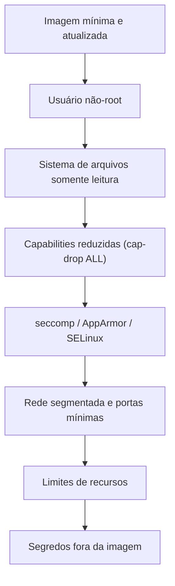

---
tags:
  - docker
  - seguranca
  - hardening
aliases:
  - Hardening de containers
tipo: conceito
nivel: intermediario
criado: 2026-10-24
relacionados:
  - "[[Containers não-root]]"
  - "[[Sistema de arquivos somente leitura]]"
  - "[[Capabilities Linux]]"
  - "[[Opções security-opt e no-new-privileges]]"
  - "[[Checklist de segurança de containers]]"
  - "[[Riscos do --privileged]]"
---

# Princípio do menor privilégio - Docker

O **princípio do menor privilégio** diz que cada container deve ter **apenas** as permissões, capacidades e acessos estritamente necessários para funcionar. Quanto menos privilégio, menor o estrago de uma falha ou invasão.

## As camadas de defesa



## Exemplo: container endurecido

```bash
docker run -d --name seguro \
  --user 10001:10001 \
  --read-only \
  --tmpfs /tmp:rw,noexec,nosuid,size=64m \
  --cap-drop ALL \
  --security-opt no-new-privileges:true \
  --pids-limit 100 \
  --memory 256m --cpus 0.5 \
  --network none \
  alpine:3.20 sleep 600

docker inspect seguro --format 'user={{.Config.User}} ro={{.HostConfig.ReadonlyRootfs}} caps_drop={{.HostConfig.CapDrop}}'
docker rm -f seguro
```

## Equivalente em Compose

```yaml
services:
  app:
    image: alpine:3.20
    command: sleep 600
    user: "10001:10001"
    read_only: true
    tmpfs:
      - /tmp:rw,noexec,nosuid,size=64m
    cap_drop:
      - ALL
    security_opt:
      - no-new-privileges:true
    pids_limit: 100
    deploy:
      resources:
        limits:
          cpus: "0.5"
          memory: 256M
```

> [!tip] Comece restritivo e libere o necessário
> Aplique as restrições e, se a aplicação falhar, descubra **qual** permissão falta (logs, `strace`) e conceda apenas ela, em vez de relaxar tudo.

> [!danger] O oposto: `--privileged` e `docker.sock`
> Essas duas práticas anulam quase todas as camadas acima. Veja [[Riscos do --privileged]] e [[Proteção do docker.sock]].

## Exercício

Pegue um container seu e aplique as restrições do exemplo uma a uma. Anote qual delas quebrou a aplicação e como você resolveu sem remover a restrição.

## Veja também

- [[Containers não-root]]
- [[Sistema de arquivos somente leitura]]
- [[Capabilities Linux]]
- [[Opções security-opt e no-new-privileges]]
- [[Checklist de segurança de containers]]
- [[Riscos do --privileged]]
- [[MOC - Segurança]]
