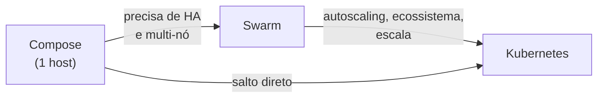

---
tags:
  - docker
  - swarm
  - compose
  - kubernetes
  - comparativo
aliases:
  - Compose vs Swarm vs K8s
tipo: comparativo
nivel: intermediario
criado: 2026-10-24
relacionados:
  - "[[Visão geral do Docker Compose]]"
  - "[[Visão geral do Swarm]]"
  - "[[Swarm vs Kubernetes e quando migrar]]"
---

# Compose vs Swarm vs Kubernetes

| Característica | **Compose** | **Swarm** | **Kubernetes** |
|---|---|---|---|
| Escopo | Um host | Cluster pequeno/médio | Cluster de qualquer tamanho |
| Definição | `compose.yaml` | `compose.yaml` com `deploy:` | Manifestos YAML / Helm / Kustomize |
| Alta disponibilidade | Não | **Sim** (managers/Raft) | **Sim** |
| Escala | `--scale` (manual, um host) | `replicas` | `replicas`, **HPA/VPA/Cluster Autoscaler** |
| Rolling updates | Limitado (`up -d` recria) | **Sim**, com rollback | **Sim**, com estratégias avançadas |
| Balanceamento | Não nativo | Routing mesh | Services, Ingress, Gateway API |
| Descoberta de serviços | DNS do projeto | DNS overlay | DNS do cluster |
| Secrets | Arquivos locais | **Criptografados no Raft** | Secrets (com criptografia opcional/KMS) |
| Complexidade | **Baixa** | Baixa a média | **Alta** |
| Ecossistema | Docker | Docker | **Gigantesco** |
| Melhor uso | Desenvolvimento, CI, host único | Produção simples multi-nó | Produção em escala, múltiplos times |

> [!tip] Regra prática
> Comece com **Compose**. Se precisar de alta disponibilidade simples, **Swarm**. Se a escala, o ecossistema ou o mercado exigirem, **Kubernetes** (de preferência gerenciado).

## Exercício

Classifique três aplicações (um blog pessoal, uma loja com picos de tráfego, uma plataforma multi-tenant) em Compose, Swarm ou Kubernetes e justifique.

## Veja também

- [[Visão geral do Docker Compose]]
- [[Visão geral do Swarm]]
- [[Swarm vs Kubernetes e quando migrar]]
- [[MOC - Swarm e Orquestração]]
