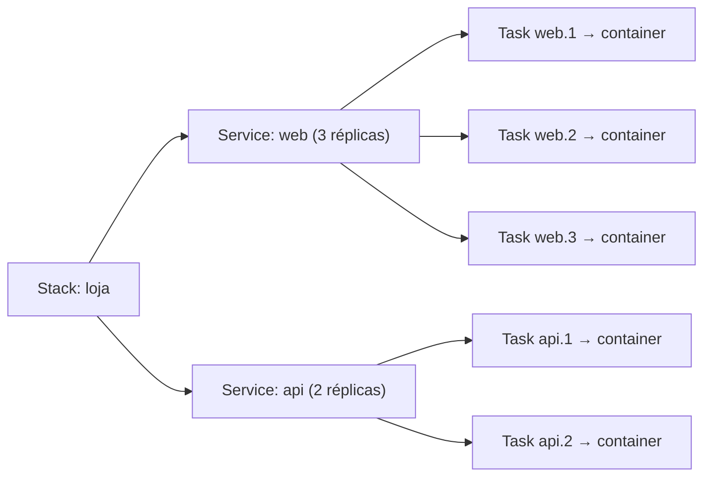

---
tags:
  - docker
  - swarm
aliases: []
tipo: conceito
nivel: intermediario
criado: 2026-10-24
relacionados:
  - "[[Visão geral do Swarm]]"
  - "[[Comando docker service]]"
  - "[[Stacks com docker stack deploy]]"
---

# Nodes, services, tasks e stacks

| Conceito | Definição |
|---|---|
| **Node** | Uma máquina (host Docker) participante do Swarm. Pode ser **manager** ou **worker** |
| **Manager** | Mantém o estado do cluster (Raft), agenda tarefas, serve a API |
| **Worker** | Executa as tarefas |
| **Service** | Definição do estado desejado: imagem, réplicas, portas, rede, recursos |
| **Task** | Unidade de execução: **um container** agendado em um nó para um serviço |
| **Stack** | Conjunto de serviços, redes, volumes, secrets e configs implantado a partir de um arquivo Compose |

## Modos de serviço

| Modo | Comportamento |
|---|---|
| **Replicated** (padrão) | N réplicas distribuídas pelo cluster |
| **Global** | Exatamente **uma tarefa por nó** (agentes de monitoramento, logs) |

## Estados de um nó

`Active` (recebe tarefas), `Pause` (não recebe novas), `Drain` (as tarefas são movidas para outros nós, útil para manutenção).

> [!tip] Self-healing
> Se um container falha ou o nó cai, o Swarm cria uma **nova task** em outro nó para voltar ao número de réplicas desejado.

> [!warning] Quórum dos managers
> Use número **ímpar** de managers (3 ou 5). Perder a maioria dos managers deixa o cluster sem poder alterar o estado até recuperar o quórum.

## Exercício

Para um serviço global de monitoramento e um serviço replicado `web` com 3 réplicas em 4 nós, descreva quantas tasks existem de cada e onde.

## Veja também

- [[Visão geral do Swarm]]
- [[Comando docker service]]
- [[Stacks com docker stack deploy]]
- [[MOC - Swarm e Orquestração]]
