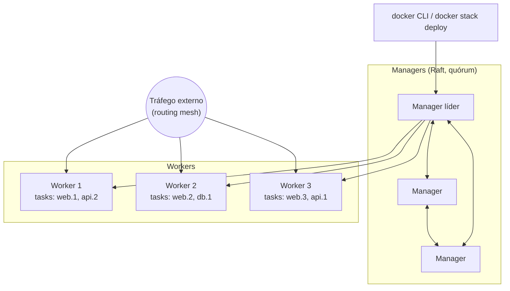

---
tags:
  - docker
  - swarm
  - orquestracao
  - mermaid
  - visao-geral
aliases:
  - Docker Swarm
  - Modo Swarm
tipo: conceito
nivel: intermediario
criado: 2026-10-24
relacionados:
  - "[[Nodes, services, tasks e stacks]]"
  - "[[Inicializando um Swarm]]"
  - "[[Rede overlay]]"
  - "[[Compose vs Swarm vs Kubernetes]]"
---

# Visão geral do Swarm

O **Docker Swarm** (modo Swarm) é o orquestrador **nativo** do Docker Engine: transforma vários hosts em um **cluster** gerenciado como se fosse um único Docker, com escala, balanceamento, descoberta de serviços, atualizações progressivas e *self-healing*.

## Topologia

## Recursos principais

| Recurso | Descrição |
|---|---|
| Declarativo | Você descreve o estado desejado; o Swarm o mantém |
| Escala | `--replicas N` |
| Balanceamento | **Routing mesh**: qualquer nó recebe tráfego e o direciona a uma réplica |
| Descoberta de serviços | DNS interno por nome de serviço |
| Atualizações progressivas | Rolling update com rollback automático |
| Secrets e configs | Distribuição segura, criptografada em trânsito e em repouso |
| Redes overlay | Comunicação entre hosts |
| Alta disponibilidade | Múltiplos managers com consenso **Raft** |

> [!info] Quando faz sentido
> Clusters pequenos/médios, equipes que já dominam Docker/Compose e querem orquestração simples, sem a complexidade do Kubernetes. Veja [[Swarm vs Kubernetes e quando migrar]].

> [!question] Verificar na documentação oficial
> O Swarm é mantido, mas o ecossistema e o ritmo de novidades são menores que os do Kubernetes. Confirme o estado atual do projeto e do suporte comercial na documentação oficial antes de adotá-lo em novos projetos críticos.

## Exercício

Desenhe, à mão ou em Mermaid, um cluster de 3 managers e 3 workers e marque onde ficariam as réplicas de um serviço `web` com 4 réplicas.

## Veja também

- [[Nodes, services, tasks e stacks]]
- [[Inicializando um Swarm]]
- [[Rede overlay]]
- [[Compose vs Swarm vs Kubernetes]]
- [[MOC - Swarm e Orquestração]]
