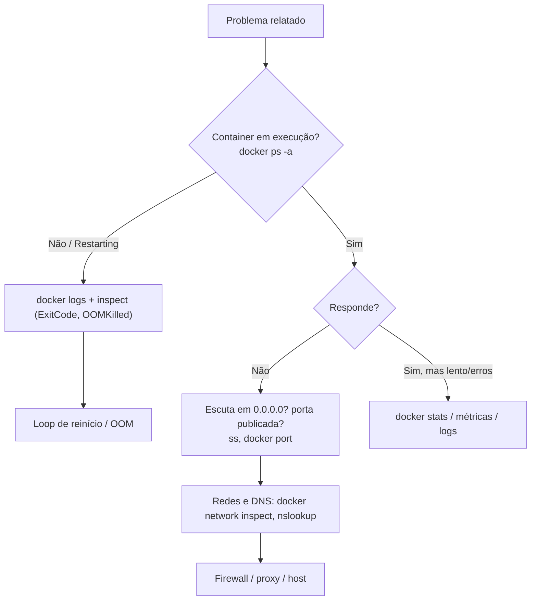

---
tags:
  - docker
  - observabilidade
  - troubleshooting
  - checklist
  - mermaid
aliases: []
tipo: referencia
nivel: intermediario
criado: 2026-10-24
relacionados:
  - "[[Containers em loop de reinício]]"
  - "[[Depuração de rede]]"
  - "[[Análise de OOM kill]]"
  - "[[Comando docker logs]]"
  - "[[Erros comuns e soluções]]"
---

# Fluxo de diagnóstico de problemas

Um roteiro sistemático evita tentativas aleatórias.



## Comandos em ordem

```bash
docker ps -a                                 # estado geral
docker logs --tail 100 -t NOME               # o que a aplicação disse
docker inspect NOME --format 'exit={{.State.ExitCode}} oom={{.State.OOMKilled}} health={{if .State.Health}}{{.State.Health.Status}}{{end}}'
docker stats --no-stream                     # recursos
docker events --since 15m --filter container=NOME
docker exec -it NOME sh                      # por dentro
docker system df                             # disco
docker info | grep -iE 'warning|storage|cgroup'
journalctl -u docker.service -n 100 --no-pager   # daemon
```

> [!tip] Reproduza em pequeno
> Isole: rode a imagem com `--entrypoint sh`, remova volumes/redes complexas e adicione elementos até o problema reaparecer.

> [!info] Sempre registre o que encontrou
> Anote sintoma, causa e correção; alimenta a [[Erros comuns e soluções]].

## Exercício

Escolha um problema real que já teve com Docker e refaça o diagnóstico seguindo o fluxograma, anotando quais comandos revelariam a causa.

## Veja também

- [[Containers em loop de reinício]]
- [[Depuração de rede]]
- [[Análise de OOM kill]]
- [[Comando docker logs]]
- [[Erros comuns e soluções]]
- [[MOC - Observabilidade e Depuração]]
