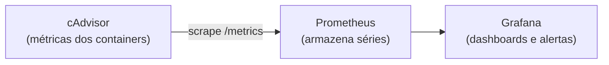

---
tags:
  - docker
  - observabilidade
  - prometheus
  - grafana
  - cadvisor
  - compose
aliases: []
tipo: procedimento
nivel: avancado
criado: 2026-10-24
relacionados:
  - "[[Logs centralizados com Loki]]"
  - "[[Comandos stats e top]]"
  - "[[Limites de recursos - Docker]]"
  - "[[Análise de OOM kill]]"
---

# Métricas com cAdvisor, Prometheus e Grafana

Stack clássica de métricas de containers:



Estrutura:

```text
monitoramento/
├── compose.yaml
└── prometheus.yml
```

`prometheus.yml`:

```yaml
global:
  scrape_interval: 15s

scrape_configs:
  - job_name: cadvisor
    static_configs:
      - targets: ["cadvisor:8080"]
  - job_name: prometheus
    static_configs:
      - targets: ["localhost:9090"]
```

`compose.yaml`:

```yaml
services:
  cadvisor:
    image: gcr.io/cadvisor/cadvisor:v0.49.1
    volumes:
      - /:/rootfs:ro
      - /var/run:/var/run:ro
      - /sys:/sys:ro
      - /var/lib/docker/:/var/lib/docker:ro
    restart: unless-stopped

  prometheus:
    image: prom/prometheus:v2.55.1
    volumes:
      - ./prometheus.yml:/etc/prometheus/prometheus.yml:ro
      - prom_data:/prometheus
    ports:
      - "127.0.0.1:9090:9090"
    depends_on:
      - cadvisor
    restart: unless-stopped

  grafana:
    image: grafana/grafana:11.3.0
    environment:
      GF_SECURITY_ADMIN_PASSWORD: troque-esta-senha
    volumes:
      - grafana_data:/var/lib/grafana
    ports:
      - "127.0.0.1:3000:3000"
    depends_on:
      - prometheus
    restart: unless-stopped

volumes:
  prom_data:
  grafana_data:
```

```bash
docker compose up -d
# Prometheus: http://localhost:9090 (Status → Targets)
# Grafana:    http://localhost:3000 → Data sources → Prometheus → http://prometheus:9090
#             Importe um dashboard para cAdvisor (ID 14282 no grafana.com)
```

## Consultas úteis (PromQL)

```text
rate(container_cpu_usage_seconds_total{name!=""}[5m])
container_memory_working_set_bytes{name!=""}
rate(container_network_receive_bytes_total{name!=""}[5m])
```

> [!warning] cAdvisor monta diretórios sensíveis do host
> Os volumes `rootfs`, `/sys` e `/var/lib/docker` são somente leitura, mas ainda expõem informação do host. Mantenha o cAdvisor em rede interna e não publique a porta.

> [!question] Verificar na documentação oficial
> As versões de imagens acima são ilustrativas e envelhecem; consulte as páginas de cada projeto. Mudanças de versão maior (por exemplo, Prometheus 3) podem alterar flags e comportamento.

> [!tip] Também existe o endpoint nativo
> O próprio daemon pode expor métricas Prometheus (`"metrics-addr": "127.0.0.1:9323"` no `daemon.json`). Verifique na documentação do Engine.

## Exercício

Suba a stack, importe um dashboard para cAdvisor no Grafana e identifique qual container usa mais memória. Depois aplique um limite e observe a mudança.

## Veja também

- [[Logs centralizados com Loki]]
- [[Comandos stats e top]]
- [[Limites de recursos - Docker]]
- [[Análise de OOM kill]]
- [[MOC - Observabilidade e Depuração]]
