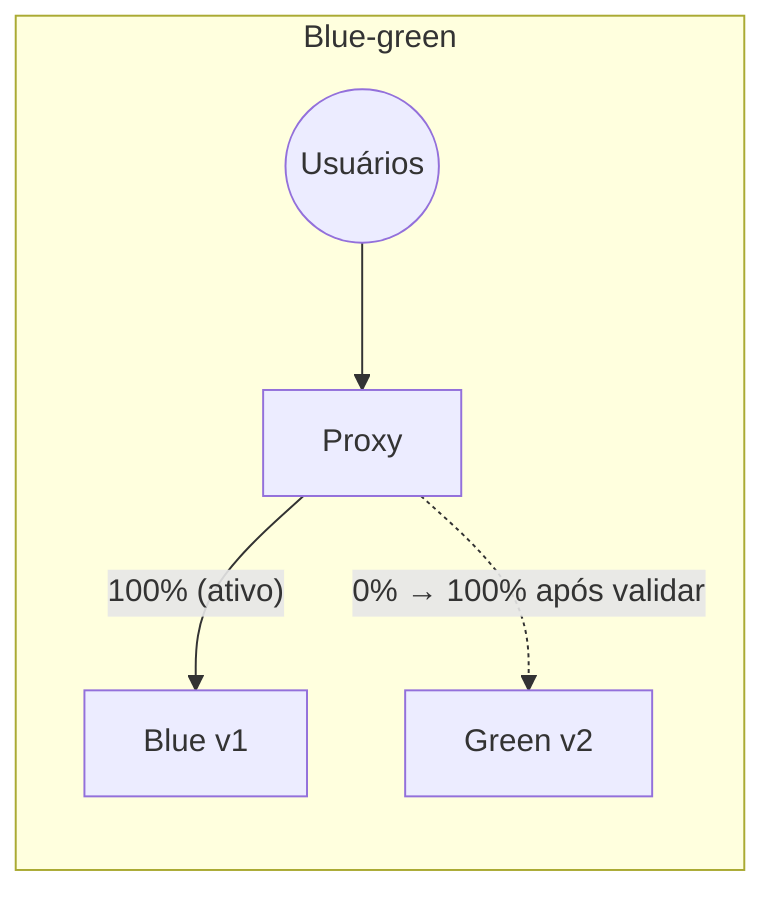

---
tags:
  - docker
  - cicd
  - deploy
aliases: []
tipo: conceito
nivel: avancado
criado: 2026-10-24
relacionados:
  - "[[Atualização sem downtime]]"
  - "[[Atualizações progressivas e rollback]]"
  - "[[Deploy com Compose via SSH]]"
  - "[[Proxy reverso com Traefik]]"
---

# Estratégias de rollout

Como substituir a versão antiga pela nova com **risco e indisponibilidade mínimos**.

| Estratégia | Como funciona | Downtime | Rollback | Custo |
|---|---|---|---|---|
| **Recreate** | Para tudo e sobe a nova versão | **Sim** | Reimplantar a anterior | Baixo |
| **Rolling** | Substitui réplicas aos poucos | Não | Automático/rápido | Baixo |
| **Blue-green** | Dois ambientes completos; troca o tráfego de uma vez | Não | **Instantâneo** (volta o tráfego) | Alto (2x) |
| **Canary** | Pequena fração do tráfego vai à nova versão e cresce | Não | Rápido | Médio |



## Em Swarm: rolling nativo

```bash
docker service update --image meuapp:1.5 --update-order start-first --update-failure-action rollback web
```

## Em Compose de um host: blue-green com proxy (ilustrativo)

```bash
# 1) Nova versão sobe ao lado da antiga (projetos com nomes diferentes, mesma rede do proxy)
APP_TAG=1.5.0 docker compose -p app-green up -d --wait

# 2) O proxy (Traefik/Nginx/Caddy) passa a apontar para o "green" (labels ou upstream)
# 3) Valide; se algo falhar, aponte de volta para o "blue"
# 4) Remova a versão antiga após o período de observação
docker compose -p app-blue down
```

## Canary com Traefik (pesos)

```yaml
# Trecho de configuração dinâmica (arquivo) — 90% v1 e 10% v2
http:
  services:
    app:
      weighted:
        services:
          - name: app-v1
            weight: 90
          - name: app-v2
            weight: 10
```

> [!tip] Requisitos para qualquer estratégia sem downtime
> **Healthchecks** confiáveis, *graceful shutdown* (tratar SIGTERM), migrações de banco **retrocompatíveis** e um proxy ou orquestrador que distribua tráfego somente para instâncias saudáveis.

> [!question] Verificar na documentação oficial
> A sintaxe de pesos do Traefik (serviços ponderados) e a integração com o provider Docker devem ser conferidas na documentação do Traefik.

## Exercício

Escolha a estratégia ideal para: (a) um blog; (b) uma API de pagamentos; (c) uma ferramenta interna. Justifique com base em risco, custo e tolerância a downtime.

## Veja também

- [[Atualização sem downtime]]
- [[Atualizações progressivas e rollback]]
- [[Deploy com Compose via SSH]]
- [[Proxy reverso com Traefik]]
- [[MOC - CI-CD e DevOps]]
