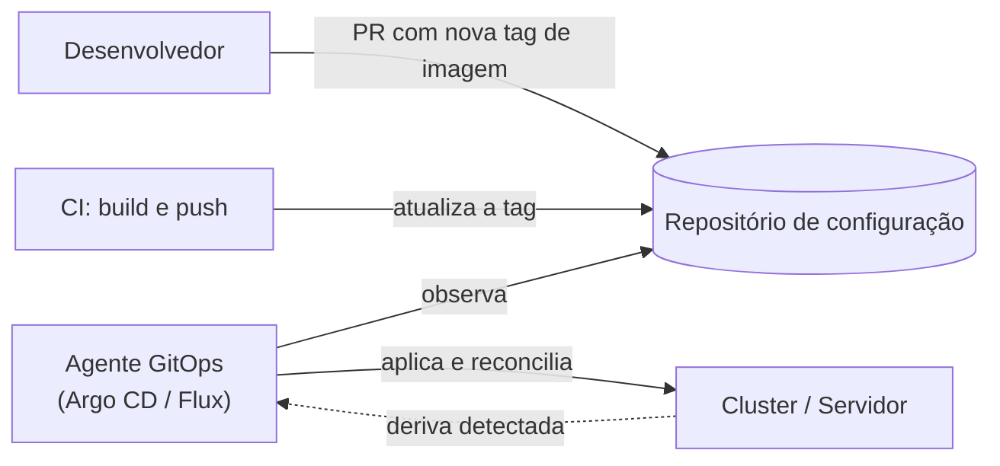

---
tags:
  - docker
  - cicd
  - devops
aliases: []
tipo: conceito
nivel: avancado
criado: 2026-10-24
relacionados:
  - "[[Estratégias de rollout]]"
  - "[[Docker com Terraform e Ansible]]"
  - "[[Compose vs Swarm vs Kubernetes]]"
---

# GitOps introdução

**GitOps** usa o **Git como fonte única da verdade** do estado desejado da infraestrutura e das aplicações. Um agente no ambiente **observa o repositório** e reconcilia o estado real com o declarado.



## Princípios

| Princípio | Significado |
|---|---|
| Declarativo | O estado desejado está descrito em arquivos |
| Versionado e auditável | Cada mudança é um commit/PR revisado |
| Aplicado automaticamente | Um agente **puxa** (pull) e aplica |
| Reconciliação contínua | Desvios manuais são corrigidos ou alertados |

## Com containers

- **Kubernetes**: Argo CD e Flux observam manifests (YAML, Helm, Kustomize).
- **Servidor único com Compose**: o mesmo princípio pode ser aplicado com um agente/script que observa o repositório e roda `docker compose up -d`, ou com ferramentas de gerenciamento que suportam Git.
- **Atualização de imagens**: Renovate/Dependabot (ou *image updaters*) abrem PRs com novas versões; a aprovação do PR é o gatilho do deploy.

```bash
# Exemplo mínimo de reconciliação em um servidor (ilustrativo, executado por um timer/cron)
cd /srv/app-config && git pull --ff-only
docker compose up -d --remove-orphans
```

> [!tip] Benefícios
> Rollback = `git revert`; auditoria completa; ambientes reproduzíveis; menos acesso direto aos servidores.

> [!question] Verificar na documentação oficial
> Ferramentas GitOps para hosts Docker/Compose variam em maturidade e manutenção; avalie o estado atual do projeto antes de adotar.

## Exercício

Descreva como seria o fluxo GitOps do seu projeto: onde ficam os manifests, quem altera a tag da imagem e qual agente aplica.

## Veja também

- [[Estratégias de rollout]]
- [[Docker com Terraform e Ansible]]
- [[Compose vs Swarm vs Kubernetes]]
- [[MOC - CI-CD e DevOps]]
