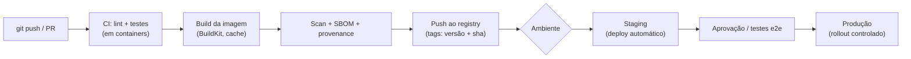

---
tags:
  - docker
  - cicd
  - devops
  - pipeline
  - mermaid
aliases:
  - CI/CD com Docker
tipo: conceito
nivel: intermediario
criado: 2026-10-24
relacionados:
  - "[[GitHub Actions para build e push]]"
  - "[[GitLab CI com Docker]]"
  - "[[Jenkins com Docker]]"
  - "[[Estratégias de rollout]]"
  - "[[Automação de publicação de imagens]]"
---

# Pipeline CI-CD com Docker

**CI/CD** automatiza o caminho do código até a produção. O Docker torna cada etapa **reprodutível**: o mesmo container que passou nos testes é o que vai para produção.

## Princípios

| Princípio | Prática |
|---|---|
| **Construir uma vez, promover** | A mesma imagem (mesmo digest) vai de staging a produção; não reconstrua por ambiente |
| Configuração por ambiente | Variáveis/secrets na execução, nunca na imagem |
| Pipeline como código | `Actions`, `.gitlab-ci.yml`, `Jenkinsfile` versionados |
| Falhar cedo | Lint, testes e varredura antes do push |
| Segredos | Cofres da plataforma, tokens de curta duração (OIDC) |
| Rastreabilidade | Tag `sha-<commit>` + labels OCI + provenance |

> [!tip] Testes dentro de containers
> Use um estágio `test` no Dockerfile ou `docker compose run --rm app pytest`, garantindo que o CI use as mesmas dependências do desenvolvimento. Veja [[Multi-stage builds]] e [[Testes com Testcontainers]].

> [!warning] CI é um alvo de ataque
> Pipelines com acesso a registries e produção são alvos valiosos. Restrinja permissões, fixe versões de actions/imagens e revise contribuições externas.

## Exercício

Desenhe o pipeline do seu projeto (ou de um fictício) com as etapas do diagrama e indique quais ferramentas usaria em cada uma.

## Veja também

- [[GitHub Actions para build e push]]
- [[GitLab CI com Docker]]
- [[Jenkins com Docker]]
- [[Estratégias de rollout]]
- [[Automação de publicação de imagens]]
- [[MOC - CI-CD e DevOps]]
