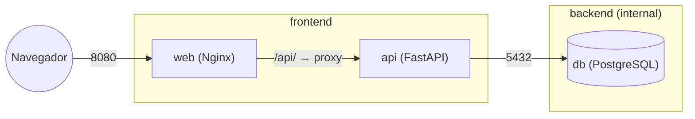

---
tags:
  - docker
  - projetos
  - postgres
  - fastapi
  - nginx
  - compose
  - redes
aliases: []
tipo: projeto
nivel: intermediario
criado: 2026-10-24
relacionados:
  - "[[Persistência de bancos de dados]]"
  - "[[Comunicação entre containers]]"
  - "[[Python em Docker]]"
  - "[[configs e secrets no Compose]]"
  - "[[Projeto 05 - Proxy reverso com Traefik e HTTPS]]"
---

# Projeto 04 - Stack com Postgres, API e frontend

## Objetivos

- Montar uma aplicação em **três camadas**: banco (PostgreSQL), API (FastAPI) e frontend (Nginx + HTML/JS).
- Isolar redes: só o frontend é publicado; a API e o banco ficam internos.
- Usar **secrets** para a senha do banco e healthchecks encadeados.

**Nível:** intermediário · **Tempo estimado:** 60 min



## Estrutura

```text
notas/
├── compose.yaml
├── secrets/
│   └── db_password.txt
├── api/
│   ├── Dockerfile
│   ├── requirements.txt
│   └── main.py
└── web/
    ├── Dockerfile
    ├── default.conf
    └── public/
        └── index.html
```

## API

`api/requirements.txt`:

```text
fastapi==0.115.0
uvicorn[standard]==0.30.6
psycopg[binary]==3.2.3
```

`api/main.py`:

```python
import os
import time
from contextlib import asynccontextmanager

import psycopg
from fastapi import FastAPI
from pydantic import BaseModel


def senha() -> str:
    with open(os.environ["DB_PASSWORD_FILE"], encoding="utf-8") as arquivo:
        return arquivo.read().strip()


def conectar() -> psycopg.Connection:
    return psycopg.connect(
        host=os.environ["DB_HOST"],
        dbname=os.environ["DB_NAME"],
        user=os.environ["DB_USER"],
        password=senha(),
    )


@asynccontextmanager
async def lifespan(app: FastAPI):
    # Cria a tabela; tenta novamente se o banco ainda estiver subindo
    for _ in range(15):
        try:
            with conectar() as conn:
                conn.execute(
                    "CREATE TABLE IF NOT EXISTS notas ("
                    "id SERIAL PRIMARY KEY, "
                    "texto TEXT NOT NULL, "
                    "criada_em TIMESTAMPTZ NOT NULL DEFAULT now())"
                )
            break
        except psycopg.OperationalError:
            time.sleep(2)
    yield


app = FastAPI(title="API de Notas", lifespan=lifespan)


class NotaEntrada(BaseModel):
    texto: str


@app.get("/health")
def saude():
    with conectar() as conn:
        conn.execute("SELECT 1")
    return {"status": "ok"}


@app.get("/notas")
def listar():
    with conectar() as conn:
        linhas = conn.execute(
            "SELECT id, texto, criada_em FROM notas ORDER BY id DESC"
        ).fetchall()
    return [{"id": i, "texto": t, "criada_em": c.isoformat()} for i, t, c in linhas]


@app.post("/notas", status_code=201)
def criar(nota: NotaEntrada):
    with conectar() as conn:
        linha = conn.execute(
            "INSERT INTO notas (texto) VALUES (%s) RETURNING id", (nota.texto,)
        ).fetchone()
    return {"id": linha[0], "texto": nota.texto}
```

`api/Dockerfile`:

```dockerfile
# syntax=docker/dockerfile:1
FROM python:3.12-slim
ENV PYTHONDONTWRITEBYTECODE=1 \
    PYTHONUNBUFFERED=1
WORKDIR /app

COPY requirements.txt .
RUN --mount=type=cache,target=/root/.cache/pip \
    pip install -r requirements.txt

COPY main.py .

RUN useradd --system --uid 10001 --no-create-home app
USER 10001
EXPOSE 8000

CMD ["uvicorn", "main:app", "--host", "0.0.0.0", "--port", "8000"]
```

## Frontend

`web/public/index.html`:

```html
<!doctype html>
<html lang="pt-BR">
<head>
  <meta charset="utf-8">
  <title>Notas</title>
  <style>
    body { font-family: system-ui, sans-serif; max-width: 640px; margin: 2rem auto; }
    li { margin: .25rem 0; }
    input { padding: .4rem; width: 70%; }
  </style>
</head>
<body>
  <h1>Notas</h1>
  <input id="texto" placeholder="Escreva uma nota">
  <button id="salvar">Salvar</button>
  <ul id="lista"></ul>

  <script>
    async function carregar() {
      const resposta = await fetch("/api/notas");
      const notas = await resposta.json();
      const lista = document.getElementById("lista");
      lista.textContent = "";
      for (const nota of notas) {
        const item = document.createElement("li");
        item.textContent = nota.texto;          // textContent evita injeção de HTML
        lista.appendChild(item);
      }
    }

    document.getElementById("salvar").addEventListener("click", async () => {
      const campo = document.getElementById("texto");
      if (!campo.value.trim()) return;
      await fetch("/api/notas", {
        method: "POST",
        headers: { "Content-Type": "application/json" },
        body: JSON.stringify({ texto: campo.value })
      });
      campo.value = "";
      carregar();
    });

    carregar();
  </script>
</body>
</html>
```

`web/default.conf`:

```nginx
server {
  listen 8080;
  server_name _;

  root /usr/share/nginx/html;
  index index.html;

  # Repassa /api/... para a API (o prefixo /api é removido)
  location /api/ {
    proxy_pass http://api:8000/;
    proxy_set_header Host $host;
    proxy_set_header X-Real-IP $remote_addr;
    proxy_set_header X-Forwarded-For $proxy_add_x_forwarded_for;
  }

  location / {
    try_files $uri $uri/ =404;
  }
}
```

`web/Dockerfile`:

```dockerfile
# syntax=docker/dockerfile:1
FROM nginxinc/nginx-unprivileged:1.27-alpine
COPY default.conf /etc/nginx/conf.d/default.conf
COPY public/ /usr/share/nginx/html/
EXPOSE 8080
```

## Compose

`compose.yaml`:

```yaml
services:
  db:
    image: postgres:16
    restart: unless-stopped
    environment:
      POSTGRES_USER: app
      POSTGRES_DB: notas
      POSTGRES_PASSWORD_FILE: /run/secrets/db_password
    secrets:
      - db_password
    volumes:
      - pgdata:/var/lib/postgresql/data
    networks:
      - backend
    healthcheck:
      test: ["CMD-SHELL", "pg_isready -U app -d notas"]
      interval: 5s
      timeout: 3s
      retries: 10
      start_period: 10s

  api:
    build: ./api
    image: notas-api:1.0
    restart: unless-stopped
    environment:
      DB_HOST: db
      DB_NAME: notas
      DB_USER: app
      DB_PASSWORD_FILE: /run/secrets/db_password
    secrets:
      - db_password
    depends_on:
      db:
        condition: service_healthy
    networks:
      - backend
      - frontend
    healthcheck:
      test: ["CMD", "python", "-c", "import urllib.request; urllib.request.urlopen('http://127.0.0.1:8000/health', timeout=3)"]
      interval: 10s
      timeout: 5s
      retries: 5
      start_period: 15s

  web:
    build: ./web
    image: notas-web:1.0
    restart: unless-stopped
    ports:
      - "127.0.0.1:8080:8080"
    depends_on:
      api:
        condition: service_healthy
    networks:
      - frontend

networks:
  backend:
    internal: true
  frontend:

volumes:
  pgdata:

secrets:
  db_password:
    file: ./secrets/db_password.txt
```

## Passo a passo

```bash
mkdir -p notas/secrets && cd notas
printf '%s' "$(openssl rand -base64 24)" > secrets/db_password.txt
chmod 644 secrets/db_password.txt     # o usuário não-root da API precisa ler (ambiente local)
echo "secrets/" > .gitignore
# crie api/ e web/ com os arquivos acima

docker compose up -d --build
docker compose ps
```

## Verificação

```bash
# Pelo frontend (proxy para a API)
curl -s -X POST http://localhost:8080/api/notas -H 'Content-Type: application/json' -d '{"texto":"primeira nota"}'
curl -s http://localhost:8080/api/notas

# Isolamento: a API e o banco NÃO estão publicados no host
docker compose ps --format 'table {{.Service}}\t{{.Ports}}'

# O banco não tem rota para a Internet (rede internal)
docker compose exec db sh -c 'getent hosts example.com || echo "sem saída para a Internet (esperado)"'

# Persistência
docker compose down && docker compose up -d
curl -s http://localhost:8080/api/notas        # a nota continua lá
```

Abra `http://localhost:8080` e adicione notas pela interface.

## Solução de problemas

| Sintoma | Causa provável | Solução |
|---|---|---|
| `api` fica `unhealthy` | Falha ao ler a senha (`Permission denied`) | `chmod 644 secrets/db_password.txt` e recrie |
| `502 Bad Gateway` no `/api/` | API ainda iniciando ou caiu | `docker compose logs api` |
| `password authentication failed` | Senha mudou após a 1ª inicialização do volume | Em laboratório: `docker compose down -v` e recomece |
| Nginx: `host not found in upstream "api"` | Nginx iniciou antes da API existir | Mantenha o `depends_on` com `service_healthy` |
| Frontend não carrega as notas | Caminho `/api/` ou proxy incorreto | Teste com `curl localhost:8080/api/health` |

## Extensões sugeridas

1. Criar **migrações** com Alembic em vez de `CREATE TABLE` na inicialização.
2. Adicionar **Redis** como cache e um serviço de **worker**.
3. Colocar um **proxy com HTTPS** na frente ([[Projeto 05 - Proxy reverso com Traefik e HTTPS]]).
4. Escrever testes de integração com **Testcontainers** ([[Testes com Testcontainers]]).
5. Implantar em um **VPS** com a rotina de backups ([[Hospedagem em VPS com Compose]]).

## Exercício

Adicione `DELETE /notas/{id}` na API e um botão "Apagar" no frontend. Escreva um teste com `curl` que cria, lista, apaga e confirma a remoção.

## Veja também

- [[Persistência de bancos de dados]]
- [[Comunicação entre containers]]
- [[Python em Docker]]
- [[configs e secrets no Compose]]
- [[Projeto 05 - Proxy reverso com Traefik e HTTPS]]
- [[MOC - Projetos - Docker]]
