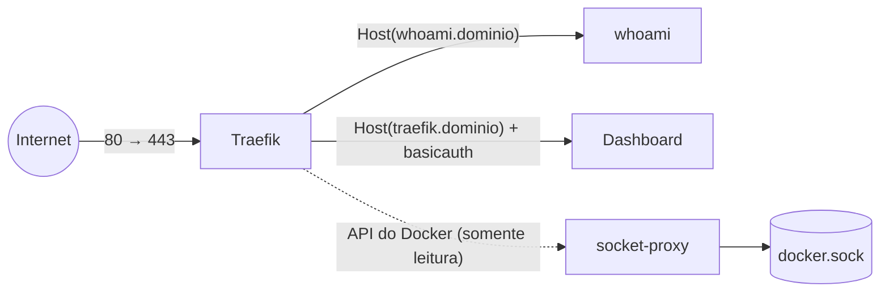

---
tags:
  - docker
  - projetos
  - traefik
  - https
  - proxy-reverso
aliases: []
tipo: projeto
nivel: avancado
criado: 2026-10-24
relacionados:
  - "[[Proxy reverso com Traefik]]"
  - "[[Proteção do docker.sock]]"
  - "[[Nomes e labels]]"
  - "[[Projeto 04 - Stack com Postgres, API e frontend]]"
  - "[[Hospedagem em VPS com Compose]]"
---

# Projeto 05 - Proxy reverso com Traefik e HTTPS

## Objetivos

- Publicar vários serviços atrás de **um único proxy** com **HTTPS automático** (Let's Encrypt).
- Redirecionar HTTP → HTTPS e proteger o **dashboard** com autenticação.
- Reduzir o risco do `docker.sock` usando um **proxy de socket**.

**Nível:** avançado · **Tempo estimado:** 60–90 min



## Pré-requisitos

| Para | Necessário |
|---|---|
| Teste **local** (passo A) | Docker e Compose; certificado autoassinado |
| **Produção** (passo B) | Servidor com IP público, **domínio** com registros DNS `A` para `whoami.SEUDOMINIO` e `traefik.SEUDOMINIO`, portas 80 e 443 liberadas |

## Estrutura

```text
traefik-https/
├── compose.yaml
├── compose.local.yaml
└── .env
```

## Passo A: teste local com certificado autoassinado

`compose.local.yaml`:

```yaml
services:
  traefik:
    image: traefik:v3.6
    command:
      - --providers.docker=true
      - --providers.docker.exposedbydefault=false
      - --entrypoints.web.address=:80
      - --entrypoints.web.http.redirections.entrypoint.to=websecure
      - --entrypoints.web.http.redirections.entrypoint.scheme=https
      - --entrypoints.websecure.address=:443
    ports:
      - "127.0.0.1:80:80"
      - "127.0.0.1:443:443"
    volumes:
      - /var/run/docker.sock:/var/run/docker.sock:ro      # apenas laboratório local

  whoami:
    image: traefik/whoami:v1.10
    labels:
      - traefik.enable=true
      - traefik.http.routers.whoami.rule=Host(`whoami.localhost`)
      - traefik.http.routers.whoami.entrypoints=websecure
      - traefik.http.routers.whoami.tls=true
```

```bash
docker compose -f compose.local.yaml up -d
curl -k --resolve whoami.localhost:443:127.0.0.1 https://whoami.localhost
curl -i --resolve whoami.localhost:80:127.0.0.1 http://whoami.localhost     # 301/308 → https
docker compose -f compose.local.yaml down
```

O certificado é o **padrão autoassinado** do Traefik (por isso o `-k`).

## Passo B: produção com Let's Encrypt

`.env`:

```text
DOMAIN=exemplo.com.br
ACME_EMAIL=voce@exemplo.com.br
# Gere com: htpasswd -nb admin 'SUA-SENHA'  (aspas simples preservam o $)
DASHBOARD_USERS='admin:$apr1$trocar$hashgeradopeloHtpasswd'
```

`compose.yaml`:

```yaml
services:
  socket-proxy:
    image: tecnativa/docker-socket-proxy
    restart: unless-stopped
    environment:
      CONTAINERS: 1
      NETWORKS: 1
      POST: 0
    volumes:
      - /var/run/docker.sock:/var/run/docker.sock:ro
    networks:
      - socket

  traefik:
    image: traefik:v3.6
    restart: unless-stopped
    depends_on:
      - socket-proxy
    command:
      - --providers.docker=true
      - --providers.docker.endpoint=tcp://socket-proxy:2375
      - --providers.docker.exposedbydefault=false
      - --providers.docker.network=proxy
      - --entrypoints.web.address=:80
      - --entrypoints.web.http.redirections.entrypoint.to=websecure
      - --entrypoints.web.http.redirections.entrypoint.scheme=https
      - --entrypoints.websecure.address=:443
      - --certificatesresolvers.le.acme.email=${ACME_EMAIL}
      - --certificatesresolvers.le.acme.storage=/letsencrypt/acme.json
      - --certificatesresolvers.le.acme.httpchallenge.entrypoint=web
      # Use primeiro o ambiente de testes do Let's Encrypt para não estourar limites:
      # - --certificatesresolvers.le.acme.caserver=https://acme-staging-v02.api.letsencrypt.org/directory
      - --api.dashboard=true
      - --log.level=INFO
    ports:
      - "80:80"
      - "443:443"
    volumes:
      - letsencrypt:/letsencrypt
    networks:
      - proxy
      - socket
    labels:
      - traefik.enable=true
      - traefik.http.routers.dashboard.rule=Host(`traefik.${DOMAIN}`)
      - traefik.http.routers.dashboard.entrypoints=websecure
      - traefik.http.routers.dashboard.tls.certresolver=le
      - traefik.http.routers.dashboard.service=api@internal
      - traefik.http.routers.dashboard.middlewares=dashboard-auth
      - traefik.http.middlewares.dashboard-auth.basicauth.users=${DASHBOARD_USERS}

  whoami:
    image: traefik/whoami:v1.10
    restart: unless-stopped
    networks:
      - proxy
    labels:
      - traefik.enable=true
      - traefik.http.routers.whoami.rule=Host(`whoami.${DOMAIN}`)
      - traefik.http.routers.whoami.entrypoints=websecure
      - traefik.http.routers.whoami.tls.certresolver=le
      - traefik.http.services.whoami.loadbalancer.server.port=80

networks:
  proxy:
    name: proxy
  socket:
    internal: true

volumes:
  letsencrypt:
```

```bash
docker compose up -d
docker compose logs -f traefik         # acompanhe a emissão do certificado
curl -I https://whoami.exemplo.com.br
```

> [!tip] Adicionando novos serviços
> Qualquer container com `traefik.enable=true`, os labels de roteador/TLS e conectado à rede `proxy` passa a ser publicado automaticamente, sem tocar no Traefik.

## Verificação

```bash
curl -I http://whoami.SEUDOMINIO                 # redireciona para HTTPS
curl -s https://whoami.SEUDOMINIO | head         # resposta do whoami
curl -i https://traefik.SEUDOMINIO               # 401 sem credenciais
curl -i -u admin:SUA-SENHA https://traefik.SEUDOMINIO/dashboard/    # 200
echo | openssl s_client -connect whoami.SEUDOMINIO:443 -servername whoami.SEUDOMINIO 2>/dev/null | openssl x509 -noout -issuer -dates
```

## Solução de problemas

| Sintoma | Causa provável | Solução |
|---|---|---|
| Certificado "TRAEFIK DEFAULT CERT" | Falha na emissão ACME | Veja os logs; DNS e portas 80/443; use o *staging* primeiro |
| `client version ... is too old` | Traefik antigo com Docker novo | Atualize o Traefik para uma versão recente |
| `404 page not found` | Regra `Host` não corresponde ou serviço fora da rede `proxy` | Confira labels e `providers.docker.network` |
| Provider não vê containers | Permissões do `socket-proxy` | Confira variáveis do proxy de socket e o endpoint |
| `acme.json` permissões | Arquivo do certificado | O Traefik cria com `600`; não monte arquivo externo com permissões abertas |
| 401 mesmo com a senha certa | `$` interpretado | Use aspas simples no `.env` ou dobre os `$$` |

> [!question] Verificar na documentação oficial
> Confirme a tag estável do Traefik, as variáveis necessárias no `docker-socket-proxy` para o provider Docker e a sintaxe de redirecionamento global na documentação do Traefik.

## Extensões sugeridas

1. **Certificado curinga** (`*.dominio`) com *DNS challenge* (Cloudflare, Route 53).
2. Middlewares: *rate limit*, cabeçalhos de segurança, compressão e *IP allow list*.
3. Colocar a stack do [[Projeto 04 - Stack com Postgres, API e frontend]] atrás do Traefik, removendo a porta publicada.
4. Métricas do Traefik no Prometheus ([[Projeto 06 - Monitoramento com Prometheus e Grafana]]).

## Exercício

Acrescente um segundo serviço (por exemplo, `nginx`) com subdomínio próprio e um middleware de *rate limit*, e comprove com um loop de `curl` que o limite é aplicado.

## Veja também

- [[Proxy reverso com Traefik]]
- [[Proteção do docker.sock]]
- [[Nomes e labels]]
- [[Projeto 04 - Stack com Postgres, API e frontend]]
- [[Hospedagem em VPS com Compose]]
- [[MOC - Projetos - Docker]]
