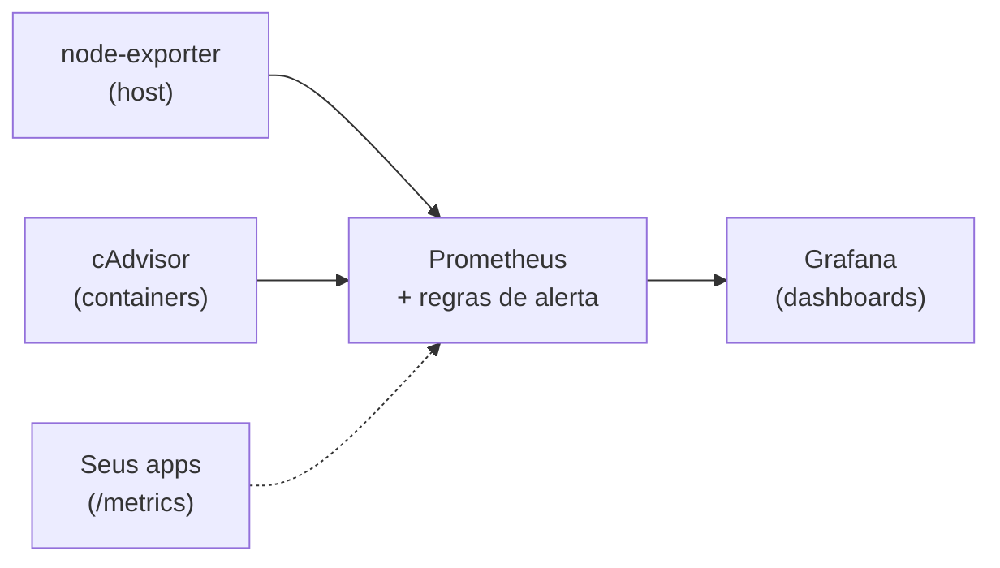

---
tags:
  - docker
  - projetos
  - prometheus
  - grafana
  - cadvisor
  - monitoramento
aliases: []
tipo: projeto
nivel: avancado
criado: 2026-10-24
relacionados:
  - "[[Métricas com cAdvisor, Prometheus e Grafana]]"
  - "[[Monitoramento em produção]]"
  - "[[Análise de OOM kill]]"
  - "[[Projeto 05 - Proxy reverso com Traefik e HTTPS]]"
---

# Projeto 06 - Monitoramento com Prometheus e Grafana

## Objetivos

- Montar uma stack de monitoramento do host e dos containers: **node_exporter**, **cAdvisor**, **Prometheus** e **Grafana**.
- Provisionar **automaticamente** a fonte de dados do Grafana.
- Criar **regras de alerta** e validar com uma carga de teste.

**Nível:** avançado · **Tempo estimado:** 60 min



## Estrutura

```text
monitoramento/
├── compose.yaml
├── prometheus/
│   ├── prometheus.yml
│   └── alerts.yml
└── grafana/
    └── provisioning/
        └── datasources/
            └── prometheus.yml
```

## Configuração

`prometheus/prometheus.yml`:

```yaml
global:
  scrape_interval: 15s
  evaluation_interval: 15s

rule_files:
  - /etc/prometheus/alerts.yml

scrape_configs:
  - job_name: prometheus
    static_configs:
      - targets: ["localhost:9090"]

  - job_name: node
    static_configs:
      - targets: ["node-exporter:9100"]

  - job_name: cadvisor
    static_configs:
      - targets: ["cadvisor:8080"]
```

`prometheus/alerts.yml`:

```yaml
groups:
  - name: host-e-containers
    rules:
      - alert: AlvoForaDoAr
        expr: up == 0
        for: 2m
        labels:
          severity: critical
        annotations:
          summary: "Alvo {{ $labels.job }} ({{ $labels.instance }}) fora do ar"

      - alert: CPUAltaNoHost
        expr: 100 - (avg by (instance) (rate(node_cpu_seconds_total{mode="idle"}[5m])) * 100) > 85
        for: 10m
        labels:
          severity: warning
        annotations:
          summary: "CPU acima de 85% em {{ $labels.instance }}"

      - alert: DiscoQuaseCheio
        expr: (node_filesystem_avail_bytes{fstype!~"tmpfs|overlay"} / node_filesystem_size_bytes{fstype!~"tmpfs|overlay"}) < 0.15
        for: 10m
        labels:
          severity: warning
        annotations:
          summary: "Menos de 15% de espaço livre em {{ $labels.mountpoint }}"

      - alert: ContainerReiniciando
        expr: increase(container_start_time_seconds{name!=""}[15m]) > 0 and changes(container_start_time_seconds{name!=""}[15m]) > 2
        for: 1m
        labels:
          severity: warning
        annotations:
          summary: "Container {{ $labels.name }} reiniciou várias vezes"
```

`grafana/provisioning/datasources/prometheus.yml`:

```yaml
apiVersion: 1
datasources:
  - name: Prometheus
    type: prometheus
    access: proxy
    url: http://prometheus:9090
    isDefault: true
    editable: false
```

`compose.yaml`:

```yaml
services:
  node-exporter:
    image: prom/node-exporter:v1.8.2
    restart: unless-stopped
    command:
      - --path.rootfs=/host
    volumes:
      - /:/host:ro,rslave
    pid: host
    networks: [monitoramento]

  cadvisor:
    image: gcr.io/cadvisor/cadvisor:v0.49.1
    restart: unless-stopped
    volumes:
      - /:/rootfs:ro
      - /var/run:/var/run:ro
      - /sys:/sys:ro
      - /var/lib/docker/:/var/lib/docker:ro
    networks: [monitoramento]

  prometheus:
    image: prom/prometheus:v2.55.1
    restart: unless-stopped
    command:
      - --config.file=/etc/prometheus/prometheus.yml
      - --storage.tsdb.path=/prometheus
      - --storage.tsdb.retention.time=15d
    volumes:
      - ./prometheus/prometheus.yml:/etc/prometheus/prometheus.yml:ro
      - ./prometheus/alerts.yml:/etc/prometheus/alerts.yml:ro
      - prom_data:/prometheus
    ports:
      - "127.0.0.1:9090:9090"
    networks: [monitoramento]

  grafana:
    image: grafana/grafana:11.3.0
    restart: unless-stopped
    environment:
      GF_SECURITY_ADMIN_USER: admin
      GF_SECURITY_ADMIN_PASSWORD__FILE: /run/secrets/grafana_admin
      GF_USERS_ALLOW_SIGN_UP: "false"
    secrets:
      - grafana_admin
    volumes:
      - grafana_data:/var/lib/grafana
      - ./grafana/provisioning:/etc/grafana/provisioning:ro
    ports:
      - "127.0.0.1:3000:3000"
    depends_on:
      - prometheus
    networks: [monitoramento]

networks:
  monitoramento:

volumes:
  prom_data:
  grafana_data:

secrets:
  grafana_admin:
    file: ./secrets/grafana_admin.txt
```

## Passo a passo

```bash
mkdir -p monitoramento/{prometheus,secrets} monitoramento/grafana/provisioning/datasources
cd monitoramento
printf '%s' "$(openssl rand -base64 18)" > secrets/grafana_admin.txt
chmod 644 secrets/grafana_admin.txt
cat secrets/grafana_admin.txt        # anote a senha do usuário admin
# crie os arquivos acima

docker compose up -d
docker compose ps
```

## Verificação

1. **Prometheus**: `http://localhost:9090/targets`: os 3 alvos devem estar `UP`.
2. **Regras**: `http://localhost:9090/alerts` lista os alertas definidos.
3. **Grafana**: `http://localhost:3000` (usuário `admin`, senha do arquivo). Em **Dashboards → New → Import**, importe os IDs **1860** (Node Exporter Full) e **14282** (cAdvisor).
4. **Carga de teste**:

```bash
docker run --rm --name estresse --cpus 1 alpine:3.20 sh -c 'while :; do :; done' &
# observe o container "estresse" aparecer nos gráficos de CPU do cAdvisor
docker rm -f estresse
```

```bash
# Consulta direta pela API
curl -s 'http://localhost:9090/api/v1/query?query=up' | head -c 400
```

## Solução de problemas

| Sintoma | Causa provável | Solução |
|---|---|---|
| Alvo `cadvisor` DOWN | Container reiniciou ou erro de montagem | `docker compose logs cadvisor` |
| Sem métricas por nome de container | Runtime/cgroup não detectado | Confira versão do cAdvisor e cgroup v2 |
| Grafana sem datasource | Provisioning não montado | Verifique o caminho `/etc/grafana/provisioning/datasources` |
| `GF_..._FILE` ignorado | Nome da variável incorreto | Use `GF_SECURITY_ADMIN_PASSWORD__FILE` (dois sublinhados) |
| Prometheus não inicia: regra inválida | Erro de YAML/PromQL | `docker run --rm -v "$PWD/prometheus":/p --entrypoint promtool prom/prometheus:v2.55.1 check rules /p/alerts.yml` |

> [!warning] Exposição
> O cAdvisor e o node-exporter revelam informações do host. Não publique suas portas; mantenha-os na rede interna e publique somente Prometheus/Grafana em `127.0.0.1` (ou atrás de proxy com autenticação, como no [[Projeto 05 - Proxy reverso com Traefik e HTTPS]]).

> [!question] Verificar na documentação oficial
> As versões fixadas são ilustrativas. Confirme as tags atuais e eventuais mudanças de flags, principalmente entre as séries 2.x e 3.x do Prometheus.

## Extensões sugeridas

1. Adicionar o **Alertmanager** para enviar notificações (e-mail, Slack, Telegram).
2. Adicionar **Loki** para logs e correlacioná-los no Grafana ([[Logs centralizados com Loki]]).
3. Expor métricas do seu app (`/metrics`) com uma biblioteca cliente do Prometheus e criar um dashboard.
4. Monitorar o próprio daemon (`metrics-addr` no `daemon.json`).

## Exercício

Escreva uma nova regra de alerta que dispare quando um container usar mais de 90% do seu limite de memória, valide com `promtool` e force o disparo com um container limitado.

## Veja também

- [[Métricas com cAdvisor, Prometheus e Grafana]]
- [[Monitoramento em produção]]
- [[Análise de OOM kill]]
- [[Projeto 05 - Proxy reverso com Traefik e HTTPS]]
- [[MOC - Projetos - Docker]]
