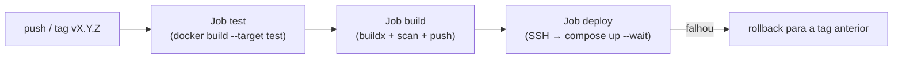

---
tags:
  - docker
  - projetos
  - cicd
  - github-actions
  - deploy
  - ssh
  - rollback
aliases: []
tipo: projeto
nivel: avancado
criado: 2026-10-24
relacionados:
  - "[[Pipeline CI-CD com Docker]]"
  - "[[GitHub Actions para build e push]]"
  - "[[Deploy com Compose via SSH]]"
  - "[[Tagging e versionamento semântico em CI]]"
  - "[[Projeto 02 - API Node.js containerizada]]"
---

# Projeto 07 - Pipeline CI-CD completo

## Objetivos

Automatizar o caminho **do commit à produção** para a API do [[Projeto 02 - API Node.js containerizada]]:

1. **Testes** dentro de container.
2. **Build** multiplataforma com cache, **varredura** de vulnerabilidades, **SBOM e provenance**.
3. **Publicação** no GHCR com tags `semver` e `sha`.
4. **Deploy por SSH** com `docker compose`, verificação de saúde e **rollback automático**.

**Nível:** avançado · **Tempo estimado:** 2 h



## Estrutura do repositório

```text
api-node/
├── .github/
│   └── workflows/
│       └── ci-cd.yml
├── deploy/
│   ├── compose.yaml          # copiado para o servidor (/srv/app)
│   └── deploy.sh
├── Dockerfile                # do Projeto 02 (alvos dev, test, prod)
├── server.js  package.json  package-lock.json  test/
└── .dockerignore
```

## Servidor (uma vez)

```bash
# No servidor, com Docker instalado
sudo adduser --disabled-password deploy && sudo usermod -aG docker deploy
sudo mkdir -p /srv/app && sudo chown deploy:deploy /srv/app

# Login no GHCR com um token apenas de leitura de pacotes (read:packages)
echo "$TOKEN_LEITURA" | sudo -u deploy docker login ghcr.io -u SEU_USUARIO --password-stdin
```

`deploy/compose.yaml`:

```yaml
services:
  api:
    image: ghcr.io/SEU_USUARIO/api-node:${APP_TAG:?defina APP_TAG}
    restart: unless-stopped
    init: true
    read_only: true
    cap_drop: [ALL]
    security_opt:
      - no-new-privileges:true
    ports:
      - "127.0.0.1:3000:3000"
    healthcheck:
      test: ["CMD-SHELL", "wget -qO- http://127.0.0.1:3000/health || exit 1"]
      interval: 10s
      timeout: 3s
      retries: 5
      start_period: 10s
```

`deploy/deploy.sh`:

```bash
#!/usr/bin/env bash
set -euo pipefail

NOVA="${1:?Informe a tag a implantar}"
cd /srv/app

ANTERIOR="$(cat .current_tag 2>/dev/null || true)"

export APP_TAG="$NOVA"
docker compose pull

if docker compose up -d --remove-orphans --wait --wait-timeout 90; then
  echo "$NOVA" > .current_tag
  docker image prune -f >/dev/null
  echo "Deploy de $NOVA concluído."
else
  echo "Falha ao implantar $NOVA."
  if [ -n "$ANTERIOR" ]; then
    echo "Rollback para $ANTERIOR..."
    export APP_TAG="$ANTERIOR"
    docker compose up -d --remove-orphans --wait --wait-timeout 90
  fi
  exit 1
fi
```

## Segredos do GitHub (Settings → Secrets and variables → Actions)

| Nome | Conteúdo |
|---|---|
| `DEPLOY_HOST` | Endereço do servidor |
| `DEPLOY_USER` | `deploy` |
| `DEPLOY_SSH_KEY` | Chave privada **dedicada** ao deploy |
| `DEPLOY_KNOWN_HOSTS` | Saída de `ssh-keyscan -H servidor` (verificada previamente) |

Crie também um **Environment** `production` com aprovação manual obrigatória (opcional, recomendado).

## Workflow

`.github/workflows/ci-cd.yml`:

```yaml
name: ci-cd

on:
  push:
    branches: [main]
    tags: ["v*.*.*"]
  pull_request:

permissions:
  contents: read
  packages: write

env:
  IMAGEM: ghcr.io/${{ github.repository }}

jobs:
  test:
    runs-on: ubuntu-latest
    steps:
      - uses: actions/checkout@v4
      - uses: docker/setup-buildx-action@v3
      - name: Testes no container
        run: |
          docker buildx build --target test --load -t api-node:test .
          docker run --rm api-node:test

  build:
    needs: test
    runs-on: ubuntu-latest
    outputs:
      versao: ${{ steps.meta.outputs.version }}
    steps:
      - uses: actions/checkout@v4
      - uses: docker/setup-qemu-action@v3
      - uses: docker/setup-buildx-action@v3

      - name: Login no GHCR
        if: github.event_name != 'pull_request'
        uses: docker/login-action@v3
        with:
          registry: ghcr.io
          username: ${{ github.actor }}
          password: ${{ secrets.GITHUB_TOKEN }}

      - name: Metadados
        id: meta
        uses: docker/metadata-action@v5
        with:
          images: ${{ env.IMAGEM }}
          tags: |
            type=semver,pattern={{version}}
            type=semver,pattern={{major}}.{{minor}}
            type=ref,event=branch
            type=sha

      - name: Build local para varredura
        uses: docker/build-push-action@v6
        with:
          context: .
          target: prod
          load: true
          tags: api-node:scan
          cache-from: type=gha
          cache-to: type=gha,mode=max

      - name: Varredura de vulnerabilidades (falha em CRITICAL)
        uses: aquasecurity/trivy-action@0.28.0
        with:
          image-ref: api-node:scan
          severity: CRITICAL
          ignore-unfixed: true
          exit-code: "1"

      - name: Build multiplataforma e push
        if: github.event_name != 'pull_request'
        uses: docker/build-push-action@v6
        with:
          context: .
          target: prod
          platforms: linux/amd64,linux/arm64
          push: true
          tags: ${{ steps.meta.outputs.tags }}
          labels: ${{ steps.meta.outputs.labels }}
          cache-from: type=gha
          sbom: true
          provenance: mode=max

  deploy:
    if: startsWith(github.ref, 'refs/tags/v')
    needs: build
    runs-on: ubuntu-latest
    environment: production
    steps:
      - uses: actions/checkout@v4

      - name: Configura SSH
        run: |
          install -m 700 -d ~/.ssh
          printf '%s\n' "${{ secrets.DEPLOY_SSH_KEY }}" > ~/.ssh/id_ed25519
          chmod 600 ~/.ssh/id_ed25519
          printf '%s\n' "${{ secrets.DEPLOY_KNOWN_HOSTS }}" > ~/.ssh/known_hosts

      - name: Copia arquivos de deploy
        run: |
          scp deploy/compose.yaml deploy/deploy.sh \
            ${{ secrets.DEPLOY_USER }}@${{ secrets.DEPLOY_HOST }}:/srv/app/

      - name: Implanta (com rollback automático)
        run: |
          ssh ${{ secrets.DEPLOY_USER }}@${{ secrets.DEPLOY_HOST }} \
            "chmod +x /srv/app/deploy.sh && /srv/app/deploy.sh ${{ needs.build.outputs.versao }}"
```

> [!question] Verificar na documentação oficial
> Atualize as versões das actions (inclusive `aquasecurity/trivy-action@0.28.0`, que deve ser **fixada pelo SHA do commit** em produção) e confirme os parâmetros atuais de cada uma. O backend `type=gha` também pode ter mudado.

## Passo a passo

1. Crie o repositório, adicione os arquivos e configure os segredos.
2. Abra um PR: apenas **test** e **build/scan** rodam (sem push).
3. Faça merge em `main`: publica `main` e `sha-...`.
4. Crie a tag de release:

```bash
git tag v1.0.0
git push origin v1.0.0
```

O pipeline publica `1.0.0`, `1.0` e `sha-...`, e **implanta** a versão `1.0.0` no servidor.

## Verificação

```bash
# No servidor
docker compose -f /srv/app/compose.yaml ps
curl -s http://127.0.0.1:3000/health
cat /srv/app/.current_tag

# Imagem publicada e seus atestados
docker buildx imagetools inspect ghcr.io/SEU_USUARIO/api-node:1.0.0
```

**Teste o rollback:** quebre o app de propósito (por exemplo, remova a rota `/health`), crie a tag `v1.0.1` e observe o `deploy.sh` reverter para `1.0.0`.

## Solução de problemas

| Sintoma | Causa provável | Solução |
|---|---|---|
| `denied` ao fazer pull no servidor | Servidor sem login no GHCR ou pacote privado | `docker login ghcr.io` com token `read:packages` |
| `Host key verification failed` | `known_hosts` ausente/incorreto | Gere com `ssh-keyscan -H` e confira a impressão digital |
| Trivy falha o build | CVE crítica na base | Atualize a imagem base; reavalie se há correção |
| `needs.build.outputs.versao` vazio | Evento sem tag semver | O deploy só roda em tags `v*.*.*` |
| `--wait` expira | Healthcheck falhando | `docker compose logs api` no servidor |

## Extensões sugeridas

1. **Assinar** a imagem com Cosign (keyless) e verificar antes do deploy ([[Assinatura de imagens com Cosign e Content Trust]]).
2. Ambiente de **staging** com deploy automático e produção com aprovação.
3. Substituir o SSH por **GitOps** ([[GitOps introdução]]).
4. Usar **blue-green** no servidor ([[Estratégias de rollout]]).
5. Notificar o resultado no Slack/Telegram ao final do pipeline.

## Exercício

Execute o pipeline com uma tag `v1.0.0` e depois com uma versão propositalmente quebrada `v1.0.1`. Documente os logs do rollback e o tempo total de recuperação.

## Veja também

- [[Pipeline CI-CD com Docker]]
- [[GitHub Actions para build e push]]
- [[Deploy com Compose via SSH]]
- [[Tagging e versionamento semântico em CI]]
- [[Projeto 02 - API Node.js containerizada]]
- [[MOC - Projetos - Docker]]
