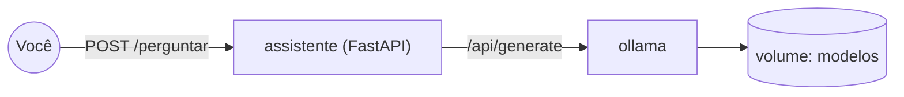

---
tags:
  - docker
  - projetos
  - ia
  - llm
  - ollama
  - fastapi
  - compose
aliases: []
tipo: projeto
nivel: intermediario
criado: 2026-10-24
relacionados:
  - "[[Ambientes para ML e LLMs]]"
  - "[[Docker Model Runner]]"
  - "[[Containers com GPU e NVIDIA Container Toolkit]]"
  - "[[Python em Docker]]"
  - "[[Projeto 04 - Stack com Postgres, API e frontend]]"
---

# Projeto 09 - IA local com Ollama e aplicação

## Objetivos

- Executar um **LLM local** em container (Ollama) e consumi-lo por uma **API própria** (FastAPI).
- Persistir modelos em **volume**, aplicar **healthchecks** e manter tudo **fora da Internet**.
- (Opcional) usar **GPU NVIDIA** e comparar com o **Docker Model Runner**.

**Nível:** intermediário · **Tempo estimado:** 45 min (mais o download do modelo)



## Estrutura

```text
ia-local/
├── compose.yaml
└── assistente/
    ├── Dockerfile
    ├── requirements.txt
    └── main.py
```

## Arquivos

`assistente/requirements.txt`:

```text
fastapi==0.115.0
uvicorn[standard]==0.30.6
httpx==0.27.2
```

`assistente/main.py`:

```python
import os

import httpx
from fastapi import FastAPI, HTTPException
from pydantic import BaseModel

OLLAMA_URL = os.environ.get("OLLAMA_URL", "http://ollama:11434")
MODELO = os.environ.get("MODELO", "qwen2.5:0.5b")

app = FastAPI(title="Assistente local")


class Pergunta(BaseModel):
    texto: str


@app.get("/health")
def saude():
    return {"status": "ok", "modelo": MODELO}


@app.post("/perguntar")
def perguntar(pergunta: Pergunta):
    try:
        resposta = httpx.post(
            f"{OLLAMA_URL}/api/generate",
            json={"model": MODELO, "prompt": pergunta.texto, "stream": False},
            timeout=180,
        )
        resposta.raise_for_status()
    except httpx.HTTPError as erro:
        raise HTTPException(status_code=502, detail=f"Falha ao consultar o modelo: {erro}")
    return {"resposta": resposta.json()["response"]}
```

`assistente/Dockerfile`:

```dockerfile
# syntax=docker/dockerfile:1
FROM python:3.12-slim
ENV PYTHONDONTWRITEBYTECODE=1 PYTHONUNBUFFERED=1
WORKDIR /app
COPY requirements.txt .
RUN --mount=type=cache,target=/root/.cache/pip pip install -r requirements.txt
COPY main.py .
RUN useradd --system --uid 10001 --no-create-home app
USER 10001
EXPOSE 8000
CMD ["uvicorn", "main:app", "--host", "0.0.0.0", "--port", "8000"]
```

`compose.yaml`:

```yaml
services:
  ollama:
    image: ollama/ollama:latest          # em uso real, fixe uma versão
    restart: unless-stopped
    volumes:
      - ollama_models:/root/.ollama
    networks:
      - interna
    healthcheck:
      test: ["CMD", "ollama", "list"]
      interval: 10s
      timeout: 5s
      retries: 10
    # Para usar GPU NVIDIA, descomente:
    # deploy:
    #   resources:
    #     reservations:
    #       devices:
    #         - driver: nvidia
    #           count: all
    #           capabilities: [gpu]

  assistente:
    build: ./assistente
    image: assistente-local:1.0
    restart: unless-stopped
    environment:
      OLLAMA_URL: http://ollama:11434
      MODELO: qwen2.5:0.5b
    depends_on:
      ollama:
        condition: service_healthy
    ports:
      - "127.0.0.1:8000:8000"
    networks:
      - interna

networks:
  interna:

volumes:
  ollama_models:
```

## Passo a passo

```bash
docker compose up -d --build

# Baixa o modelo (uma vez; fica no volume)
docker compose exec ollama ollama pull qwen2.5:0.5b
docker compose exec ollama ollama list
```

## Verificação

```bash
curl -s http://localhost:8000/health

curl -s -X POST http://localhost:8000/perguntar \
  -H 'Content-Type: application/json' \
  -d '{"texto":"Explique em duas frases o que é um container Docker."}'
```

A API está em `http://localhost:8000/docs` (documentação interativa do FastAPI).

**Persistência dos modelos:**

```bash
docker compose down            # sem -v
docker compose up -d
docker compose exec ollama ollama list      # o modelo continua baixado
```

## Variante com Docker Model Runner

```bash
docker model pull ai/smollm2
docker model run ai/smollm2 "Explique containers em uma frase."
```

O `assistente` pode chamar a API compatível com OpenAI do Model Runner (veja [[Docker Model Runner]]) em vez do Ollama, trocando a URL e o formato do corpo da requisição (`/engines/v1/chat/completions`).

## Solução de problemas

| Sintoma | Causa provável | Solução |
|---|---|---|
| `model not found` | Modelo não baixado | `ollama pull` e confira o nome em `MODELO` |
| Resposta muito lenta | CPU sem aceleração, modelo grande | Use modelo menor, ou GPU |
| `502` do assistente | Ollama indisponível ou *timeout* | `docker compose logs ollama`; aumente o timeout |
| Container morto (137) | Falta de memória | Modelo menor; ajuste a memória do Docker Desktop/VM |
| `could not select device driver "nvidia"` | NVIDIA Container Toolkit ausente | Veja [[Containers com GPU e NVIDIA Container Toolkit]] |

> [!warning] Segurança
> O Ollama **não tem autenticação**. Aqui ele não publica portas no host (somente na rede `interna`). Se precisar expô-lo, coloque um proxy autenticado na frente.

> [!question] Verificar na documentação oficial
> Confirme o nome atual do modelo (`qwen2.5:0.5b`) na biblioteca do Ollama e as tags/versões da imagem; considere licenças dos modelos antes de uso comercial.

## Extensões sugeridas

1. Adicionar **interface web** (Open WebUI) apontando para o Ollama.
2. Implementar **RAG** simples com um banco vetorial (`pgvector` no Postgres do [[Projeto 04 - Stack com Postgres, API e frontend]]).
3. Rodar sobre **GPU** e comparar tempo de resposta CPU vs GPU.
4. Executar o assistente como **servidor MCP** em container ([[MCP e containers]]).

## Exercício

Meça o tempo de resposta para a mesma pergunta com dois modelos de tamanhos diferentes e registre uso de CPU/memória com `docker stats` durante a inferência.

## Veja também

- [[Ambientes para ML e LLMs]]
- [[Docker Model Runner]]
- [[Containers com GPU e NVIDIA Container Toolkit]]
- [[Python em Docker]]
- [[Projeto 04 - Stack com Postgres, API e frontend]]
- [[MOC - Projetos - Docker]]
