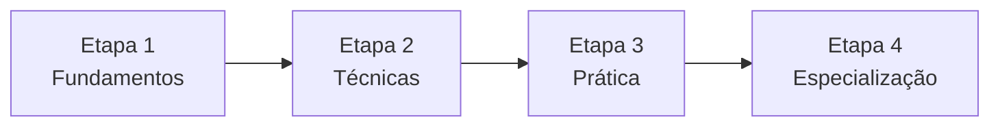

# Trilha de aprendizado - Jailbreaking

Voltar ao [[Índice - Jailbreaking]].

> [!info] Estimativas de tempo
> Os tempos abaixo assumem cerca de 5 a 8 horas por semana, para quem tem conhecimentos básicos de informática. Ajuste ao seu ritmo.

## Etapa 1 — Fundamentos

**Duração estimada:** 2 a 3 semanas

**Objetivos**
- Explicar o que é um LLM e como gera texto (tokens, contexto, inferência).
- Distinguir treinamento, *fine-tuning* e inferência.
- Entender a hierarquia entre system prompt, developer e usuário.
- Compreender alinhamento, guardrails e mecanismos de recusa.

**Pré-requisitos:** noções de programação (Python básico), uso de terminal, leitura de inglês técnico.

**Notas:** [[O que é um LLM]], [[Como funcionam os LLMs]], [[Tokens e Contexto]], [[System Prompt e Hierarquia de Instruções]], [[Alinhamento e Guardrails]]

**Atividades práticas**
- Tokenizar frases em um tokenizador local e comparar contagens em português e inglês.
- Escrever um system prompt simples para um assistente fictício e observar o comportamento.

**Critérios de conclusão**
- [ ] Desenha, sem consulta, o fluxo entrada → tokens → modelo → saída.
- [ ] Explica por que um system prompt não é um controle de segurança absoluto.
- [ ] Acerta ao menos 80% do [[Questionário de Fundamentos]].

## Etapa 2 — Técnicas

**Duração estimada:** 3 a 4 semanas

**Objetivos**
- Definir jailbreak e diferenciá-lo de prompt injection, extração de prompts, alucinação e falha de autorização.
- Dominar a taxonomia por objetivo, vetor, superfície e impacto.
- Analisar famílias de técnicas do ponto de vista de mecanismo, limites, detecção e mitigação.

**Pré-requisitos:** Etapa 1 concluída.

**Notas:** pastas 02, 03 e 04.

**Atividades práticas**
- Classificar cenários fictícios na [[Taxonomia de Ataques]].
- Redigir, para cada família, um quadro "por que pode falhar" e "como detectar".

**Critérios de conclusão**
- [ ] Classifica 10 cenários fictícios sem erro de categoria.
- [ ] Explica por que um mesmo ataque funciona em um modelo e falha em outro.
- [ ] Mostra um sistema vulnerável mesmo sem jailbreak tradicional.

## Etapa 3 — Prática

**Duração estimada:** 3 a 4 semanas

**Objetivos**
- Executar experimentos controlados e reprodutíveis.
- Medir taxa de sucesso de ataque, recusa indevida e robustez.
- Documentar evidências de forma que outra pessoa consiga repetir.

**Pré-requisitos:** Etapa 2 concluída; ambiente local (por exemplo, um modelo aberto rodando em máquina própria) ou API própria, com ciência de custos e privacidade.

**Notas:** pasta 05 e pasta 06.

**Atividades práticas:** os cinco laboratórios, do [[Laboratório 01 - Comportamento de Recusa]] ao [[Laboratório 05 - Avaliação Comparativa]].

**Critérios de conclusão**
- [ ] Matriz de testes preenchida com repetições (nunca uma única execução).
- [ ] Relatório de laboratório para cada experimento.
- [ ] Análise de falsos positivos e falsos negativos registrada.

## Etapa 4 — Especialização

**Duração estimada:** 4 a 6 semanas

**Objetivos**
- Conduzir uma avaliação de red teaming completa, do escopo ao reteste.
- Analisar riscos de agentes, RAG e memória.
- Projetar defesa em camadas e plano de monitoramento.
- Ler e resumir criticamente artigos científicos.

**Pré-requisitos:** Etapa 3 concluída.

**Notas:** pastas 07, 08 e 09.

**Atividades práticas:** [[Projeto Final]] sobre uma aplicação fictícia baseada em LLM.

**Critérios de conclusão**
- [ ] Relatório técnico final com modelo de ameaças, casos de teste, classificação de risco e plano de reteste.
- [ ] Resumo crítico de ao menos três artigos de [[Artigos Científicos]].
- [ ] Autoavaliação pela rubrica do projeto final.

## Resumo

| Etapa | Foco | Tempo | Entrega |
|---|---|---|---|
| 1 | Fundamentos | 2–3 semanas | Questionário ≥ 80% |
| 2 | Técnicas | 3–4 semanas | Classificação de cenários |
| 3 | Prática | 3–4 semanas | Matriz de testes e relatórios |
| 4 | Especialização | 4–6 semanas | Projeto final |

Total aproximado: **12 a 17 semanas**.
