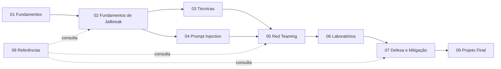

# Índice - Jailbreaking

> [!abstract] Sobre este material
> Curso de autoestudo, em português, sobre como modelos de linguagem de grande escala (*Large Language Models*, LLMs) podem ter suas regras de comportamento contornadas, como esses desvios são **testados de forma autorizada** e como **defender** sistemas contra eles. O foco é compreender mecanismos, medir robustez e construir contramedidas.

> [!warning] Uso responsável
> Todo o conteúdo é voltado a pesquisa, educação e avaliação de segurança **autorizada**. Os laboratórios usam ambientes próprios, dados fictícios e exemplos inofensivos. Não use estas técnicas contra sistemas de terceiros sem autorização expressa, nem para obter conteúdo nocivo ou dados confidenciais.

## Como usar esta base

1. Leia o [[Trilha de aprendizado - Jailbreaking]] para escolher o ritmo.
2. Siga as pastas na ordem numérica; cada nota lista pré-requisitos, conceitos relacionados e próximos passos.
3. Faça os laboratórios em ambiente isolado e registre tudo com o [[Template de Laboratório]].
4. Use o [[Template de Estudo]] para suas próprias anotações e o [[Template de Vulnerabilidade]] para relatar achados.
5. Consulte o [[Glossário#Segurança de IA (jailbreaking e prompt injection)]] sempre que um termo novo aparecer.

## Mapa do curso

## Índice geral

Legenda de status: ✅ concluída · 🚧 em desenvolvimento · ⏳ pendente

### 01 — Fundamentos

| Nota | Status |
|---|---|
| [[O que é um LLM]] | ✅ |
| [[Como funcionam os LLMs]] | ✅ |
| [[Tokens e Contexto]] | ✅ |
| [[System Prompt e Hierarquia de Instruções]] | ✅ |
| [[Alinhamento e Guardrails]] | ✅ |

### 02 — Fundamentos de Jailbreak

| Nota | Status |
|---|---|
| [[O que é AI Jailbreaking]] | ✅ |
| [[Jailbreak vs Prompt Injection]] | ✅ |
| [[Taxonomia de Ataques]] | ✅ |
| [[Limitações dos Modelos]] | ✅ |

### 03 — Técnicas de Jailbreak

| Nota | Status |
|---|---|
| [[Ataques Diretos]] | ✅ |
| [[Roleplay e Personificação]] | ✅ |
| [[Obfuscação e Codificação]] | ✅ |
| [[Ataques Multilíngues]] | ✅ |
| [[Jailbreak Multiturno]] | ✅ |
| [[Ataques Baseados em Contexto]] | ✅ |
| [[Jailbreak Multimodal]] | ✅ |
| [[Ataques Adaptativos e Transferência]] | ✅ |

### 04 — Prompt Injection

| Nota | Status |
|---|---|
| [[Conceitos Fundamentais]] | ✅ |
| [[Injeção Direta]] | ✅ |
| [[Injeção Indireta]] | ✅ |
| [[Ataques Contra Agentes de IA]] | ✅ |

### 05 — Red Teaming

| Nota | Status |
|---|---|
| [[Metodologia de Testes]] | ✅ |
| [[Planejamento de Avaliações]] | ✅ |
| [[Métricas e Critérios de Sucesso]] | ✅ |
| [[Relatório de Vulnerabilidades]] | ✅ |

### 06 — Laboratórios

| Nota | Status |
|---|---|
| [[README - Kit de Laboratório]] (instalação e uso do `labkit`; **leia primeiro**) | ✅ |
| [[Laboratório 01 - Comportamento de Recusa]] | ✅ |
| [[Laboratório 02 - Robustez a Instruções]] | ✅ |
| [[Laboratório 03 - Prompt Injection]] | ✅ |
| [[Laboratório 04 - Defesa em Camadas]] | ✅ |
| [[Laboratório 05 - Avaliação Comparativa]] | ✅ |

### 07 — Defesa e Mitigação

| Nota | Status |
|---|---|
| [[Defesa em Camadas]] | ✅ |
| [[Validação de Entradas e Saídas]] | ✅ |
| [[Segurança de Agentes]] | ✅ |
| [[Monitoramento e Resposta]] | ✅ |

Código de apoio do módulo (testado, só biblioteca padrão): `07 - Defesa e Mitigação/codigo/` com `contrato_saida.py`, `politica_ferramentas.py`, `alertas.py`, `gate_regressao.py` e `test_defesas.py` (31 testes; `python3 -I -m unittest` dentro da pasta).

### 08 — Pesquisa e Referências

| Nota | Status |
|---|---|
| [[OWASP para Aplicações de LLM]] | ✅ |
| [[MITRE ATLAS]] | ✅ |
| [[Artigos Científicos]] | ✅ |
| [[Glossário#Segurança de IA (jailbreaking e prompt injection)]] | ✅ |

### 09 — Exercícios e Avaliações

| Nota | Status |
|---|---|
| [[Questionário de Fundamentos]] | ✅ |
| [[Desafios Práticos]] | ✅ |
| [[Projeto Final]] | ✅ |

### Templates e planejamento

| Nota | Status |
|---|---|
| [[Trilha de aprendizado - Jailbreaking]] | ✅ |
| [[Template de Estudo]] | ✅ |
| [[Template de Laboratório]] | ✅ |
| [[Template de Vulnerabilidade]] | ✅ |

## Acompanhamento pessoal

- [ ] Etapa 1 — Fundamentos concluída
- [ ] Etapa 2 — Técnicas concluída
- [ ] Etapa 3 — Prática concluída
- [ ] Etapa 4 — Especialização concluída
- [ ] Projeto final entregue

## Regras de pesquisa deste material

> [!note] Verificabilidade
> Referências (OWASP, MITRE ATLAS, NIST, artigos) só entram com nome, autores, data/versão e link **verificados em fonte primária**. Quando algo não puder ser confirmado, a nota dirá isso explicitamente. Cada referência traz a data da consulta.

## Próximos passos

Comece pelo [[Trilha de aprendizado - Jailbreaking]] e depois abra [[O que é um LLM]].
