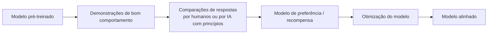
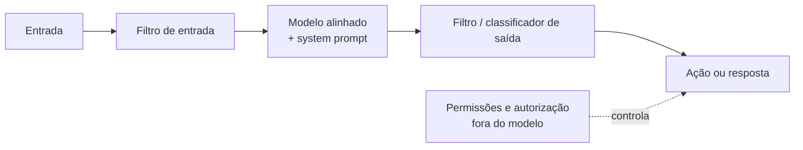

# Alinhamento e Guardrails

Pré-requisito: [[System Prompt e Hierarquia de Instruções]]

## 1. Definição

> [!info] Definições
> - **Alinhamento** (*alignment*): conjunto de métodos para que o comportamento do modelo corresponda às intenções e valores de quem o desenvolve e usa (ser útil, honesto e evitar danos).
> - **Treinamento de segurança** (*safety training*): parte do alinhamento que ensina o modelo a evitar ou recusar certos conteúdos e ações.
> - **Recusa** (*refusal*): resposta em que o modelo declina atender, total ou parcialmente.
> - **Guardrails:** controles que limitam o comportamento do sistema. Podem estar **no modelo** (treinamento), **ao redor do modelo** (filtros, classificadores) ou **na aplicação** (permissões, validações).

## 2. Contexto

Um modelo pré-treinado apenas prevê texto; não "sabe" o que é desejável. Ouyang et al. (2022) mostraram que ajustar modelos com feedback humano (*reinforcement learning from human feedback*, RLHF) melhora o seguimento de instruções e reduz respostas tóxicas ou não verdadeiras. Bai et al. (2022) propuseram o *Constitutional AI*, em que o feedback vem de um modelo guiado por princípios escritos (*RL from AI feedback*, RLAIF).

## 3. Funcionamento

### Onde ficam os controles

| Camada | Exemplo | Natureza |
|---|---|---|
| Treinamento | Recusa aprendida | Probabilística |
| Instruções | System prompt | Probabilística |
| Filtros/classificadores | Moderação de entrada e saída | Estatística, com falsos positivos e negativos |
| Código e permissões | Autorização no backend, menor privilégio | **Determinística** |

## 4. Exemplo

> [!example] Comparação de comportamento de recusa
> Considere dois pedidos: (a) "Explique como funciona a criptografia de chave pública" e (b) um pedido claramente nocivo. Um modelo bem alinhado atende (a) e recusa (b). Mas há casos intermediários, como segurança defensiva, ficção ou pesquisa legítima, em que a decisão correta é difícil. O [[Laboratório 01 - Comportamento de Recusa]] trabalha essa fronteira com pedidos inofensivos.

## 5. Análise

Dois erros possíveis, ambos custosos:

| Erro | Descrição | Consequência |
|---|---|---|
| **Falso negativo de segurança** | Atende algo que deveria recusar | Dano, vazamento, ação indevida |
| **Recusa indevida** (*over-refusal*) | Recusa algo legítimo | Inutilidade, frustração, perda de confiança |

Um bom sistema equilibra os dois; medi-los exige métricas ([[Métricas e Critérios de Sucesso]]).

## 6. Limitações

- Alinhamento reduz, não elimina, comportamentos indesejados.
- O que o modelo aprendeu a recusar vem de exemplos; situações fora da distribuição de treino podem se comportar de modo diferente (**generalização**).
- Diferentes fornecedores têm políticas e graus de rigor diferentes.
- Filtros externos podem ser contornados ou errar; não são garantia.

> [!danger] Princípio central do curso
> **Nem o alinhamento do modelo, nem o system prompt, nem filtros de texto, isoladamente, garantem segurança.** Defesa real é em camadas, com controles determinísticos fora do modelo.

## 7. Aplicação em segurança

Entender onde cada guardrail vive permite perguntar, ao avaliar um sistema: *qual controle falhou?* O modelo, o filtro, o prompt ou a ausência de autorização? Isso distingue vulnerabilidade do modelo de vulnerabilidade da aplicação ([[O que é AI Jailbreaking]]).

## 8. Defesa

- Combinar treinamento de segurança, instruções, filtros e controles de código.
- Medir recusas indevidas além de falhas de segurança.
- Reavaliar a cada mudança de modelo, prompt ou ferramenta.

## 9. Exercício

- [ ] Para uma aplicação fictícia de suporte, liste um guardrail por camada (treinamento, instrução, filtro, código).
- [ ] Dê dois exemplos de pedidos inofensivos que um modelo muito restritivo poderia recusar (recusa indevida).

## 10. Referências

- Ouyang, L. et al. **Training language models to follow instructions with human feedback**. arXiv:2203.02155, 04/03/2022. <https://arxiv.org/abs/2203.02155> — consultado em 15/10/2026.
- Bai, Y. et al. **Constitutional AI: Harmlessness from AI Feedback**. arXiv:2212.08073, 15/12/2022. <https://arxiv.org/abs/2212.08073> — consultado em 15/10/2026.
- Wallace, E. et al. **The Instruction Hierarchy**. arXiv:2404.13208, 19/04/2024. <https://arxiv.org/abs/2404.13208> — consultado em 15/10/2026.

## Conceitos relacionados
[[O que é AI Jailbreaking]] · [[Limitações dos Modelos]] · [[Defesa em Camadas]]

## Próximos passos
- Concluir o [[Questionário de Fundamentos]] e seguir para [[O que é AI Jailbreaking]].
