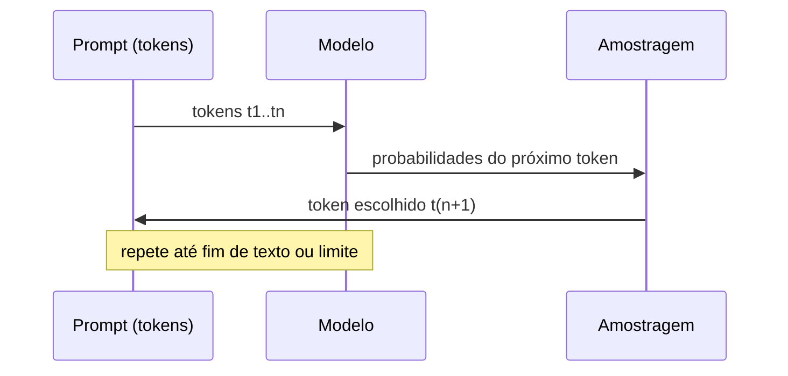
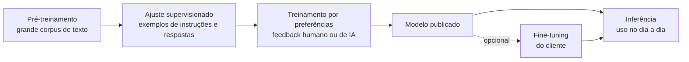

# Como funcionam os LLMs

Pré-requisito: [[O que é um LLM]]

## 1. Definição

> [!info] Definição
> Um LLM transforma uma sequência de *tokens* em vetores numéricos (*embeddings*), processa-os por camadas de *atenção* (*attention*) e produz, para cada posição, uma distribuição de probabilidade sobre o vocabulário. O texto é gerado escolhendo tokens dessa distribuição, um por vez.

## 2. Contexto

Para entender por que o comportamento de um modelo pode ser influenciado por texto, é preciso ver o que acontece entre a entrada e a saída, e em que momento do ciclo de vida cada comportamento é "ensinado".

## 3. Funcionamento

### 3.1 Embeddings

Cada token é mapeado a um vetor de números (*embedding*). Tokens usados em contextos parecidos tendem a ter vetores próximos. É uma representação aprendida, não um dicionário escrito à mão.

### 3.2 Atenção

Em cada camada, cada posição "olha" para as anteriores e decide quanto peso dar a cada uma ao construir sua própria representação. É assim que o modelo relaciona uma instrução no início do contexto com um trecho no fim.

> [!note] Consequência para segurança
> A atenção opera sobre **todo o contexto de forma uniforme em mecanismo**: não há um canal privilegiado fisicamente separado para "instruções do desenvolvedor". A distinção entre papéis é aprendida no treinamento (ver [[System Prompt e Hierarquia de Instruções]]), não imposta por hardware.

### 3.3 Geração e amostragem

A cada passo, o modelo produz probabilidades. A escolha do próximo token depende de parâmetros:

| Parâmetro | Efeito |
|---|---|
| Temperatura (*temperature*) | Valores baixos tornam a escolha mais determinística; altos, mais variada |
| *top-p* / *top-k* | Restringem o conjunto de candidatos considerados |
| *seed* | Quando suportada, torna a amostragem reproduzível |

Por isso, **a mesma entrada pode gerar saídas diferentes**, e por isso testes de segurança devem ser repetidos e ter parâmetros registrados.

## 4. Treinamento, fine-tuning e inferência

| Fase | O que ocorre | Muda os pesos? | Quem faz |
|---|---|---|---|
| Pré-treinamento | Aprende a prever o próximo token em enorme corpus | Sim | Desenvolvedor do modelo |
| Ajuste para instruções e preferências | Aprende a seguir instruções e a preferir certos tipos de resposta | Sim | Desenvolvedor do modelo |
| *Fine-tuning* | Especializa o modelo com dados adicionais | Sim | Desenvolvedor ou cliente |
| Inferência | Usa o modelo para gerar respostas | **Não** | Qualquer usuário |

> [!warning] Erro comum
> Durante a inferência, o modelo **não aprende** com a conversa; ele apenas condiciona sua saída ao contexto atual. "Memória" entre sessões, quando existe, é uma funcionalidade da *aplicação* que reinsere texto no contexto. Esses mecanismos de memória são uma superfície de ataque própria (ver [[Ataques Contra Agentes de IA]]).

## 5. Exemplo

> [!example] Mesma pergunta, duas execuções
> Pergunta: "Dê um nome criativo para uma cafeteria." Com temperatura alta, duas execuções darão nomes distintos. Com temperatura zero (quando disponível), tendem a coincidir. Em testes de recusa, esse mesmo efeito faz com que um modelo recuse 9 vezes e atenda 1 vez, o que só é visível com repetição.

## 6. Análise

O ponto central: o comportamento é **distribuição**, não regra. Falar em "o modelo recusa X" é uma simplificação; o correto é "o modelo recusa X em N% das execuções sob certa configuração".

## 7. Limitações

- Parâmetros e versões de modelo mudam os resultados.
- Modelos são atualizados pelos fornecedores; resultados de ontem podem não valer hoje (**regressão**).
- A explicação acima é simplificada; modelos reais têm variações arquiteturais.

## 8. Aplicação em segurança

- Registrar modelo, versão, temperatura, *seed* e data em cada teste.
- Tratar resultados como estimativas estatísticas.
- Reavaliar após mudança de modelo ou de prompt (ver [[Métricas e Critérios de Sucesso]]).

## 9. Defesa

Não se confia em um comportamento "médio" do modelo para proteger um ativo crítico. Controles determinísticos fora do modelo ([[Defesa em Camadas]]) cobrem a cauda da distribuição.

## 10. Exercício

- [ ] Rode (localmente ou em API própria) o mesmo prompt inofensivo 10 vezes com temperatura 0 e 10 vezes com temperatura 1. Compare e registre no [[Template de Laboratório]].
- [ ] Explique em três frases por que "o modelo recusou uma vez" não prova que ele sempre recusa.

## Referências

- Vaswani, A. et al. **Attention Is All You Need**. arXiv:1706.03762 (2017). <https://arxiv.org/abs/1706.03762> — consultado em 15/10/2026.
- Ouyang, L. et al. **Training language models to follow instructions with human feedback**. arXiv:2203.02155, 04/03/2022. <https://arxiv.org/abs/2203.02155> — consultado em 15/10/2026.

## Próximos passos
- [[Tokens e Contexto]]
