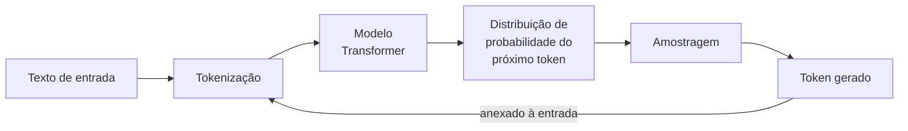
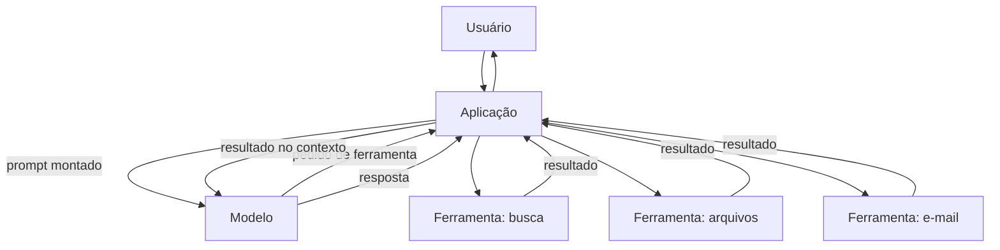

# O que é um LLM

Voltar ao [[Índice - Jailbreaking]] · Etapa 1 do [[Trilha de aprendizado - Jailbreaking]]

## Pré-requisitos
- Noções básicas de programação e de como uma API web funciona.

## 1. Definição

> [!info] Definição
> Um **modelo de linguagem de grande escala** (*Large Language Model*, LLM) é um modelo estatístico, tipicamente uma rede neural com bilhões de parâmetros, treinado sobre grandes volumes de texto para **prever o próximo trecho de texto** (o próximo *token*) dado o que veio antes.

Tudo o que um LLM "faz" (responder perguntas, resumir, escrever código, seguir instruções) é consequência dessa tarefa de previsão, refinada por etapas posteriores de treinamento (ver [[Alinhamento e Guardrails]]).

## 2. Contexto

Antes dos LLMs, sistemas de linguagem eram construídos tarefa por tarefa: um para tradução, outro para classificação, outro para resumo. A arquitetura *Transformer* (Vaswani et al., 2017) tornou viável treinar modelos grandes em paralelo, e a escala de dados e computação fez surgir modelos de propósito geral, capazes de executar tarefas descritas em linguagem natural.

Para segurança, isso muda o problema: **a interface de controle do modelo é a própria linguagem**. Quem escreve texto que chega ao modelo influencia seu comportamento. Essa é a raiz de quase tudo que este curso estuda.

## 3. Funcionamento (visão geral)

O detalhe de cada etapa está em [[Como funcionam os LLMs]] e [[Tokens e Contexto]].

## 4. Quatro camadas que não devem ser confundidas

Muitas confusões em segurança nascem de tratar tudo como "a IA". Separe:

| Camada | O que é | Exemplo | Quem controla |
|---|---|---|---|
| **Modelo** | Pesos treinados que mapeiam texto em probabilidades | Um modelo aberto rodando localmente | Quem treina/publica o modelo |
| **Aplicação** | Software que monta o prompt, chama o modelo e trata a saída | Um chatbot de atendimento | Equipe de desenvolvimento |
| **Ferramenta** (*tool*) | Função externa que o modelo pode pedir para executar | Busca web, consulta a banco, envio de e-mail | Desenvolvedor da integração |
| **Agente** (*agent*) | Aplicação em que o modelo decide, em laço, quais ferramentas usar para cumprir um objetivo | Assistente que lê e-mails e agenda reuniões | Aplicação + modelo |

> [!tip] Por que isso importa
> Uma falha pode estar **no modelo** (aceita algo que deveria recusar), **na aplicação** (dá ferramentas demais ao modelo, não valida saídas) ou na **integração** (conteúdo externo entra no prompt sem tratamento). Corrigir a camada errada não resolve o problema. Retomamos isso em [[O que é AI Jailbreaking]] e [[Defesa em Camadas]].

## 5. Exemplo

> [!example] Mesmo modelo, três comportamentos
> Um mesmo modelo, chamado por três aplicações diferentes, pode:
> 1. Ser um tutor de matemática que só responde sobre álgebra (system prompt restritivo).
> 2. Ser um assistente de código com acesso a um repositório (ferramentas de arquivo).
> 3. Ser um chat genérico sem ferramentas.
>
> O modelo é idêntico; o **risco** é diferente, porque o que ele pode *fazer* e o que ele pode *ler* mudam.

## 6. Análise

O comportamento observado resulta de: pesos do modelo + instruções (system prompt) + conteúdo no contexto + parâmetros de geração + ferramentas disponíveis. Ao relatar um achado de segurança, todos esses fatores precisam ser registrados (ver [[Template de Vulnerabilidade]]).

## 7. Limitações inerentes

- **Geração probabilística:** a mesma entrada pode produzir saídas diferentes. Um único teste não prova nada (ver [[Metodologia de Testes]]).
- **Alucinação** (*hallucination*): o modelo pode produzir texto fluente e falso.
- **Sem separação rígida entre dados e instruções:** tudo é texto no mesmo contexto.
- **Conhecimento limitado ao treinamento:** sem ferramentas, não conhece fatos posteriores ao corte de dados.
- **Sensibilidade à formulação:** pequenas mudanças de redação podem mudar o resultado.

Mais em [[Limitações dos Modelos]].

## 8. Aplicação em segurança

Se a linguagem é a interface e o modelo não distingue com rigor "ordem" de "dado", então a segurança não pode depender apenas de o modelo "se comportar". Controles precisam existir **fora** do modelo (autorização, validação, menor privilégio).

## 9. Exercício

- [ ] Escolha uma aplicação que você usa (chatbot de banco, assistente de código). Desenhe as quatro camadas (modelo, aplicação, ferramentas, agente) e indique o que é desconhecido para você.
- [ ] Liste três decisões que a aplicação toma *antes* de o texto chegar ao modelo.

## 10. Referências

- Vaswani, A. et al. **Attention Is All You Need**. arXiv:1706.03762, submetido em 12/06/2017 (última revisão: 02/08/2023). <https://arxiv.org/abs/1706.03762> — consultado em 15/10/2026.

## Conceitos relacionados
[[Como funcionam os LLMs]] · [[Tokens e Contexto]] · [[System Prompt e Hierarquia de Instruções]] · [[Glossário#Segurança de IA (jailbreaking e prompt injection)]]

## Próximos passos
- [[Como funcionam os LLMs]]
