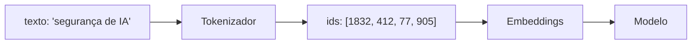
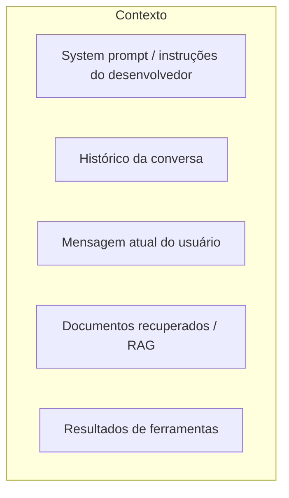

# Tokens e Contexto

Pré-requisito: [[Como funcionam os LLMs]]

## 1. Definição

> [!info] Definições
> - **Token:** unidade de texto processada pelo modelo (uma palavra, parte de palavra, símbolo ou byte).
> - **Tokenizador** (*tokenizer*): algoritmo que converte texto em tokens e vice-versa.
> - **Janela de contexto** (*context window*): quantidade máxima de tokens que o modelo consegue considerar de uma vez (entrada + saída).
> - **Contexto:** tudo o que está na janela naquele momento: system prompt, histórico, documentos, resultados de ferramentas.

## 2. Contexto (por que existe)

Redes neurais trabalham com números. Tokenizar em subpalavras permite um vocabulário de tamanho fixo que ainda representa palavras raras ou novas, combinando pedaços. Uma técnica comum é a *byte pair encoding* (BPE), aplicada a tradução por Sennrich et al. (2015).

## 3. Funcionamento

> [!note] Os ids acima são ilustrativos
> Valores reais dependem do tokenizador de cada modelo.

Pontos práticos:

- **Idiomas diferentes geram contagens diferentes.** Textos em português costumam consumir mais tokens que o equivalente em inglês em tokenizadores treinados majoritariamente em inglês.
- **Custo e limite** são medidos em tokens, não em caracteres.
- **Tokenizadores diferem entre modelos**, então o mesmo texto vira sequências diferentes.

## 4. O contexto é um espaço compartilhado

O contexto de uma chamada típica contém, na mesma sequência de tokens:

> [!warning] Ponto-chave para segurança
> Itens D e E frequentemente vêm de fontes **não confiáveis** (páginas web, e-mails, arquivos), mas ficam no mesmo espaço de tokens que as instruções legítimas. Daí nasce a *prompt injection* (ver [[Conceitos Fundamentais]]).

## 5. Exemplo

> [!example] Experimento seguro de tokenização
> Use um tokenizador local ou público e compare a contagem de tokens de:
> - "Olá, tudo bem?" e "Hello, how are you?"
> - Uma palavra comum e uma palavra rara ou inventada.
>
> Observe que palavras raras se dividem em mais pedaços.

## 6. Análise

O tokenizador define a "visão" que o modelo tem do texto. Isso explica por que transformações simples de escrita (espaços, maiúsculas, idioma) podem mudar como o modelo percebe uma entrada, assunto de [[Obfuscação e Codificação]] e [[Ataques Multilíngues]]. Aqui o objetivo é só compreender o mecanismo.

## 7. Limitações

- **Janela finita:** quando o contexto excede o limite, algo é truncado ou resumido; instruções antigas podem ser perdidas ou receber menos atenção prática.
- **Uso desigual do contexto:** modelos não usam todas as posições com a mesma eficácia, e isso varia por modelo.
- Contagens de tokens são específicas do tokenizador; não generalize.

## 8. Aplicação em segurança

- Conversas longas (ver [[Jailbreak Multiturno]]) alteram o que o modelo "vê" e o peso relativo das instruções iniciais.
- Limites de tamanho de entrada e de saída são controles simples e úteis.
- Registro de logs deve incluir o contexto completo montado, não só a mensagem do usuário.

## 9. Defesa

- Delimitar e rotular conteúdo não confiável ([[Validação de Entradas e Saídas]]).
- Reafirmar regras críticas de forma estruturada, mas sem depender apenas delas.
- Limitar tamanho de contexto proveniente de fontes externas.

## 10. Exercício

- [ ] Meça tokens de um mesmo parágrafo em português e inglês e calcule a razão.
- [ ] Desenhe o contexto de uma aplicação RAG e marque quais partes são confiáveis.

## Referências

- Sennrich, R.; Haddow, B.; Birch, A. **Neural Machine Translation of Rare Words with Subword Units**. arXiv:1508.07909, submetido em 31/08/2015 (v5: 10/06/2016). <https://arxiv.org/abs/1508.07909> — consultado em 15/10/2026.

## Próximos passos
- [[System Prompt e Hierarquia de Instruções]]
