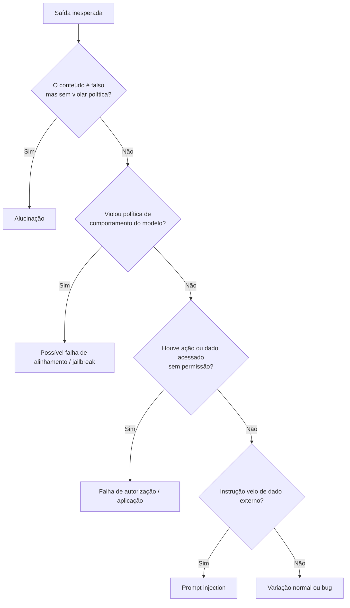

# Limitações dos Modelos

Pré-requisito: [[Taxonomia de Ataques]]

## 1. Definição

> [!info] Definição
> **Limitações dos modelos** são propriedades inerentes aos LLMs que causam comportamentos inesperados ou inseguros **mesmo sem ataque**. Conhecê-las evita atribuir a "jailbreak" o que é falha de outra natureza e ajuda a projetar defesas realistas.

## 2. Contexto

Ao testar segurança, é comum observar uma resposta estranha e concluir que houve ataque bem-sucedido. Muitas vezes, é apenas uma limitação. Distinguir exige conhecer cada uma.

## 3. Principais limitações

| Limitação | Descrição | Efeito em segurança |
|---|---|---|
| **Não determinismo** | Saída varia entre execuções | Um teste isolado não prova nada |
| **Alucinação** (*hallucination*) | Texto fluente, porém falso | Pode gerar relatórios, código ou citações incorretas |
| **Ausência de fronteira dados × instruções** | Tudo é texto no mesmo contexto | Base da injeção ([[Conceitos Fundamentais]]) |
| **Sensibilidade à formulação** | Mudanças pequenas alteram a resposta | Dificulta garantias; exige cobertura de testes |
| **Generalização imperfeita** | Treino cobre uma distribuição; casos novos podem divergir | Origem de falhas de recusa ([[O que é AI Jailbreaking]]) |
| **Janela de contexto finita** | Excesso de conteúdo é truncado ou diluído | Regras antigas podem pesar menos |
| **Conhecimento defasado** | Limitado aos dados de treino | Respostas desatualizadas sem ferramenta de busca |
| **Falta de verificação interna** | O modelo não confirma fatos por conta própria | Confiança excessiva na saída |
| **Dependência de versão** | Atualizações mudam o comportamento | Necessidade de testes de regressão |
| **Opacidade** | Difícil explicar *por que* decidiu | Auditoria dependente de testes externos |

## 4. Diferenciando falhas de aparência parecida

## 5. Exemplo

> [!example] Parece ataque, mas não é
> Um assistente fictício de biblioteca responde com um horário de funcionamento errado. Não houve instrução adversarial: o horário não estava no contexto e o modelo "completou" com algo plausível. É **alucinação**; a correção é fornecer a informação por fonte confiável e validar a saída, não reforçar o system prompt contra "jailbreak".

## 6. Análise

Três perguntas ajudam a triar qualquer achado:

1. **Reproduz?** Em quantas de N execuções? ([[Métricas e Critérios de Sucesso]])
2. **Existe adversário?** Ou o comportamento aparece com entradas comuns?
3. **Onde está a falha?** Modelo, aplicação ou integração?

## 7. Limites desta lista

- Não é exaustiva; surgem novas limitações com novas arquiteturas.
- Algumas são mitigáveis (ex.: busca e RAG reduzem defasagem; validação reduz alucinação), outras são estruturais.

## 8. Aplicação em segurança

- Projetar a aplicação supondo que o modelo **vai errar** em algum percentual de casos.
- Controles determinísticos (validação de saída, autorização, limites de ação) cobrem o que o modelo não garante.

## 9. Defesa

- Respostas críticas ancoradas em fontes verificáveis.
- Validação de formato e conteúdo da saída ([[Validação de Entradas e Saídas]]).
- Aprovação humana para ações de alto impacto ([[Segurança de Agentes]]).
- Testes de regressão a cada mudança ([[Monitoramento e Resposta]]).

## 10. Exercício

- [ ] Percorra o fluxograma da seção 4 com três saídas inesperadas reais ou fictícias e classifique cada uma.
- [ ] Liste duas limitações que podem ser mitigadas por arquitetura e duas que devem ser apenas toleradas.

## Referências

- Ouyang, L. et al. (2022), arXiv:2203.02155 — discute respostas não verdadeiras e tóxicas como motivação do alinhamento; os próprios autores observam que o modelo resultante ainda comete erros simples. <https://arxiv.org/abs/2203.02155> — consultado em 15/10/2026.
- Wei, A. et al. (2023), arXiv:2307.02483. <https://arxiv.org/abs/2307.02483> — consultado em 15/10/2026.

## Conceitos relacionados
[[Como funcionam os LLMs]] · [[Alinhamento e Guardrails]] · [[Glossário#Segurança de IA (jailbreaking e prompt injection)]]

## Próximos passos
- Módulo 3: [[Ataques Diretos]]
