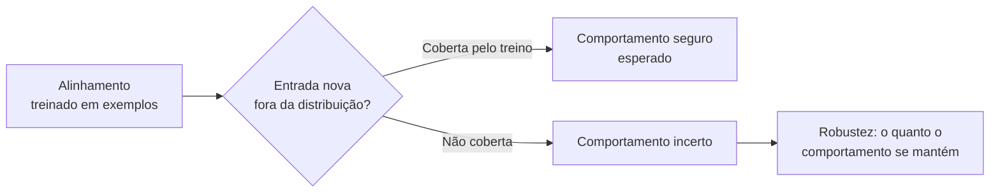
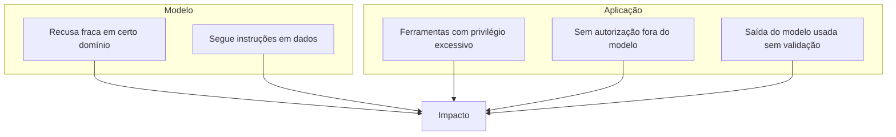

# O que é AI Jailbreaking

Pré-requisitos: [[Alinhamento e Guardrails]] · [[System Prompt e Hierarquia de Instruções]]

> [!warning] Escopo deste curso
> Aqui estudamos **por que** e **em que condições** controles de comportamento falham, para medir robustez e construir defesas. Não há receitas prontas para obter conteúdo nocivo; os exemplos são inofensivos e os testes ocorrem em ambiente próprio ou autorizado.

## 1. Definição

> [!info] Definição
> **AI jailbreaking** é o uso de entradas (ou de condições de interação) para fazer um modelo ou sistema de IA produzir comportamento que suas regras, seu treinamento de segurança ou sua configuração pretendiam impedir.

O termo vem de *jailbreak* em dispositivos móveis (contornar restrições do fabricante). Em LLMs, o "sistema operacional" é o comportamento aprendido e as instruções; a "restrição" é a recusa ou a política.

## 2. Contexto: objetivos e motivações

| Perfil | Motivação típica | Observação |
|---|---|---|
| Pesquisador / red team | Medir robustez, publicar falhas, melhorar defesas | Opera com autorização e divulgação responsável |
| Equipe de produto | Validar antes de lançar | Foco em regressão e métricas |
| Curioso / entusiasta | Testar limites do modelo | Frequentemente sem método nem registro |
| Atacante | Obter conteúdo ou ações indevidas, abusar de ferramentas | É o cenário que a defesa precisa antecipar |

Pesquisa reconhecida descreve que modelos treinados para segurança continuam suscetíveis a esse tipo de uso adversarial, e propõe hipóteses para o motivo (ver seção 5).

## 3. O que jailbreak **não** é

Este é o ponto onde mais se confunde. Compare:

| Conceito | O que é | Exemplo inofensivo | Nota |
|---|---|---|---|
| **Jailbreak** | Fazer o modelo violar suas políticas de comportamento | Fazer um assistente restrito a culinária sair do escopo | esta nota |
| **Prompt injection** | Instruções não confiáveis em entrada/dados que sequestram a tarefa da aplicação | Documento com texto que manda o assistente ignorar sua função | [[Jailbreak vs Prompt Injection]] |
| **Extração de prompt** (*prompt leaking*) | Fazer o modelo revelar suas instruções internas | Pedir o system prompt de um bot fictício | [[Jailbreak vs Prompt Injection]] |
| **Vulnerabilidade tradicional** | Falha de software clássica (SQL injection, XSS) | Aplicação concatena saída do modelo em consulta SQL | [[Segurança de Agentes]] |
| **Alucinação** | O modelo inventa algo falso sem ninguém atacar | Cita um artigo que não existe | [[Limitações dos Modelos]] |
| **Falha de autorização** | A aplicação deixa alguém fazer o que não deveria, independente do modelo | Usuário A lê dados do usuário B via chatbot | [[Defesa em Camadas]] |
| **Bypass de política** | Termo amplo: contornar qualquer regra, do modelo ou da aplicação | | pode incluir os acima |

> [!tip] Pergunta diagnóstica
> Ao ver um incidente, pergunte: *"Se eu trocasse o modelo por um perfeito em recusas, o problema desapareceria?"* Se **não**, provavelmente é falha de aplicação, não de modelo.

## 4. Jailbreak, alinhamento, robustez e generalização

- **Alinhamento** ensina comportamentos a partir de exemplos.
- **Generalização** é o quanto esse comportamento se mantém em situações diferentes das vistas.
- **Robustez** é a estabilidade do comportamento sob variações adversariais.
- Um jailbreak bem-sucedido é, em geral, evidência de **falha de generalização ou de conflito de objetivos** do treinamento.

## 5. Por que o treinamento de segurança falha: duas hipóteses publicadas

Wei et al. (2023) propõem dois modos de falha:

1. **Objetivos concorrentes** (*competing objectives*): as capacidades do modelo (ex.: seguir instruções) entram em conflito com os objetivos de segurança.
2. **Generalização descasada** (*mismatched generalization*): o treinamento de segurança não cobre um domínio em que o modelo tem capacidade, de modo que a recusa não "acompanha" a competência.

Os autores concluem que as vulnerabilidades persistiram mesmo em modelos com extenso red teaming e defendem **paridade entre segurança e capacidade**: mecanismos de segurança tão sofisticados quanto o modelo. Trata-se de uma hipótese e de resultados experimentais naquele momento e para aqueles modelos; não é lei geral.

## 6. Por que um jailbreak funciona em um modelo e falha em outro

| Fator | Efeito |
|---|---|
| Dados e método de treinamento | Cobrem situações diferentes |
| Versão do modelo | Fornecedores corrigem e atualizam |
| Tokenizador e idioma | Mudam a "percepção" da entrada |
| System prompt e configuração | Alteram o peso das regras |
| Parâmetros de amostragem | Resultado varia entre execuções |
| Filtros externos | Podem bloquear antes ou depois do modelo |
| Ferramentas e contexto | Mudam o que está em jogo |

Pesquisa mostrou que entradas otimizadas em modelos abertos podem, em certos casos, transferir-se para outros modelos (Zou et al., 2023), o que **não** significa transferência universal nem permanente.

## 7. Vulnerabilidade do modelo × vulnerabilidade da aplicação

Corrigir apenas o modelo não resolve A1–A3. Em relatórios, sempre indique **onde** está a falha.

## 8. Exemplo (inofensivo)

> [!example] Fora do escopo
> **System prompt:** assistente de receitas, só responde sobre culinária.
> **Entrada:** pedido de ajuda com um tema sem relação (por exemplo, uma dúvida de matemática), formulado de várias maneiras.
>
> **Análise:** se o assistente sai do escopo em algumas formulações, há um *bypass de política de escopo*. O impacto é baixo, mas o mecanismo (conflito entre instrução do desenvolvedor e pedido do usuário) é o mesmo de casos graves. Por isso é um bom objeto de estudo em [[Laboratório 02 - Robustez a Instruções]].

## 9. Limitações da análise

- Um sucesso isolado não prova vulnerabilidade; um fracasso isolado não prova robustez ([[Metodologia de Testes]]).
- Resultados de artigos refletem modelos e datas específicos.
- Não existe técnica eficaz universalmente comprovada.

## 10. Aplicação em segurança e defesa

- Tratar jailbreak como **risco de modelo** a ser medido, não como evento binário.
- Reduzir o impacto no nível da aplicação: mesmo que o modelo seja contornado, ele não deve ter acesso a nada crítico sem autorização externa ([[Defesa em Camadas]]).

## Exercício

- [ ] Para cada cenário, classifique (jailbreak, prompt injection, extração de prompt, falha de autorização, alucinação): (a) bot de RH revela salário de outro funcionário porque a API não checa permissão; (b) e-mail com texto escondido faz o assistente encaminhar mensagens; (c) usuário convence o assistente de culinária a falar de política; (d) assistente cita lei inexistente.
- [ ] Explique em um parágrafo por que a pergunta diagnóstica da seção 3 ajuda.

## Referências

- Wei, A.; Haghtalab, N.; Steinhardt, J. **Jailbroken: How Does LLM Safety Training Fail?** arXiv:2307.02483, 05/07/2023. <https://arxiv.org/abs/2307.02483> — consultado em 15/10/2026.
- Zou, A.; Wang, Z.; Carlini, N.; Nasr, M.; Kolter, J. Z.; Fredrikson, M. **Universal and Transferable Adversarial Attacks on Aligned Language Models**. arXiv:2307.15043, 27/07/2023 (v2: 20/12/2023). <https://arxiv.org/abs/2307.15043> — consultado em 15/10/2026.

## Conceitos relacionados
[[Taxonomia de Ataques]] · [[Limitações dos Modelos]] · [[Glossário#Segurança de IA (jailbreaking e prompt injection)]]

## Próximos passos
- [[Jailbreak vs Prompt Injection]]
