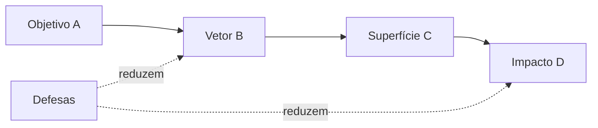

# Taxonomia de Ataques

Pré-requisito: [[Jailbreak vs Prompt Injection]]

## 1. Definição

> [!info] Definição
> Uma **taxonomia** é um sistema de classificação. Aqui, organizamos ataques a sistemas baseados em LLM por quatro eixos independentes: **objetivo**, **vetor**, **superfície de exposição** e **impacto potencial**. Classificar bem evita confundir problemas diferentes e orienta o teste e a defesa.

## 2. Contexto

Sem taxonomia, relatórios dizem apenas "o modelo foi burlado". Com ela, dizem: *objetivo = desvio de política; vetor = conversa multiturno; superfície = chat sem ferramentas; impacto = baixo*. Isso permite comparar achados, priorizar correções e mapear para frameworks como [[OWASP para Aplicações de LLM]] e [[MITRE ATLAS]].

## 3. Os quatro eixos

### Eixo A — Objetivo (o que o atacante quer)

| Código | Objetivo | Descrição |
|---|---|---|
| A1 | Desvio de política de conteúdo | Obter saída que a política deveria bloquear |
| A2 | Desvio de escopo | Tirar o assistente de sua função definida |
| A3 | Extração de prompt/configuração | Revelar instruções internas |
| A4 | Exfiltração de dados | Fazer o sistema revelar dados a que o atacante não tem direito |
| A5 | Abuso de ferramentas | Fazer o sistema executar ações indevidas |
| A6 | Degradação/negação | Gerar custo, loops, indisponibilidade |
| A7 | Contaminação | Inserir informação falsa em memória, base RAG ou resultados |

### Eixo B — Vetor (como o ataque chega)

| Código | Vetor | Nota |
|---|---|---|
| B1 | Instrução direta / conflito de instruções | [[Ataques Diretos]] |
| B2 | Roleplay e alteração de contexto | [[Roleplay e Personificação]] |
| B3 | Obfuscação e codificação | [[Obfuscação e Codificação]] |
| B4 | Idioma / multilíngue | [[Ataques Multilíngues]] |
| B5 | Multiturno (múltiplas etapas) | [[Jailbreak Multiturno]] |
| B6 | Contexto e conteúdo citado | [[Ataques Baseados em Contexto]] |
| B7 | Multimodal (texto em imagem etc.) | [[Jailbreak Multimodal]] |
| B8 | Injeção em dados externos | [[Injeção Indireta]] |
| B9 | Entradas otimizadas automaticamente | [[Ataques Adaptativos e Transferência]] |
| B10 | Manipulação de memória/ferramentas | [[Ataques Contra Agentes de IA]] |

### Eixo C — Superfície de exposição (onde o sistema é atingível)

| Código | Superfície | Risco típico |
|---|---|---|
| C1 | Chat público sem ferramentas | Conteúdo, reputação |
| C2 | Assistente com system prompt de negócio | Escopo, vazamento de regras |
| C3 | Aplicação com RAG | Contaminação, injeção indireta |
| C4 | Agente com ferramentas (e-mail, arquivos, web) | Ações indevidas, exfiltração |
| C5 | Sistema com memória persistente | Persistência do ataque |
| C6 | Pipeline multimodal | Instruções ocultas em imagens/áudio |
| C7 | Cadeia multiagente | Propagação entre agentes |

### Eixo D — Impacto potencial

| Nível | Descrição | Exemplo |
|---|---|---|
| Baixo | Sem dano material; resposta fora de escopo | Bot de receitas fala de futebol |
| Médio | Exposição limitada, dano reputacional | Revelação de regras internas |
| Alto | Dados sensíveis ou ações com efeito externo | Envio indevido de e-mail |
| Crítico | Compromisso de contas, dados em massa, ações irreversíveis | Agente com privilégios amplos manipulado |

> [!important] Impacto depende da superfície
> O mesmo vetor (B1) tem impacto baixo em C1 e potencialmente crítico em C4. **O risco é função da combinação**, não do vetor isolado.

## 4. Visão integrada

## 5. Estado do conhecimento: histórico, documentado, experimental

| Categoria | Significado | Exemplos de vetores |
|---|---|---|
| **Histórico** | Descrito há tempo; modelos modernos costumam tratá-lo melhor, mas ainda serve de linha de base de teste | Instruções diretas simples (B1) |
| **Documentado em pesquisa** | Descrito em artigos com metodologia e resultados | Falhas de generalização e objetivos concorrentes; entradas otimizadas e sua transferência; injeção indireta |
| **Experimental / em evolução** | Evidências limitadas ou mudando rapidamente | Combinações multimodais, ataques contra agentes e memória |

> [!warning] Cautela
> Classificar como "documentado" não significa "funciona hoje". Eficácia depende de modelo, versão e configuração, e só se afirma com teste repetido ([[Metodologia de Testes]]).

## 6. Exemplo de classificação

> [!example] Caso fictício
> "Um assistente de suporte com acesso à base de clientes revela dados de outra conta após uma conversa longa."
>
> | Eixo | Valor |
> |---|---|
> | Objetivo | A4 (exfiltração de dados) |
> | Vetor | B5 (multiturno) |
> | Superfície | C4 (agente com ferramenta de consulta) |
> | Impacto | Alto |
> | Causa provável | Falta de autorização por registro **fora do modelo** |

## 7. Limitações

- Eixos podem se sobrepor; use o campo principal e anote secundários.
- Taxonomias envelhecem; revise a cada novo tipo de ataque.
- Esta é uma proposta didática do curso, não um padrão oficial; para padrões, ver as referências abaixo.

## 8. Aplicação em segurança e defesa

- Use os códigos na matriz de testes ([[Metodologia de Testes]]) e no [[Template de Vulnerabilidade]].
- Priorize defesa por **superfície × impacto**, não por vetor.

## Exercício

- [ ] Classifique cinco cenários fictícios com os quatro eixos.
- [ ] Para o cenário de maior impacto, aponte qual controle externo ao modelo mais reduziria o risco.

## Referências

- Greshake, K. et al. (2023), arXiv:2302.12173, propõem uma taxonomia sob a ótica de segurança clássica para injeção indireta. <https://arxiv.org/abs/2302.12173> — consultado em 15/10/2026.
- Wei, A.; Haghtalab, N.; Steinhardt, J. (2023), arXiv:2307.02483. <https://arxiv.org/abs/2307.02483> — consultado em 15/10/2026.
- Mapeamento para OWASP e MITRE ATLAS será feito nas notas [[OWASP para Aplicações de LLM]] e [[MITRE ATLAS]], após verificação das versões vigentes.

## Próximos passos
- [[Limitações dos Modelos]]
