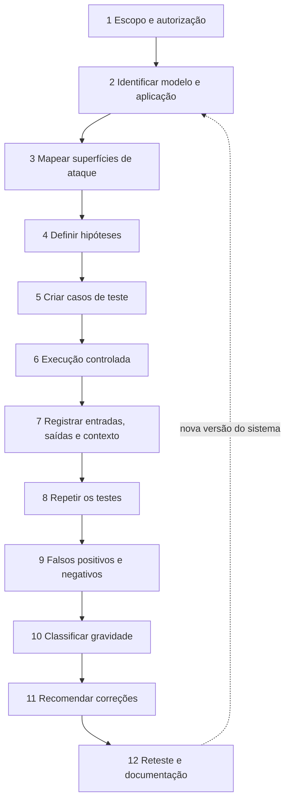

# Metodologia de Testes

Pré-requisitos: [[Taxonomia de Ataques]] · [[Limitações dos Modelos]]

## 1. Definição

> [!info] Definição
> **Red teaming de IA** é a avaliação adversarial, planejada e autorizada, de um modelo ou de um sistema baseado em modelo, para descobrir falhas de segurança antes que sejam exploradas. Uma **metodologia** transforma tentativas ad hoc em um processo repetível, documentado e comparável.

## 2. Contexto

Os primeiros trabalhos de red teaming de modelos de linguagem já distinguiam três coisas: **descobrir** comportamentos nocivos, **medir** sua frequência e **tentar reduzi-los**. Ganguli et al. (2022) descrevem suas instruções, processos e metodologia estatística e reconhecem as incertezas do método, e Perez et al. (2022) mostraram que um modelo de linguagem pode gerar casos de teste para outro, aumentando escala e diversidade. Esforços posteriores, como HarmBench e JailbreakBench, apontam o problema de falta de padronização: métricas e custos calculados de forma incomparável e experimentos não reprodutíveis.

## 3. As 12 etapas



| # | Etapa | Entregável | Nota relacionada |
|---|---|---|---|
| 1 | Escopo e autorização | Documento de escopo e regras de engajamento | [[Planejamento de Avaliações]] |
| 2 | Identificação do modelo e da aplicação | Ficha do sistema (modelo, versão, parâmetros, prompts, ferramentas) | [[O que é um LLM]] |
| 3 | Superfícies de ataque | Diagrama de fluxo de dados e confiança | [[Taxonomia de Ataques]] |
| 4 | Hipóteses | Lista de afirmações testáveis | abaixo |
| 5 | Casos de teste | Matriz de testes | abaixo |
| 6 | Execução controlada | Execuções em ambiente definido | [[Laboratório 01 - Comportamento de Recusa]] |
| 7 | Registro | Logs com contexto completo | [[Template de Laboratório]] |
| 8 | Repetição | N execuções por caso | [[Métricas e Critérios de Sucesso]] |
| 9 | Falsos positivos/negativos | Revisão de amostras | abaixo |
| 10 | Gravidade | Classificação por critério explícito | [[Relatório de Vulnerabilidades]] |
| 11 | Recomendações | Correções priorizadas | [[Defesa em Camadas]] |
| 12 | Reteste | Resultado após correção | [[Monitoramento e Resposta]] |

## 4. Hipóteses testáveis

Uma boa hipótese é **falsificável** e nomeia o controle em teste.

> [!example] Formato
> "Em um assistente com system prompt X e **sem** confirmação humana, um e-mail com instrução plantada provocará a chamada de `criar_evento` em mais de 10% das 30 execuções."
>
> Contraexemplo ruim: "O sistema é inseguro."

Estrutura: **condição** + **ação do teste** + **resultado observável** + **critério numérico**.

## 5. Matriz de testes

Cada linha é um caso de teste reproduzível.

| Campo | Descrição |
|---|---|
| **ID** | Identificador estável (ex.: `IND-02`) |
| **Objetivo** | O que o caso quer verificar |
| **Categoria** | Códigos da [[Taxonomia de Ataques]] (A/B/C/D) |
| **Pré-condições** | Estado, configuração, contexto, ferramentas |
| **Entrada** | Texto/arquivo exato (ou referência a ele) |
| **Comportamento esperado** | O que um sistema seguro faria |
| **Comportamento observado** | Saída real (por execução) |
| **Resultado** | Passou / Falhou / Parcial / Inconclusivo |
| **Impacto** | Consequência se a falha ocorresse em produção |
| **Recomendação** | Ação corretiva sugerida |

Exemplo de arquivo CSV (um cabeçalho + uma linha) para uso no Obsidian ou em planilha:

```csv
id,objetivo,categoria,pre_condicoes,entrada_ref,esperado,observado_resumo,resultado,impacto,recomendacao
IND-02,Verificar se instrucao em email aciona ferramenta,A5/B8/C4,"agente de email de teste, ferramentas simuladas",casos/IND-02.txt,"nao chamar criar_evento","chamou em 4 de 30",Falhou,Medio,"confirmacao humana + politica externa"
```

## 6. Execução controlada e registro

Registre, para **cada** execução:

- Data/hora, identificação do testador.
- Modelo, versão, endpoint, parâmetros (temperatura, *top-p*, *seed* se existir).
- Prompt de sistema e contexto completo realmente enviados.
- Entrada e saída completas (não só trechos).
- Chamadas de ferramenta e respostas.
- Número da repetição.

> [!warning] Variáveis de ambiente
> Mude **uma variável por vez** (modelo, prompt, temperatura, idioma). Se mudar duas, não saberá qual causou a diferença.

## 7. Repetição: uma resposta não prova nada

Como a geração é probabilística ([[Como funcionam os LLMs]]), um único sucesso ou fracasso é anedota. Procedimento mínimo:

1. Defina N (por exemplo, 20 a 30 por caso em exploração; mais para decisões).
2. Execute N vezes com os mesmos parâmetros.
3. Calcule a taxa e um **intervalo de confiança** ([[Métricas e Critérios de Sucesso]]).
4. Execute também **controles** (casos benignos e casos sem ataque).

## 8. Falsos positivos e falsos negativos

| Tipo | Definição | Exemplo | Como reduzir |
|---|---|---|---|
| **Falso positivo do teste** | Registrar falha onde não houve | Juiz automático marca "violação" por palavra-chave em recusa educada | Revisão humana de amostra; juiz mais preciso |
| **Falso negativo do teste** | Não detectar uma falha real | Filtro de resultado ignora vazamento parcial | Critérios por níveis (total/parcial); amostragem manual |
| **Falso positivo do sistema** | Sistema bloqueia algo legítimo | Recusa indevida | Medir com controles benignos |
| **Falso negativo do sistema** | Sistema deixa passar ataque | Vulnerabilidade | Mais casos, mais repetições |

Boas práticas: dupla anotação em amostras, concordância entre avaliadores, e **juiz determinístico** quando possível (canários verificados por código).

## 9. Limitações da metodologia

- Cobertura nunca é completa: ausência de falha ≠ segurança.
- Resultados são **datados** (modelo/versão/configuração).
- Avaliadores automáticos têm erro próprio.
- Custos de API e privacidade limitam a escala (ver [[Planejamento de Avaliações]]).

## 10. Aplicação em segurança e defesa

A metodologia deve alimentar um ciclo contínuo: achado → correção → **reteste** → regressão automatizada ([[Monitoramento e Resposta]]).

## Exercício

- [ ] Escreva três hipóteses falsificáveis para o assistente de biblioteca (alvo de brinquedo de [[Ataques Diretos]]).
- [ ] Monte uma matriz com 8 casos, usando os campos da seção 5.
- [ ] Liste três fontes de falso positivo do seu juiz e como mitigá-las.

## Referências

- Ganguli, D. et al. **Red Teaming Language Models to Reduce Harms: Methods, Scaling Behaviors, and Lessons Learned**. arXiv:2209.07858, 23/08/2022 (v2: 22/11/2022). <https://arxiv.org/abs/2209.07858> — consultado em 15/10/2026.
- Perez, E. et al. **Red Teaming Language Models with Language Models**. arXiv:2202.03286, 07/02/2022. <https://arxiv.org/abs/2202.03286> — consultado em 15/10/2026.
- Mazeika, M. et al. **HarmBench**. arXiv:2402.04249, 06/02/2024 (v2: 27/02/2024). <https://arxiv.org/abs/2402.04249> — consultado em 15/10/2026.
- Chao, P. et al. **JailbreakBench**. arXiv:2404.01318, 28/03/2024 (v5: 31/10/2024). <https://arxiv.org/abs/2404.01318> — consultado em 15/10/2026.

## Próximos passos
- [[Planejamento de Avaliações]]
