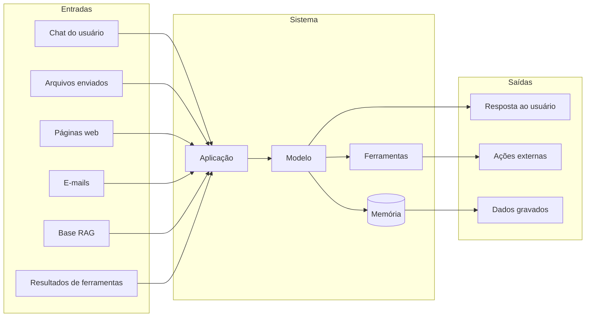

# Planejamento de Avaliações

Pré-requisito: [[Metodologia de Testes]]

## 1. Definição

> [!info] Definição
> **Planejamento de avaliação** é a fase que antecede qualquer teste: define **o que** pode ser testado, **por quem**, **com que limites**, **em que ambiente** e **como os resultados serão tratados**. É o que separa uma avaliação de segurança profissional de uma tentativa de abuso.

## 2. Contexto

Em segurança ofensiva clássica, testar sem autorização é ilegal e antiético. O mesmo vale para sistemas de IA: modelos hospedados por terceiros, aplicações de empresas e plataformas têm termos de uso e regras de divulgação. Planejar evita danos, custos inesperados e problemas legais.

> [!warning] Responsabilidade
> Teste apenas **ambientes próprios** (modelo local, aplicação sua) ou sistemas para os quais exista **autorização escrita** com escopo claro. Este curso usa alvos de brinquedo por esse motivo. Este material não substitui aconselhamento jurídico.

## 3. Documento de escopo e regras de engajamento

| Item | O que definir |
|---|---|
| **Autorização** | Quem autoriza, data, validade, contato de emergência |
| **Alvos em escopo** | Modelos, endpoints, aplicações, versões, ambientes |
| **Fora de escopo** | Sistemas de produção de terceiros, dados reais, contas de usuários |
| **Tipos de teste permitidos** | Categorias da [[Taxonomia de Ataques]] autorizadas |
| **Restrições** | Limites de taxa, orçamento, horários, proibição de conteúdo de certos tipos |
| **Dados** | Uso exclusivo de dados sintéticos; tratamento de qualquer dado sensível encontrado |
| **Ferramentas** | Ferramentas de ação **simuladas** quando possível |
| **Comunicação** | Canal para relatar achados críticos imediatamente |
| **Divulgação** | Prazos e regras de divulgação responsável |
| **Critério de parada** | Quando interromper (ex.: dado real exposto, custo excedido) |

## 4. Identificação do modelo e da aplicação

Ficha do sistema (preencher antes de testar):

```yaml
sistema:
  nome: ""
  descricao: ""
modelo:
  nome_versao: ""
  origem: ""            # local, API de fornecedor, fine-tuning próprio
  parametros: {temperatura: , top_p: , seed: }
aplicacao:
  prompt_de_sistema_ref: ""
  filtros_entrada: []
  filtros_saida: []
  rag: {usa: , fontes: []}
  memoria: {usa: , escopo: ""}
ferramentas:
  - nome: ""
    privilegios: ""
    reais_ou_simuladas: ""
dados:
  tipos: []
  sensibilidade: ""
usuarios:
  perfis: []
```

## 5. Mapeamento de superfícies de ataque



Para cada seta de entrada, anote **quem controla o conteúdo** e **que defesa existe**. Para cada saída, anote o **impacto** se for abusada.

## 6. Priorização

Priorize casos por **superfície × impacto × probabilidade** (ver eixo D da [[Taxonomia de Ataques]]):

| Prioridade | Critério |
|---|---|
| Alta | Entradas não confiáveis + ferramentas com efeito externo ou dados sensíveis |
| Média | Entradas não confiáveis sem ferramentas; ou usuário confiável com ferramentas |
| Baixa | Chat sem ferramentas e sem segredos |

## 7. Ambiente, custos e privacidade

| Opção | Vantagens | Cuidados |
|---|---|---|
| **Modelo local** | Sem custo por chamada, privacidade total, controle de parâmetros e *seed* | Exige hardware; modelos menores diferem dos de produção |
| **API de fornecedor** | Acesso a modelos de ponta | **Custo por token**, política de uso do fornecedor, dados enviados saem do seu ambiente, versões mudam sem aviso |
| **Híbrido** | Desenvolva localmente, confirme em API | Registre versões; mantenha dados sintéticos |

Defina um **orçamento máximo** (tokens ou valor) antes de executar e um limite de taxa. Em avaliações comparativas, estime custo = nº de casos × repetições × modelos × tokens médios.

## 8. Cronograma e papéis (modelo)

| Fase | Atividade | Responsável |
|---|---|---|
| 1 | Escopo e autorização | Líder da avaliação |
| 2 | Ficha do sistema e superfícies | Analista |
| 3 | Casos de teste | Analista |
| 4 | Execução e registro | Executor |
| 5 | Análise e classificação | Analista + revisor |
| 6 | Relatório | Líder |
| 7 | Reteste | Executor |

Em avaliações individuais de estudo, o mesmo estudante assume todos os papéis, mas deve **separar mentalmente** executor e revisor.

## 9. Limitações

O plano pode ser incompleto, pois novos vetores surgem; revise-o durante a avaliação e registre desvios.

## 10. Aplicação em segurança

Um plano bem feito: reduz riscos legais e operacionais, evita testes redundantes e permite comparar avaliações ao longo do tempo.

## Exercício

- [ ] Preencha o documento de escopo para o seu laboratório local (alvo de brinquedo).
- [ ] Preencha a ficha do sistema do assistente de biblioteca.
- [ ] Estime o custo de executar 30 casos × 20 repetições em dois modelos.

## Referências

- Ganguli, D. et al. (2022), arXiv:2209.07858 — descrevem instruções e processos de red teaming. <https://arxiv.org/abs/2209.07858> — consultado em 15/10/2026.
- NIST. **Artificial Intelligence Risk Management Framework (AI RMF 1.0)**, NIST AI 100-1, 26/01/2023. <https://doi.org/10.6028/NIST.AI.100-1> — consultado em 15/10/2026. O NIST também publicou o perfil para IA generativa, **NIST AI 600-1** (26/07/2024), citado na página oficial do framework (<https://www.nist.gov/itl/ai-risk-management-framework>). Ler o texto completo de cada documento fica para a nota de referências; aqui só a existência e as datas foram confirmadas.

## Próximos passos
- [[Métricas e Critérios de Sucesso]]
