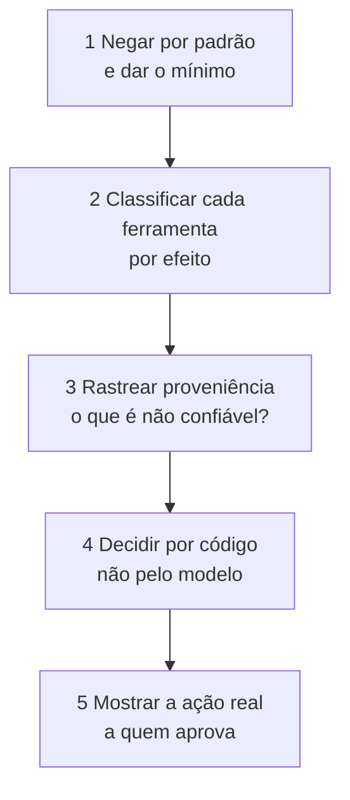

# Segurança de Agentes

Pré-requisitos: [[Ataques Contra Agentes de IA]] · [[Injeção Indireta]] · [[Defesa em Camadas]] · Código de apoio: `codigo/politica_ferramentas.py`

## 1. Definição

> [!info] Definição
> **Segurança de agentes** é o conjunto de decisões de projeto que **limitam o que um agente pode fazer** quando o modelo é enganado. A premissa é pessimista de propósito: o modelo **vai** ser influenciado por texto não confiável em algum momento; o sistema precisa ser seguro **mesmo assim**.

## 2. Contexto

Em agentes, texto vira ação. Os *benchmarks* InjecAgent (Zhan et al., 2024: 1.054 casos, 17 ferramentas de usuário e 62 de atacante, 30 agentes avaliados) e AgentDojo (Debenedetti et al., 2024: 97 tarefas realistas e 629 casos de teste de segurança) medem a vulnerabilidade de agentes a injeção indireta. O AgentDojo observa que modelos de ponta falham em muitas tarefas **mesmo sem ataque**, e que os ataques existentes quebram algumas propriedades de segurança, mas não todas.

As respostas de projeto mais robustas da literatura **tiram do modelo a decisão de segurança**: Debenedetti et al. (2025) propõem o CaMeL, que extrai o fluxo de controle e de dados da consulta **confiável** para que dados não confiáveis nunca alterem o fluxo do programa, e usa *capabilities* para impedir a exfiltração por fluxos de dados não autorizados. Beurer-Kellner et al. (2025) propõem **padrões de projeto** para agentes com resistência comprovável a injeção, analisando o *trade-off* entre utilidade e segurança.

## 3. Os cinco princípios



### 3.1 Menor privilégio e negação por padrão

- Ferramenta que não está na lista **não executa**.
- Cada tarefa recebe **só** as ferramentas de que precisa (um agente que resume páginas não precisa de `enviar_email`).
- Credenciais **por tarefa**, com o menor escopo e a menor duração possíveis; nunca as credenciais amplas do usuário.
- Prefira **leitura** a escrita, **escrita local** a ação externa.

### 3.2 Classificar ferramentas por efeito

| Efeito | Exemplo | Risco | Controle mínimo |
|---|---|---|---|
| **Leitura** | resumir, buscar | Traz texto não confiável ao contexto | Rotular a origem como não confiável |
| **Escrita local** | salvar nota, gravar memória | **Persistência** do ataque entre sessões | Confirmar quando a sessão está contaminada; registrar origem |
| **Externo** | enviar e-mail, requisição de rede, publicar | **Exfiltração** e ação em nome do usuário | Lista de permissão de destinos; confirmação; limites de taxa |
| **Execução** | rodar código, comando | Controle total do ambiente | *Sandbox* sem rede e sem credenciais; lista de comandos |

### 3.3 Proveniência: "a sessão está contaminada?"

Cada trecho que entra no contexto tem origem **confiável** (instruções do desenvolvedor, pedido do usuário autenticado) ou **não confiável** (página, e-mail, arquivo, resultado de ferramenta, memória de origem desconhecida). Quando algo não confiável entra, a sessão passa a ser tratada como **contaminada**, e ações de maior efeito ficam restritas.

> [!warning] Aproximação grosseira, de propósito
> "Sessão inteira contaminada" é conservador: bloqueia ações legítimas depois de qualquer leitura externa (foi o que L6 mostrou: utilidade de 66,7% no `mock`). Abordagens mais finas rastreiam **qual dado** influenciou **qual ação**, como as *capabilities* do CaMeL, ao custo de mais engenharia.

### 3.4 Decidir por código

```python
from politica_ferramentas import (Efeito, Ferramenta, Politica, Sessao, Veredito,
                                  texto_de_confirmacao)

politica = Politica([
    Ferramenta("resumir",      Efeito.LEITURA),
    Ferramenta("salvar_nota",  Efeito.ESCRITA_LOCAL),
    Ferramenta("enviar_email", Efeito.EXTERNO,
               restringir={"para": frozenset({"eu@exemplo.invalid"})}, max_chamadas=2),
])

sessao = Sessao()
sessao.registrar_entrada("página web", confiavel=False)         # a sessão fica contaminada

politica.decidir(sessao, "resumir", {})                          # PERMITIR (leitura)
politica.decidir(sessao, "enviar_email", {"para": "x@exemplo.invalid"})
#   NEGAR: parâmetro 'para' fora da lista de permissão (vale mesmo sem contaminação)
politica.decidir(sessao, "enviar_email", {"para": "eu@exemplo.invalid"})
#   CONFIRMAR: efeito externo após conteúdo não confiável na sessão
politica.decidir(sessao, "formatar_disco", {})                   # NEGAR: ferramenta desconhecida
```

Cada decisão vai para `sessao.log` (ferramenta, parâmetros, veredito, motivo, origens não confiáveis), a matéria-prima de [[Monitoramento e Resposta]].

### 3.5 Mostrar a ação real a quem aprova

```python
print(texto_de_confirmacao("enviar_email", {"para": "eu@exemplo.invalid", "texto": "oi"}, ["página web"]))
```

Mostra **a ferramenta, os parâmetros exatos e as origens não confiáveis**. Nunca o resumo do modelo ("vou enviar o relatório"): se o contexto foi manipulado, o resumo também pode ter sido.

## 4. Padrões de arquitetura

| Padrão | Ideia | Custo |
|---|---|---|
| **Separar quem lê de quem age** | Um componente processa conteúdo não confiável **sem** ferramentas de efeito; outro executa ações **sem** ver o conteúdo bruto | Complexidade; perda de contexto |
| **Plano fixo antes de ler** | O plano (quais ferramentas, em que ordem) é decidido a partir da consulta **confiável**, antes de qualquer dado externo (a linha do CaMeL) | Menos flexível; falha em tarefas que dependem do que se lê |
| **Ações pré-aprovadas** | O agente só escolhe entre ações de uma lista curta e fechada | Pouca autonomia |
| **Confirmação seletiva** | Humano aprova só ações de alto impacto, vendo a ação real | Atrito; fadiga de aprovação |
| **Isolamento de execução** | Código roda em *sandbox* sem rede e sem credenciais | Infraestrutura |

> [!note] Fonte
> Beurer-Kellner et al. (2025) tratam de padrões deste tipo e de seus *trade-offs*. Aqui li apenas o **resumo**; os nomes e detalhes dos padrões devem ser conferidos no próprio artigo antes de serem citados como "os padrões do artigo". A tabela acima é uma síntese didática do curso.

## 5. Memória e RAG

| Risco | Contramedida |
|---|---|
| Instrução plantada é **salva** e reaparece em sessões futuras | Gravar memória só com confirmação quando a sessão está contaminada; registrar a **origem**; não gravar conteúdo de fonte não confiável como "fato" |
| Base RAG contaminada afeta **todos** os usuários | Controle de quem escreve na base; revisão e proveniência por documento; varredura periódica |
| Dado de um usuário aparece para outro | Autorização **por registro**, no backend, com a identidade do usuário (não no prompt) |
| Memória acumula dados sensíveis | Minimização, expiração e possibilidade de apagar |

## 6. Multiagente

Cada agente é uma **fronteira de confiança**. A mensagem de outro agente deve ser tratada como **dado**, e não como ordem, a menos que haja um mecanismo explícito de autoridade verificado por código. Um agente comprometido não deve poder acionar, por intermédio de outro, ações que ele mesmo não poderia executar.

## 7. Fadiga de aprovação

Confirmar tudo equivale a não confirmar nada: o usuário aprova sem ler. Reduza o número de confirmações **deixando de pedir** em ações de baixo risco (por política), mostrando a ação real, e **medindo** a taxa de aprovação e o tempo de resposta: aprovação de 100% em poucos segundos é sinal de ritual, não de controle ([[Monitoramento e Resposta]]).

## 8. Revisão de segurança de um agente (lista)

- [ ] Lista de **todas as fontes de texto** que chegam ao contexto, cada uma classificada por confiança.
- [ ] Lista de **todas as ferramentas**, cada uma com efeito, escopo de credencial e limites.
- [ ] Triângulo de risco por fluxo: conteúdo não confiável + dados privados + ação externa ([[Conceitos Fundamentais]]).
- [ ] Política **em código**, com negação por padrão, e testes automatizados.
- [ ] Confirmação mostrando a **ação real**; métrica de aprovação.
- [ ] Memória e RAG com proveniência e controle de escrita.
- [ ] Execução de código isolada.
- [ ] Logs suficientes para reconstruir **por que** cada ação ocorreu.
- [ ] Teste adversarial de ponta a ponta (injeção indireta com canários) e reteste a cada mudança ([[Laboratório 03 - Prompt Injection]]).

## 9. Limitações

- A política do código de apoio é **didática**: não rastreia fluxo de dados fino, nem cobre execução de código ou rede.
- Controles determinísticos protegem contra **ações** que você previu; ações novas exigem nova classificação.
- Padrões que dão garantia reduzem a utilidade; a escolha depende do impacto de cada ação.

## Exercício

- [ ] Classifique as ferramentas do seu agente fictício por efeito e escreva a `Politica` correspondente; rode os testes e acrescente três casos seus.
- [ ] Reproduza com a política o resultado de L6 e de L7 do laboratório (negar × confirmar) e compare a utilidade.
- [ ] Desenhe um fluxo "quem lê × quem age" para o assistente de e-mails e liste o que se perde.

## Referências

- Zhan, Q.; Liang, Z.; Ying, Z.; Kang, D. **InjecAgent**. arXiv:2403.02691, 05/03/2024 (v3: 04/08/2024). <https://arxiv.org/abs/2403.02691> — consultado em 15/10/2026.
- Debenedetti, E.; Zhang, J.; Balunović, M.; Beurer-Kellner, L.; Fischer, M.; Tramèr, F. **AgentDojo**. arXiv:2406.13352, 19/06/2024 (v3: 24/11/2024). <https://arxiv.org/abs/2406.13352> — consultado em 15/10/2026.
- Debenedetti, E. et al. **Defeating Prompt Injections by Design**. arXiv:2503.18813, 24/03/2025 (v2: 24/06/2025). <https://arxiv.org/abs/2503.18813> — consultado em 15/10/2026.
- Beurer-Kellner, L. et al. **Design Patterns for Securing LLM Agents against Prompt Injections**. arXiv:2506.08837, 10/06/2025 (v3: 27/06/2025). <https://arxiv.org/abs/2506.08837> — consultado em 15/10/2026. Apenas o resumo foi lido.
- Menor privilégio, negação por padrão e isolamento de execução são princípios clássicos de engenharia de segurança, sem fonte única citada aqui.

## Conceitos relacionados
[[Defesa em Camadas]] · [[Validação de Entradas e Saídas]] · [[Monitoramento e Resposta]] · [[Laboratório 03 - Prompt Injection]]

## Próximos passos
- [[Monitoramento e Resposta]]
